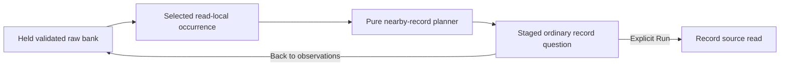

# Nearby records from raw metric observations

A held raw gauge, sum, or explicit histogram point can open **Nearby logs** or **Nearby spans**. These actions stage an ordinary record question around the point's event time. **Run** performs the record read; selecting a point or staging a question performs no source read.

This works without a successful metric evaluation. A point with an unknown temporality, a no-recorded-value flag, or an unusable magnitude can still supply time context when its event timestamp and source identity are valid. The action does not turn that point into an evaluated measurement.

## Operator flow

1. Discover an instrument and explicitly read its raw observations.
2. Use Find and paging to locate a point, then open its inspector.
3. Choose **Nearby logs** or **Nearby spans**. The record screen shows the staged question and a compact path back to the raw point. **Nearby record scope** explains the exact window and instance scope.
4. Review or edit the record question, then choose **Run**.
5. Choose **Back to observations** to restore the held raw bank, page, Find state, inspector, scroll, and focus without rereading metrics.

Saving or sharing the record question preserves its filters. It does not save the held metric bank or create a durable citation to the selected point. Expanding a trace is a separate, broader read.

## Exact scope

The planner uses the selected occurrence's event timestamp, in integer nanoseconds. Its half-open window is:

```text
from = max(event − 60 seconds, original discovery window start)
to   = min(event + 60 seconds, original discovery window end)
```

The ordinary record question has an enclosing millisecond window plus exact `timestamp_ns >= from` and `timestamp_ns <= to − 1` predicates. The outer window cannot truncate a fractional millisecond boundary. Nanoseconds remain decimal strings throughout planning, including values beyond JavaScript's exact integer range.

The record filters preserve:

| Source field | Record scope |
| --- | --- |
| Discovery environment policy | The same environment selection and policy |
| Service | Exact fixed service column |
| Actual resource `service.namespace` | Exact equality, including an empty string; an absent namespace uses a missing predicate |
| Actual resource `service.instance.id` | Exact equality when reported, including an empty string |
| Absent instance ID | No instance predicate; explicitly labeled **Service-wide · instance not reported** |

Metric attributes, instrumentation scope, metric name, unit, and raw magnitude do not become record filters. A reported instance label narrows the search but does not establish a continuous producer identity. Nearby time does not establish causality, contribution, health, or collection completeness.

## Ownership and retirement



The planner validates the whole held bank against its original question and instrument, then selects a unique read-local occurrence key. Equal timestamps, values, and streams do not collapse duplicate exports. Its returned question and origin are detached copies.

The UI owner separately checks that the selected inspector and held bank are current. A new read, scope change, closed observations, or retired owner invalidates old actions and their Return path. A retained JavaScript detail object cannot authorize navigation after that capability has retired. If a failed refresh leaves the previous bank visible, inspect its point again to create a new context action; the old action remains retired.

The retained origin records the original discovery question, instrument, source `readAt`, selected stream, event timestamp, and occurrence key. Source read time and point event time remain separate. No custody record or evaluated measurement is synthesized.

Malformed banks, ambiguous occurrence keys, invalid timestamps, or identity values that cannot be expressed safely by the ordinary record question are refused rather than silently broadening the search. No new source endpoint or query language is involved.

See [raw observation consolidation](RAW_OBSERVATION_CONSOLIDATION.md) and the [nearby-record storyboard](journeys/raw-observation-context.md).
