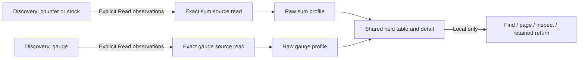

# Inspect reported sum observations

The [shared compact viewer](RAW_OBSERVATION_CONSOLIDATION.md) keeps exact clocks,
local interaction and family-specific uncertainty.

Discovered OTel sums offer **Read observations** independently of measurement
readiness. This includes monotonic counters and nonmonotonic sums. The interface
calls them **Raw sum observations**: the reported number is not automatically a
rate, increment, reset, current stock value or fleet total.

## Exact source selection

`POST /sum-observations` accepts the original fixed discovery question and an
exact instrument tuple: kind, scope, scope version, scope schema URL, metric,
unit, reported aggregation temporality and reported monotonicity. All instrument
fields are explicit and non-null. Empty scope/version/schema/unit strings remain
exact reported values; `monotonic: false` is a value, never an omitted default.
Temporality is a signed 32-bit integer, including zero or unrecognized reported
values. These are shown diagnostically rather than silently reclassified.

Discovery names a cumulative nonmonotonic sum `stock`. The request retains that
kind exactly: `stock` means temporality 2 and monotonic false; other reported sum
tuples use `counter`. Both read the sum source. This naming does not grant stock
or counter evaluator eligibility. Metadata families and measurement kernels keep
their own contracts.

The question retains a narrow environment selector, namespace, one service and a
bounded half-open `[fromMs, toMs)` event-time window. Native All-environments
selection is unsupported and refuses before a source read. SQL parameters carry
the selected instrument, including temporality and monotonicity. Returned rows
are independently checked against that complete tuple and requested bounds.
Missing, malformed or mismatched identity fields refuse the whole response;
there is no fallback to another temporality or monotonicity variant.

The gauge route and gauge profile remain unchanged. Sum inspection has its own
`goo/raw-sum-observations/v1` profile and never constructs an evaluated gauge or
counter result. Only common scalar, timestamp, flags and supplied-data display
contracts are shared.

Source selection and profile admission remain family-specific. Sharing the held
presentation does not authorize another read or promote raw rows into evaluated
measurements.

## Reported rows, not inferred intervals

Every row is an occurrence. Exact duplicate exports remain separate, with a
read-local occurrence key rather than an invented producer or stream identity.
The profile retains resource and point attributes, resource schema, unit,
reported start/end timestamps, temporality, monotonicity, flags and raw projected
source row. Reported metadata describes the row; it does not establish a
continuous stream.

The end timestamp must be a canonical nanosecond string inside the selected
window. An absent, malformed or out-of-window end refuses atomically. Zero start
is displayed as **Not reported · raw 0**; missing, malformed or start-after-end
values remain diagnostics. No interval, baseline, reset or preceding point is
invented. A cumulative number is not a delta and a delta point is not converted
into a rate.

Finite scalar display remains separate from sample validity. Missing, malformed,
nonfinite or no-recorded-value samples remain unavailable where appropriate,
with their raw representation and diagnostics retained. OTel's NoRecordedValue
flag never produces a displayed zero. Unrecognized flag bits and temporality
values remain visible facts. Source Float64/string projections cannot recover an
original SDK integer encoding or greater precision than the exporter retained.

## Acquisition and local inspection

An explicit read checks the sum metadata source and acquires bounded rows. Source
metadata compatibility alone does not establish raw-value column compatibility,
current observation freshness or evaluator readiness. The source owner's HTTP
policy, parameterization, cancellation and response budgets remain in force.
The 10,000-row limit uses a sentinel and refuses atomically; both source and
serialized inspection results obey 8 MiB budgets. No partial successful bank is
published when a limit or structural validation fails.

Find, 100-row paging, attribute detail and raw disclosure operate on the held
bank without telemetry reads. Source-read UTC remains separate from reported
observation time. Temporary navigation cancels pending reads while retaining the
settled same-owner bank, receipt and local inspection. Scope changes, new
discovery, a different instrument and Close discard it. Late responses cannot
replace held rows or focus after their request lease is retired. Failed rereads
retain the previous settled bank.

This adds no new capture carrier, store, evaluator, aggregate or connected
series. The [validation record](../VALIDATION.md) and
[executable storyboard](journeys/raw-sum-observations.md) record
what was actually exercised; this contract is not itself a passing test result.
