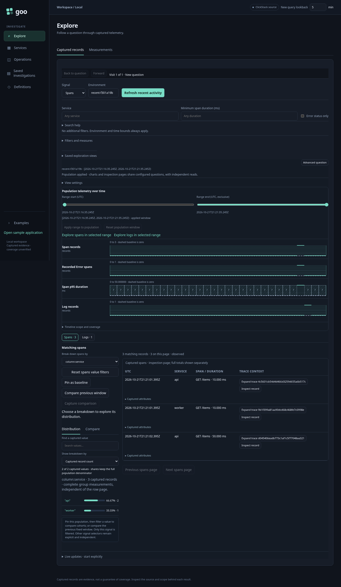
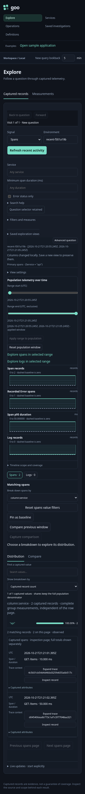
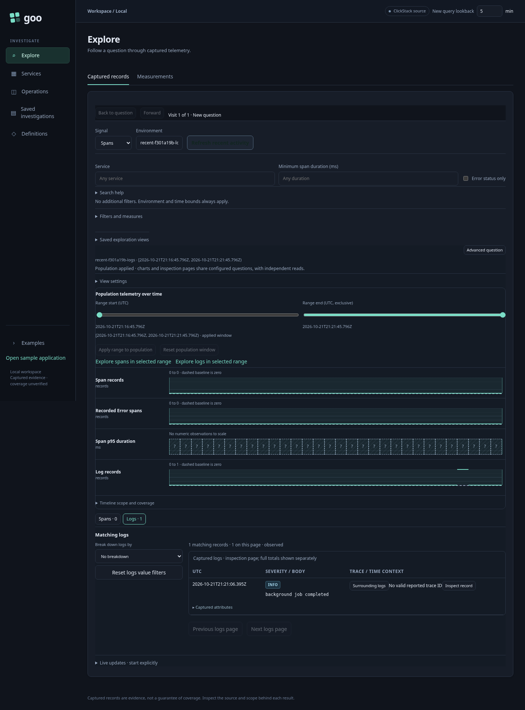

# Recent activity in Explore

The first slice of the [recent-activity design](LIVE_EXPLORATION_DESIGN.md) adds
**Show recent activity** as a direct entry into aligned span/log exploration.
Choose the environment, lookback, signal and any filters, then run it. The action
resolves a fresh fixed UTC window once and asks the existing Go population planner
for supported questions. There is no preliminary single-question source read or
manifest requirement. The initial plan initiates at most two typed exploration
requests; each request can perform several independent backend reads for counts,
groups, charts and rows. This is not a two-SQL-query budget or an atomic snapshot.

**Refresh recent activity** explicitly resolves another fresh interval. Existing
shared fixed questions still use **Run question**, and saved exploration views
still reopen staged, without telemetry reads. Running recent activity from a
staged saved question preserves its selector while replacing its time bounds.
Refreshing an applied canvas also preserves its independent companion selector;
the primary builder follows the applied facet/range question. Editing source
scope invalidates the old canvas before a replacement run.
The lab's configured environment and existing lookback remain explicit; this
slice does not discover or guess a production environment.

## One result canvas

The recent canvas removes the nested population border and heading. Shared time
charts precede matching records. The primary signal defaults to a service
breakdown unless the question already supplies one; facets sit alongside records
on desktop and stack on mobile. Span/log buttons show independently read totals
or Unavailable, and switch already-loaded inspection pages without a source read.
A log-only environment selects the nonempty log page automatically. Zero records
remain absence of captured data, not a health assessment.

Chart interval selection previews exact UTC bounds without reading telemetry.
Apply reruns the configured populations. A facet value explicitly filters and
reruns only that signal's selector; the companion's independent selector is
preserved. The existing breakdown, baseline and comparison adapters remain the
semantic authority. This slice does not add freehand brushing or anomaly scoring.

View settings collect layout, columns, fixed-window rerun/staging, save and exact
scope details. Live controls follow records in a collapsed disclosure. Opening
that disclosure does not subscribe; starts remain explicit, and the tail's
60-second inspection window is distinct from the fixed overview. Saving stores
configuration through existing immutable views, not displayed evidence. Saved
view reopening retains its existing presentation; making every entry surface
use the new canvas is subsequent work.

The advanced query builder remains available for typed measures and shared
questions. Selection trays, retained parent/child scope navigation, generalized
column fields, coordinated live charts and selection-versus-rest comparison
remain proposed in the broader design. This is the direct-entry and compact
composition slice, not a claim that the entire redesign is complete.

```mermaid
sequenceDiagram
  actor User
  participant UI as Explore adapter
  participant Plan as Go population planner
  participant Source as Existing exploration executor
  User->>UI: Show / refresh recent activity
  Note over UI: Resolve fresh bounds once; retain typed selectors
  UI->>Plan: Primary question
  Plan-->>UI: Checked questions; incompatible companion withheld
  par Independent supported signal reads
    UI->>Source: Span question when planned
    Source-->>UI: Counts, charts, groups and bounded rows / error
  and
    UI->>Source: Log question when planned
    Source-->>UI: Counts, charts, groups and bounded rows / error
  end
  Note over UI: Reject obsolete generations; preserve partial failure
  User->>UI: Switch record signal / preview chart interval
  Note over UI: Local presentation only; no source read
  User->>UI: Apply selected interval
  UI->>Source: Explicit fixed-window questions
```

## Executable storyboard

[Journey 93](../journeys/recent-entry.spec.js) emits ordinary OTel spans for an API
and worker, plus logs and a separate log-only environment. It independently checks
ingestion through ClickHouse before entering through the UI.

1. Open Explore without source reads or subscriptions. Choose scope and run recent
   activity directly; verify one planning request and two exploration requests
   with identical fresh five-minute bounds.
2. Switch loaded record pages locally. Select the API service facet and then a
   chart interval; verify the original selector, independent companion and
   source-free range preview.
3. Change columns, save configuration, reopen staged and explicitly run recent
   activity again. The saved selector survives; new bounds require the new read.
4. Exercise unavailable logs, log-only activity, no-data and a delayed obsolete
   response after scope replacement. No subscription starts implicitly.

The journey writes an observed request-initiation ledger checked with Quint via
quint-go, including rejecting controls for hidden preview/reopen reads, changed
environment, erased filtering and an implicit tail. The Bombadil actor explicitly
runs recent activity from a staged view and switches loaded logs; its invariants
check containment, runtime errors and absence of a live tail. Existing Hegel
portable-selector and saved-view state/swarm properties cover the reused Go plan
and immutable configuration semantics.




