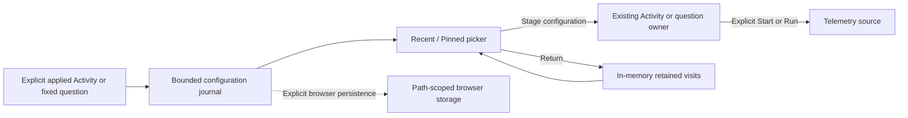

# Recent and pinned scopes

Milestone 414 consolidates configuration recall and retained-visit return in one
compact **Recent / Pinned** disclosure. See [validation](../VALIDATION.md), the
[storyboard](journeys/recent-pinned-scopes.md) and
[independent review](reviews/RECENT_PINNED_SCOPES_REVIEW_414.md).

The operator flow is **observe → narrow → inspect → return or reuse**. The
picker does not create a workspace, shared catalogue or evidence store.

| Entry | Meaning | Reopen |
| --- | --- | --- |
| Activity | Rolling log/span selector and column layout | Stages; Start stream reads |
| Fixed question | Validated query and exact UTC window | Stages; Run reads |
| Saved view | Exact immutable definition ID and title hint | Resolves metadata and stages the whole view; Run reads |
| Held visit | Existing view retained in this tab | Returns to retained view without a source read |

History contains configuration, never telemetry rows, receipts, membership tokens,
read basis, result tokens or request state. A fixed question remains fixed;
reopening it does not silently substitute the current time. Activity remains a
rolling selector. Capturing evidence and reopening a saved capture remain separate
operations with their existing authority.

## Browser storage

History starts in memory. **Remember scopes on this browser** explicitly opts in
to bounded browser storage scoped to this application's path. This is browser
profile storage, not authenticated personal isolation. Predicates may themselves
contain sensitive values. Do not enable persistence on a shared browser profile
unless that retention is appropriate. There is no server-side history publication.

Up to 20 recent configurations are retained for 30 days. Up to 20 pins remain
until removed; adding a pin beyond capacity is refused rather than evicting an
existing pin. Clear history removes recent entries separately from pins. Reset
removes both and disables persistence. Denied or corrupt storage must remain
visible and must not turn a failed write into a success claim.

## Ownership

The journal is pure configuration state. The shared picker renders local controls;
application adapters own staging and retained navigation. Existing owners cancel
retired requests and invalidate stale callbacks. Opening, filtering, pinning,
removing and staging must not execute a telemetry query. Retained result views
never enter the durable journal.

Delivered acceptance covers exact typed environments, fixed-window and rolling intent,
capacity/age behavior, poisoned payload refusal, storage failure, source-read
budgets, explicit Run, retained return, keyboard operation, and actual narrow
screenshots. The roadmap calls for a whole-product review after this consolidation
rather than automatically growing another feature queue.

Ordinary log/span questions retain their supported fixed query and Records display.
Composed saved views now use [exact saved-view references](EXACT_SAVED_VIEW_RECALL.md)
(427), rather than copying their queries into record history. That reference
retains complete composition, comparison operands and checked CEL source through
the existing definition reader. Trace searches, native measurements and other
surfaces retain their own saved-definition and evidence carriers.
