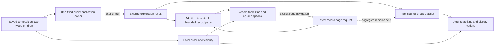

# Records and aggregates in one saved composition — 279

A saved fixed view can declare an ordered record table and aggregate display over
one checked query. **Compose aggregate and records** converts an eligible single-query authored
view locally. The HTTP service template emits this composition directly. Use the
existing View settings to change order or visibility, and the existing record
column and aggregate Measure controls to edit each child. None of these local
changes read telemetry.

This is a small content composition, not a page builder. Application navigation,
query filters, execution, source admission, paging and actions remain with one
existing population owner. The two children cannot add a query or subscription.



## One presentation authority

A composed `ExplorationView` contains `version`, `title`, `queries` and
`composition` (plus its saved `id` on publication). It requires exactly one query.
Root `layout`, `columns`, `fieldColumns`, `displays`, `breakdowns` and `tail` are
forbidden, including null/empty forms. Record columns belong to the records child;
aggregate options belong to the aggregate child. There is no second flat copy to
keep synchronized. Current noncomposed profiles remain available for their existing
multi-signal and specialized flows.

For example:

```json
{
  "version": 1,
  "title": "Service records and counts",
  "queries": [{"signal":"spans","environment":"prod","fromMs":1000,"toMs":2000,
    "limit":1,"offset":0,"groupBy":[{"kind":"column","key":"service"}]}],
  "composition": {
    "version": "goo.composition/1",
    "kind": {"name":"stack","version":1},
    "children": [
      {"records": {
        "version":"goo.view/1", "scope":{"kind":"record-query","signal":"spans"},
        "kind":{"name":"record-table","version":1},
        "display":{"columns":["utc","service","summary"]}
      }},
      {"aggregate": {
        "version":"goo.view/1", "scope":{"kind":"record-query","signal":"spans"},
        "kind":{"name":"bar","version":1},
        "display":{"category":"category","value":"count","scale":"population"}
      }}
    ]
  }
}
```

The stack has exactly one child of each role. A role is its stable identity;
there are no arbitrary node IDs, recursive layouts or child query overrides.
Optional `hidden: true` hides a child, with at least one remaining visible.
Both declarations use `goo.view/1` and reference the same parent query by signal.
Existing ordinary count/numeric/duration bar/table eligibility still applies.
Record tables keep UTC and summary, with two to four core columns and at most eight
qualified extra fields. Invalid source retains the last applied composition and
blocks Save; source/property edits retire delayed save acknowledgements.

## Distinct supplied input profiles

The aggregate consumes the existing canonical scoped dataset and its source
admission/guarantees. The record table consumes `goo.record-page/1`, a detached,
deeply frozen rich-record page. The page carries the exact delivery question,
source `basis`, UTC read clock, rows, and `{offset, limit, returned, hasMore}`.
Omitted continuation metadata is unknown, never invented false. Nanosecond strings
and rich namespaced attributes are preserved without flattening into scalar cells.

Record-page quality is always bounded-page, unknown upstream coverage, and
independent reads. It has no population denominator, completeness witness or
execution token. Known-source admission binds the page privately to its admitted
result; serialized claims or a swapped page cannot create that ownership.

Rich records are not relabeled as ranked `scopedview.Dataset` rows. This is an
explicit typed component-input profile within the composition grammar, not a claim
that every rich-record component already consumes the generic plotting dataset.
The passive record presentation family remains reusable; the application supplies
interaction guards. The public page constructor also bounds JSON size/depth and
rejects mutable class instances, accessors, cycles and invalid source metadata.

## Reads, paging and actions

One explicit Run acquires one exploration response for both aspects. Its internal
source reads are independent; this does not promise an atomic count/page/group
transaction. Hiding or reordering content does not change the query or denominator.
A one-row inspection page does not reduce a full-group population share.

Page navigation advances a separate admitted record result. The aggregate snapshot,
read clock, exact denominator and local presentation stay held. The current API
may return aggregate data with that page request; composed views ignore those
replacement aggregates. No page-only SQL optimization is claimed here. Parent
saved queries remain at offset zero, and each record page displays its own bounds
and read clock.

A per-page request serial prevents out-of-order publication. Pending page reads
disable paging and retire old record-action owners; success or failure establishes
the current page owner. Trace/context/facet/column actions require the current page
and connected owner. Hidden aggregate actions are revoked; showing the aggregate
establishes a current mount without reading again. Existing Saved inspection defaults
remain available outside the composed-owner hook.

The existing catalog extracts the aggregate declaration from either profile for
current-scope display reuse. Applying one updates only that child, preserving the
records child and destination query. Save/reopen retains composition intent and
requires explicit Run, as before.

## Scope

This cut supports one fixed record query, two typed children and a stack. Arbitrary
nesting, grids, multiple queries, live subscriptions, baseline comparison children,
whole-screen WYSIWYG and generic rich-record plotting datasets remain outside it.
Broader composition should extend these typed profiles and ownership rules rather
than introduce per-component reads or duplicate query/presentation authorities.

Next, the existing catalog should reuse this whole composition against a compatible
current population, preserving its query and held inputs. Current aggregate-only
Apply already updates one child; whole-composition reuse is the next bounded cut.
