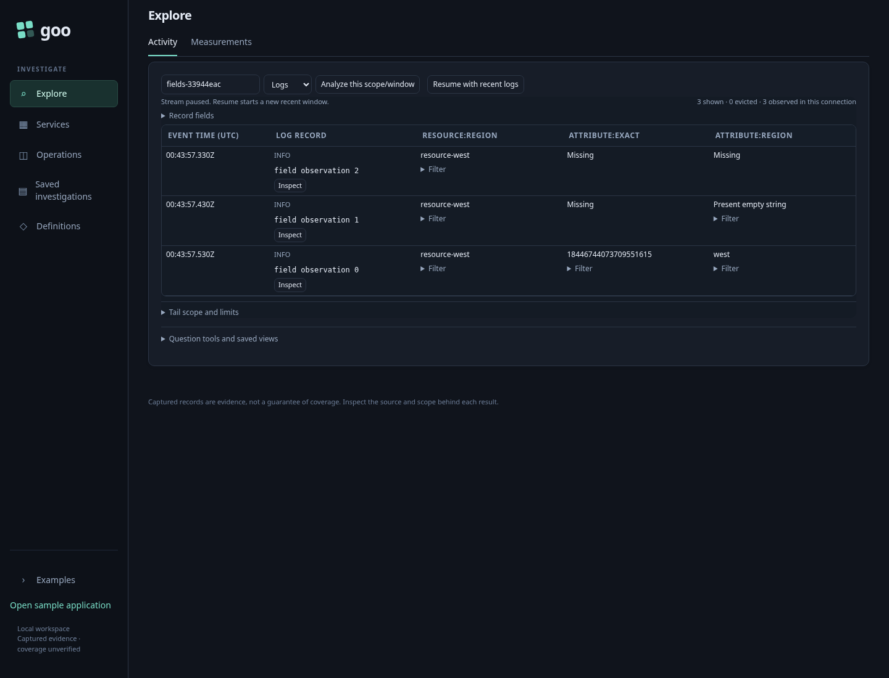
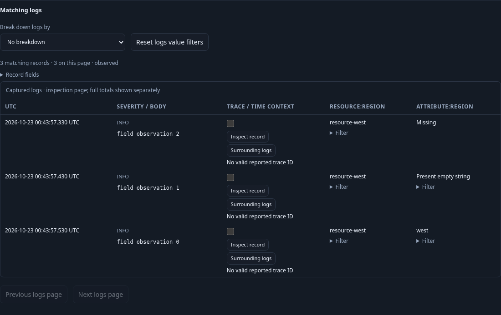
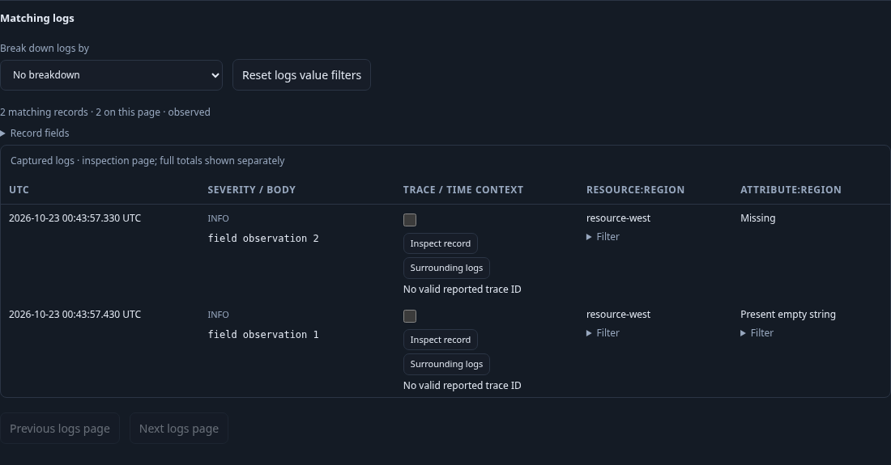

# Record fields while exploring

Activity and fixed record pages expose a collapsed **Record fields** picker next
to the rows. Search fields observed in the supplied page/buffer, add up to eight
qualified columns, hide Service or context actions, and reorder core or added
columns. UTC and Summary remain available. Added columns follow the core columns;
the two groups reorder independently. Opening the picker and changing a layout
do not read telemetry, change predicates or publish evidence.

Resource and record attributes remain separate: `resource:region` and
`attribute:region` can appear together. A missing field says **Missing**, while a
recorded empty string says **Present empty string**. Exact string values retain
their precision; durations use human units with raw nanoseconds in a tooltip.
The picker inventories supplied rows, not the complete source schema. Previously
chosen fields remain selected when absent from the next page. Empty fixed pages
show their empty state rather than a picker.

On Activity, a supported recorded string value offers Include/Exclude. This
pauses the stream and stages the existing scope tray; **Apply scope** performs
the read. **Analyze this scope/window** carries the field layout into the staged
fixed question. Its Run action reads the completed fixed bounds. In primary
fixed results, Include/Exclude stages a predicate and focuses Run. Recent and reopened saved population
records delegate the same intent to their existing facet-selection owner. These
actions do not treat missing as an empty string or infer complement populations.

Population views save the ordered core `columns` and optional `fieldColumns`.
The latter contains at most eight unique `{kind,key}` fields supported by at
least one configured signal. An incompatible family displays Missing. Reopening
the view stages its original fixed queries and layout without reading telemetry;
Run obtains new results. Layouts are configuration, never an evidence receipt.
Omitting `fieldColumns` preserves the previous wire representation and IDs.
Activity layouts are page-local and per signal; saving an Activity preference
across browser sessions is not implemented.

The passive `goo-record-columns` element and supplied-row projector live in
`ui/record-columns.js`; applications own filtering, saving and execution. See
[component contract](UI_COMPONENTS.md) and
[population ownership](POPULATION_WORKSPACE.md).

Executable storyboard: `journeys/record-columns.spec.js` ingests ordinary OTLP
logs, chooses namespaced fields, checks missing/empty/exact values, stages a
fixed predicate, saves/reopens the layout, and checks mobile containment and
server/property element composition. Bombadil's `record-columns.ts` exercises
local hide/show/reordering after an explicit population read.

Reopened saved populations also expose staged record-field Include/Exclude and
shared-field selection. Open selected facets stages an independent child; Run
reads it, and Back restores the supplied parent without another read. Excluding
a present string retains missing and empty observations through the existing
population selector semantics. Journey 118 now records this child/return protocol
for Go/Quint validation with five rejecting controls.

