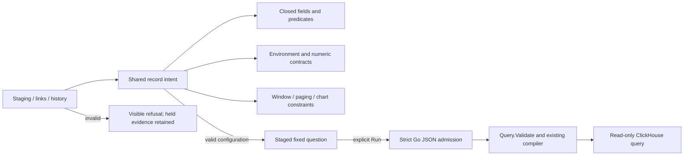

# One record-intent contract

Milestone 417 consolidates ordinary log/span configuration admission. A valid
question retains its exact environment policy, fixed window, predicates, grouping,
numeric bindings and paging across staging, links and browser history. Invalid
intent refuses before source access or replacement of held evidence.

The shared pure `record-intent.mjs` validator builds on one field/predicate
validator and the existing numeric/environment contracts. Protocol constructors,
links, lifecycle start/stage, the fixed-question owner and scope history use it.
History no longer maintains a second recursive query schema or resets paging.
Comparison identity recognizes Go zero-offset and empty-namespace omission
defaults on a copy, retaining authored configuration and namespace presence.
Activity selector adapters construct explicit synthetic bounds/page defaults for
validation; those bounds do not become a saved rolling window.

## Supported limits

These match Go execution semantics: at most 32 predicate nodes, depth four (root
at zero), two distinct grouping fields, 128 UTF-8 bytes per attribute/resource
key, 1,024 bytes per ordinary value, page limit 1–100, offset 0–1,000, and a
half-open window of at most two hours through the existing 2100 bound. Fields,
operators, span-only summaries/status, histogram bindings and split time-series
prerequisites are checked before staging. Time charts permit at most 240 cells.
Reported edges retain exact qualified endpoints and discovery-namespace constraints.

Empty strings remain values; presence predicates do not acquire a threshold.
Unpaired Unicode surrogates, NUL where disallowed, unknown nested fields, null
arms and mixed branch/leaf shapes refuse. Supplied getters, symbols, sparse arrays
and non-data prototypes cannot execute or disappear during browser admission.
JSON member names are case-sensitive. Go's strict query decoder uses the existing
typed shape guard with `reflect.TypeFor`, checks raw Unicode, and applies last-member
replacement before decoding so duplicate-object semantics agree with JSON.parse.
Typed in-process Go queries still use `Query.Validate`; its limits are unchanged.

Carrier limits remain separate: the query HTTP route and scope-history intent
have 16 KiB budgets; URL envelopes have their own encoded-length limits. A legal
query can exceed a carrier's capacity and must be refused there, not shortened.
Editor gestures are not a second query dialect and never drop unsupported arms.
Ordinary query validation does not redefine measurement or trace-search contracts.

## Operator behavior

An invalid link shows a compact refusal and leaves the current results, question,
selection authority and source budget intact. A valid replacement stages the
whole question and clears evidence only as part of that explicit transition.
Run acquires fresh evidence; opening or remembering configuration does not.
Continuations retain their offset, and recall identifies their starting record.

[Executable journey](journeys/record-intent.md) and [validation](../VALIDATION.md)
record the actual generated, browser and native-model checks. This consolidation
completes the 415/416/417 depth/breadth/consolidation cycle; the next step is the
whole-product checkpoint required by the active roadmap.
