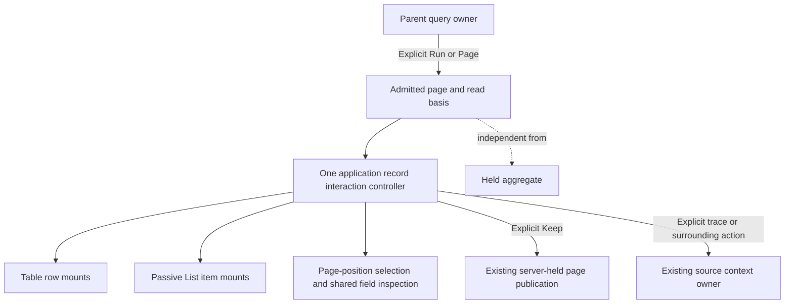

# Shared record interactions

> Implemented in milestone 298. Executed checks are recorded in
> [VALIDATION.md](../VALIDATION.md#shared-tablelist-record-interactions--298).

Table, List and the spans-only waterfall are presentations of one bounded record
page. In the application,
Select, Inspect, Keep, trace expansion and field actions use one record interaction
controller. Changing presentation does not change the question, refresh telemetry,
reconcile independent read clocks or turn supplied rows into population totals.
Finish or clear selected/submitted work before changing presentation.

Selection identifies occurrences by their position in this exact read. Two equal
records can be selected independently. Positions are not stable event identifiers:
a new page or reread establishes a new owner. Live Keep requests retain the page's
result token, delivery question and basis; captured selections retain their
capture-relative index mapping. The held aggregate is not the newer page's basis.

Inspect uses the shared structured attribute viewer. Expanding a trace or reading
surrounding logs is an explicit independent source read in the existing context
owner. Shared selected fields can stage a broader question; selected rows are not
that question's total. Missing and invalid reported identifiers remain explicit.

## Component and application boundary

`goo-record-list` remains passive when consumed from server-rendered HTML or a SPA.
Its `.page` and `.display` values carry display data, never publication authority.
The application can request `.recordItems()` to obtain frozen page-local mounting
handles for its own native controls. Each handle exposes `index`, `element`,
`actionsHost`, `detailHost` and `details`. Empty slots are hidden by default.
The component imports no action owner, performs no fetch and installs no global
navigation or publication events.

Page/display replacement creates fresh slots. Invalid or detached replacement
withdraws the old handles. Hosts must bind controls to their exact current page,
rendered mounts and private owner; retaining or reattaching a DOM node does not
authorize an old action. Selection revisions also fence shared-field and publication
closures. Optional XTDB retention uses the same currentness boundary.

See [record display semantics](RECORD_LIST.md),
[architecture review](reviews/RECORD_INTERACTIONS_ARCHITECTURE_298.md) and
[design review](reviews/RECORD_INTERACTIONS_DESIGN_298.md).

## Returning to a held visit — 300

After a capture or workspace visit, empty-selection populations receive fresh
metadata/record controls over the same held data. Restoring the visit performs no
read and does not revive old handlers; interrupted requests remain retired and
measurement gestures stay paused until Run. If a selected/submitted record workflow
is retained, its DOM stays paused instead of silently losing the selection. The
existing Run explicitly replaces that page. A submitted Keep may still finish;
returning does not replay or undo its intent.

## Supplied timing surface — 301

The waterfall's parent-first visual order does not change occurrence identity.
The app validates that every original page index has exactly one current mount,
then binds the timing button to the shared Inspect handler. Selection and context
actions use adjacent hosts, never nested controls. Handle-array/page/display
identity and the private app lease retire replacement renderings. The same 20-row
selection limit, pending-state guards, Keep mapping and explicit source actions
apply to every presentation. See [timing semantics](SUPPLIED_SPAN_WATERFALL.md).
