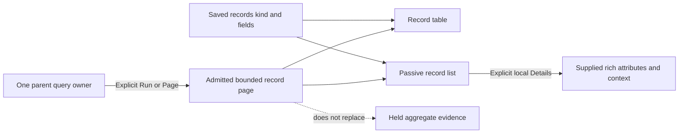

# Read supplied records as a list

In a composed view, choose **List** for the records child. The same admitted page,
configured fields, source clock and parent pager remain in use. Changing Table/List
is local presentation: it reads no telemetry and changes no query or evidence.
Save and reusable templates retain the selected kind.

List is a compact display with explicit native Details. It does not select a record
automatically. Use **Table** for selection, Keep, filtering and source actions;
List does not create a second action or selection owner. Pending selections, drafts
and reads must finish or be cleared before switching kinds.

```json
{"records":{"version":"goo.view/1",
  "scope":{"kind":"record-query","signal":"spans"},
  "kind":{"name":"record-list","version":1},
  "display":{"columns":["utc","service","summary","context"],
    "fieldColumns":[{"kind":"attribute","key":"db.namespace"}]}}}
```

This is the same records role and display contract as `record-table`. UTC and
summary remain required, with two to four core fields and at most eight qualified
extra fields. Resource and span/log attributes with the same key remain distinct.
Missing, present empty and null values are shown separately. Timestamps use UTC
with exact/raw tooltip information; durations use human-readable units.

## A passive reusable component

`goo-record-list` accepts `.page` and `.display` properties, including updates before
connection. Equivalent JSON attributes support server-rendered HTML. The
[component gallery](../ui/components.html) demonstrates both uses.

```js
import {fromExploration} from './record-page.mjs';
import './record-list.mjs';
const list = document.createElement('goo-record-list');
list.page = fromExploration(response);
list.display = {columns: ['utc', 'summary'], fieldColumns: []};
host.append(list);
```

The `goo.record-page/1` profile retains rich JSON records, the exact delivery
question, source basis, UTC read clock and bounded page metadata. Serialized input
is validated and frozen; it gains no source authority or completeness witness.
Returned row count is not a population denominator. Unreported continuation stays
unknown. Read-local row positions are not stable event identities.

Details opens only on explicit interaction and uses the existing passive attribute
and reported-context presenters. Opening/collapsing performs no IO. Replacing a
page withdraws old details instead of attaching their state to a new row index.
The component does not fetch, navigate, capture or publish.



## Selected-measure table ordering

Shared exact aggregate tables place declared dimensions and the selected measure
first, then retain remaining fields in their original order. This makes a selected
p95 visible beside its category without projecting or mutating the snapshot,
changing denominators or losing supporting values. Unmapped specialized layouts
keep their established field order.

See the [executable storyboard](../journeys/297-record-list-storyboard.md),
[design review](reviews/RECORD_SHAPE_DESIGN_297.md) and
[architecture review](reviews/RECORD_SHAPE_ARCHITECTURE_297.md).
