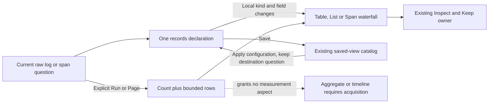

# Save a raw records view

> Delivered in milestone 302. Executed checks are recorded in
> [VALIDATION.md](../VALIDATION.md).

A log search or exact-trace span scope can use a saved records-only composition.
It contains one visible records child: Table, List or the spans-only Waterfall.
It does not require an aggregate or invent a grouping just to choose a presentation.
The existing Customize, record fields, Inspect/Keep, pager and Preserve flow remain
in use. Save stores configuration; capture remains a separate evidence operation.

```json
{"version":"goo.composition/1","kind":{"name":"stack","version":1},
 "children":[{"records":{"version":"goo.view/1",
   "scope":{"kind":"record-query","signal":"logs"},
   "kind":{"name":"record-list","version":1},
   "display":{"columns":["utc","service","summary","context"],
              "fieldColumns":[{"kind":"attribute","key":"http.route"}]}}}]}
```

The parent question remains its own: checked environment policy, filters, fixed
bounds, delivery and any existing grouping are preserved. There may be no grouping,
one grouping or multiple supported groupings. Changing presentation or fields does
not read telemetry, import a saved source query or manufacture a population from
the displayed rows. Waterfall remains spans-only.

## Read only the requested records aspect

Explicit Run and paging use the existing count-plus-rows acquisition profile when
this records-only form is active. It independently reads a matching count and a
bounded row page, retaining its query, basis, read clock and server-held selection
token. A presentation page is not the population total. The two source reads can
change between count and rows; that state remains explicit, and upstream coverage
stays unknown.

This response supplies no aggregate, timeline, field-inventory or completeness
aspect. Declared summary/status/bucket options may remain in the checked question
without granting those unused aspects. Field suggestions from supplied records
must not be described as exhaustive discovery. Source counters, not HTTP request
counts alone, establish any read-budget improvement.

## Reuse without changing scope

Inspect a saved records-only view in the current population and use the existing
Apply composition action. It remains reachable even though there are no aggregate
declarations. Apply checks signal/field/kind compatibility, retains the destination
question and performs no read. Save/reopen retains the kind and qualified fields;
Run after reopen is explicit. Read-local selection and publication leases remain
with the current page; old handles cannot act on a replacement.

The inverse transition matters too: a narrow page cannot supply the measurements
for an aggregate-based composition. A compatible configuration can be staged, but
Run must acquire its required aspects. The app never creates an aggregate from
record-page rows or reuses missing source guarantees.

## Bounded first profile

The new form is exactly one visible records child for ordinary logs/spans. Existing
aggregate-plus-records compositions, including their optional timeline/comparison,
retain their current rules. Records-plus-timeline/comparison without an aggregate
is outside this cut. Numeric, numeric-histogram, reported-edge and grouped-time
bindings are refused in the new raw profile; no query option is silently stripped.

Category-bound authored templates still require aggregate and records. The Go and
OpenAPI checks make this requirement explicit rather than inheriting it from
composition validation. Records-only views use ordinary saved-composition reuse;
they do not introduce a misleading destination-category template parameter.



See [record interactions](RECORD_INTERACTIONS.md),
[span timing](SUPPLIED_SPAN_WATERFALL.md),
[architecture review](reviews/RECORD_ONLY_VIEWS_ARCHITECTURE_302.md) and
[design review](reviews/RECORD_ONLY_VIEWS_DESIGN_302.md).
