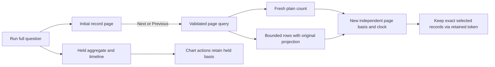

# Inspect another record page without refreshing the charts

In a composed record/aggregate/timeline view, Next and Previous read a fresh
matching count and one bounded record page. The held aggregate and timeline keep
their original basis, totals, support and source clock. The new page says
**matching at page read**; that independent count is never the held chart denominator.
An empty late page does not declare the whole held population empty.

Ordinary population paging still refreshes the full exploration result. Initial
Run and explicit rerun still acquire the full configured question. Capture
confirmation still performs its independent full capture read.

## Acquisition contract

`POST /api/explore/page` accepts the same validated record query as Explore,
including typed environment policy, predicates, reported-edge scope, summary
configuration and paging. It returns only question, basis, capturedAt, count,
state, rows, hasMore, optional resultToken and warnings. No groups, discovered
fields, summary/timeline datasets, completeness witnesses or aggregate execution
authority are returned. Query configuration is retained for exact scope matching;
it does not assert those aggregate aspects were acquired.

The source executes plain count and bounded rows separately under the existing
source limits and cancellation budget. Row projection uses the original question,
including derived fields referenced only by grouping. Count does not compute
unrequested quantiles or other configured aggregate summaries. The count/row
consistency check can report changed_between_reads; the two reads are not atomic.
Offset paging can shift as telemetry arrives. Upstream completeness stays unknown.

The existing ephemeral result token retains the actual server-produced count and
rows for exact selected-record custody. Keeping selected records requires no
source reread. This token cannot promote the page into a whole-exploration capture;
that operation remains restricted to its existing supported evidence families.
Token expiry and retention capacity refusals remain explicit.

The UI checks the exact returned question and admits the narrow page through the
existing bounded record-page model. It rejects aggregate slots. Generation,
request and connected-owner checks reject stale responses; page-local actions use
the new page basis while chart actions retain their held source basis.

The [measurement review](reviews/PAGING_MEASUREMENT_289.md) records source work
under deterministic test transport. Statement counts are not a production latency
benchmark. The [product review](reviews/FLOW_PRODUCT_289.md) and
[architecture review](reviews/FLOW_ARCHITECTURE_289.md) explain the bounded scope.
