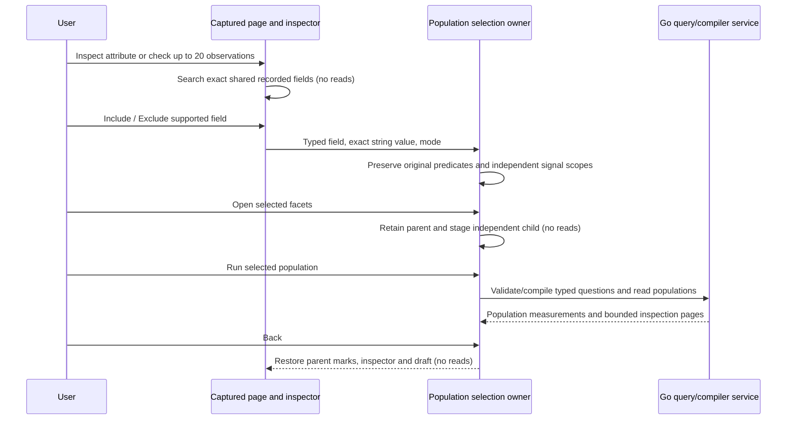
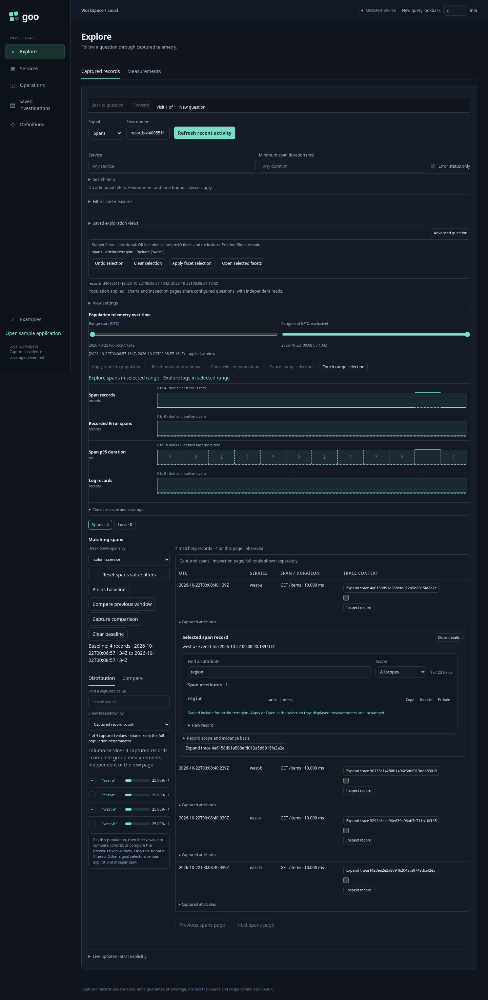
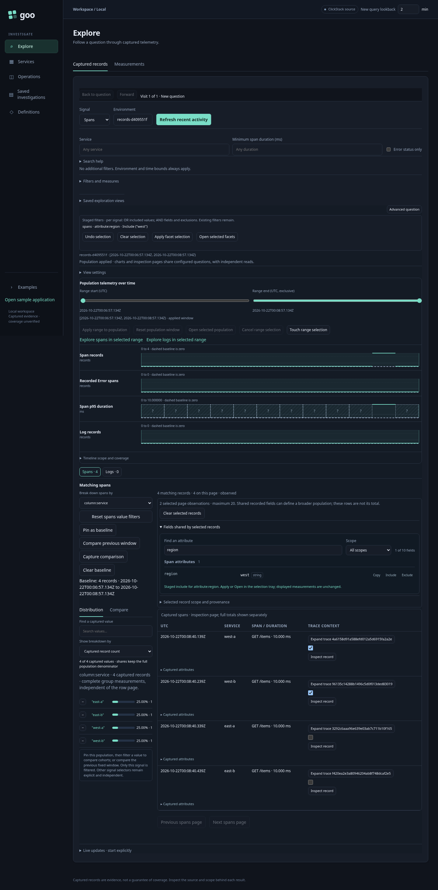
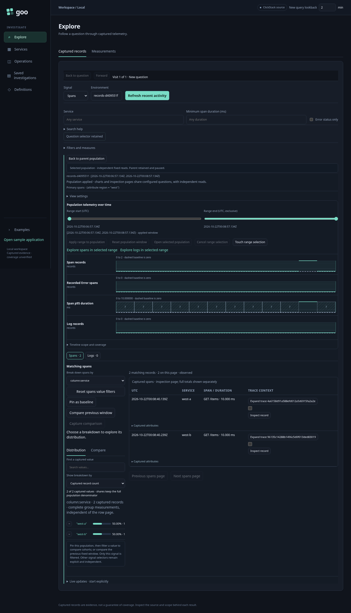
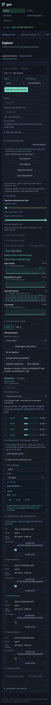

# From captured records to a population

Recent activity record inspection exposes Include/Exclude for supported exact
string fields in both Captured attributes and Inspect record. These gestures use
the [existing staged selection tray](FACET_SELECTION.md); they do not reread,
rewrite OTel attributes, or alter the displayed measurements. Original resource,
record-column and attribute namespaces remain distinct. Present nulls, booleans,
objects and absent keys are not coerced into predicates. Values/keys outside the
typed query's UTF-8/byte limits remain inspectable/copyable without filter actions.

Record checkboxes select up to **20 observations on the current signal page**.
The local selection panel offers searchable **Fields shared by selected records**:
only supported string values present and identical in every selected observation.
Different service names, mismatched values and fields absent from some records do
not appear as shared candidates. This is local field inspection, not a population
aggregation or classifier. Selecting records pauses the owner's live updates.

Include/Exclude from a shared field stages an ordinary typed predicate. Apply
explicitly reads the resulting populations and retains the pinned distribution
baseline; Open stages a retained child, whose Run is explicit. These questions
may match many more observations than the selected rows. The row selection is
never substituted for a full-population count, percentile or comparison.

The retained parent keeps its checkboxes, shared-field search, inspector and draft
when returning from a child without reading or resuming live updates. Clear selected
records removes local marks; it does not remove an independently staged facet
filter. Clear selection/Undo remain the controls for that staged predicate.

Selection belongs to one materialized table. A new page, source read, restored view
or local table replacement discards it; there is no cross-page membership or
persistent selection store. This includes changing layout, which rebuilds the
table even without a source read. Late actions from a replaced read or obsolete
shared-selection revision cannot stage filters in the current owner.

## Scope and provenance

Selected record scope and provenance discloses the exact typed source question,
its result evidence basis, page positions, exact nanosecond timestamps and reported
trace/span IDs. Displayed event times remain UTC. Page positions identify local
observations in that read; reported IDs do not prove unique events or complete
traces. No durable target ID, annotation, immutable selected-record capture or
training-label API is implied. Save a derived question using exploration views;
its configuration reopens without reading, independently of the temporary marks.

The [whole-product annotation model](PRODUCT_ANNOTATIONS_DESIGN.md) and its
[retained-example design detail](TRAINING_ANNOTATIONS_DESIGN.md)
builds on these gestures. For durable labels on selected observations, exact
fixed-record evidence freezing is a prerequisite: fresh capture reads may return
different observations. Annotation targets on other product surfaces can use
existing durable references without waiting for record freezing.

## Executable storyboards

Journey 97 ingests ordinary OTLP spans from four services: two carry region=west
and two region=east. It stages a single inspected attribute, selects the two west
observations, verifies service is not offered as shared, opens an independent
two-record population and returns to the original four-record baseline. A second
22-record environment exercises the 20-observation limit and reset on refresh.
It checks stale read/shared-selection actions, no hidden reads and mobile layout.
The final journey's model replay and actor outcomes are recorded in VALIDATION.md.

