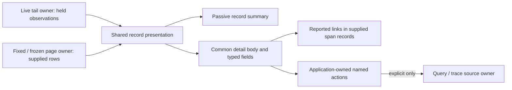

# Shared supplied-record presentation

Live Activity and the existing fixed record table now use the same display adapter
and passive elements. Consumers of that table (including its frozen record pages)
also receive the shared formatting; this does not replace their full query editor.
Services widgets with other layouts still need explicit adoption.

`GooRecordPresentation` owns normalized record-to-display mapping for UTC time,
qualified service namespace/name, log severity/body and individual span status/
duration. `goo-record-summary` renders those supplied fields. `goo-record-context`
renders only reported trace/span references and parent links within supplied span
relationships. Neither element fetches, navigates, subscribes or publishes.

The shared detail body composes these with the existing typed attribute viewer.
Normalized event time displays UTC with exact nanoseconds in the tooltip; Copy
still copies the original value. Resource/attribute fields merely named
`timestamp_ns` keep their typed values. Scope/basis notices, fixed-window staging,
trace expansion, selection and retention remain in their application owners.



## Parent context has a bounded, local basis

For spans, each hop requires the exact reported parent span ID in the same trace.
An identical span ID from another trace is ignored. Multiple observations with the
same candidate parent ID are ambiguous; arrival order never chooses a parent.
Empty/all-zero parent IDs mean no reported parent, while an omitted parent remains
unreported. Invalid IDs, parents not held in the supplied records, cycles and depth
limits have explicit states. The default walk is eight spans, accepts at most 200
supplied relationships and has no hidden wider lookup. The pure helper caps an
explicit depth argument at 16.

These are reported relationships, not a complete or authoritative causal trace.
Logs show correlation IDs and never become span ancestors. Span links, service
identity, timestamp proximity and same-trace membership do not create parent edges.
Open trace remains a separately named source action in each application adapter.

## Server HTML and SPA use

The [component reference](../ui/components.html) contains synthetic server-rendered
fixtures. Load `components.js`, `evidence-summary.js`, `service-identity.js` and
`record-presentation.js`, plus `record-presentation.css`. The application detail
helper also uses `attributes.js`. For example:

```html
<goo-record-summary signal="logs"
  record='{"Body":"Request completed","SeverityText":"INFO"}'>
</goo-record-summary>
```

Set `.record` to a supplied normalized record from an SPA; it is snapshotted and its
getter returns a copy. Context additionally accepts `.records` or a JSON `records`
attribute containing supplied span relationships. Attribute updates replace property
snapshots. Detached property assignment and reconnect are supported. Text is rendered
as text, including bodies that resemble HTML. `compact` limits visible message space;
full retained values remain available in detail. Styles define display content only;
the application owns tables, columns, viewports and action layouts.

## Adoption and remaining work

The duplicate time/service/log/span formatters in `tail.js` and `exploration.js`
are removed. Both primary inspectors now compose the same detail body. Existing
inline attribute disclosure and full read-only saved editors remain named compatibility
consumers; remove them only after entry-point, selection, evidence-basis and paging
parity. Wider Services adoption and a common record-table shell remain open S2/A3 cuts.

Journey 106 uses the same real generic OTel logs/spans in Live and fixed results,
compares the display projections, expands local context without requests and checks
mobile and standalone component behavior. Its fixture includes the same span ID in
a different trace. Hegel generates parent graphs to check permutation/cross-trace
invariance, bounded unique paths, exact reported edges and non-mutation. Observed
source ownership uses the existing Quint entry/fixed-read protocol. See
[validation](../VALIDATION.md) for actual completed campaigns.
