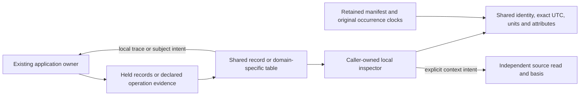

# Record renderers and action coherence — 2026-10-24

Ordinary record tables already share their presenter. The remaining custom views
mostly represent different evidence or domain semantics. This pass fixes visible
formatting/action drift and removes duplicated attribute timestamp handling.
It retains those semantic boundaries; the remaining outcome/status decision is
explicitly proposed below.

## Source inventory

| Surface and owner | Presentation and actions | Disposition |
| --- | --- | --- |
| Activity / standalone tail, `tail.js` | Shared record table/summary/inspector; local pause, inspection and occurrence selection | Already shared. Keep connection, window and membership ownership here. |
| Fixed, saved, population, comparison and explicit context rows, `record-results.js` | Shared responsive table, fields, cached spanning inspector; named context reads | Already shared. Keep original result/basis and explicit reads here. |
| Held service observations, `service-browser.js` | Shared responsive table and cached detail; stage supporting fixed question | Already shared. Supporting read is separate from the overview timeline selection. |
| Retained observations, `retention-presentation.js` | Shared description/summary, lazy attributes, per-occurrence provenance and original manifest | Keep custody cards. Reuse the common attribute formatter while retaining raw-JSON suppression and separate clocks. |
| Waterfall, `waterfall.js` / `visualizations.js` | Passive geometry and app-owned cached inspector with related/async actions | Keep geometry. Reuse shared service identity, status/duration metadata and attributes. |
| Operation invocations / subject events, `operations.js` | Declared-operation and scoped-subject evidence; local trace/subject selection | Keep domain tables. Use shared UTC/duration formatting and bounded `goo-table` viewports. |
| Trace page examples, `trace-journey.js` | Backend-supplied examples and explicit investigation handoff | Keep examples distinct from membership or full-population totals. |
| Native stream identity, `attributes.js` and native presenters | Unit/temporality/reset/identity semantics and cached field inspection | Keep native semantics; do not turn metric streams into span-duration records. |

`discovery.js`, field adapters and selection kernels are not competing record
renderers. They own identity/query semantics and should not be moved into passive
components merely because they reference record fields.

## Implemented fixes

- Operation event lists and scoped-subject tables show focusable UTC times with
  original nanoseconds in tooltips. Invocation durations use the shared readable
  formatter with exact nanoseconds retained in their tooltip. Filtering still uses
  the original exact values and half-open bounds.
- Operation row actions show **Open trace** / **Open subject trace**. Exact IDs
  remain in accessible labels, titles and `data-trace-id`; tests no longer recover
  protocol identity by parsing a visible label. Table viewports contain wide
  domain fields without converting them to raw OTel record rows.
- `GooRecordPresentation.attributes` supplies the shared root timestamp renderer
  while forwarding caller options and other custom field rendering. Record detail,
  retained content and waterfall detail adopt it. Qualified attribute/resource keys
  remain ordinary fields, not a request to reinterpret user data as an event clock.
- Waterfall descriptions use the shared namespace-aware service and metadata model.
  Missing reported status stays **Unreported status**. Related and async actions,
  controlled selection, original rows and source ownership remain in the adapter.

## Action meanings

| Action | Effect |
| --- | --- |
| Inspect | Show held record fields; no source read. |
| Open trace in Operations | Select the trace from the held operation snapshot. |
| Follow subject | Match the declared environment/service/namespace/tenant/id tuple in held events; no causal or transaction proof. |
| Follow async link | Select an exact returned trace/span target; an unavailable target remains disclosed. |
| Expand trace / surrounding logs | Explicit independent source reads with their own basis and disclosed bounds. |
| Open fixed question | Stage the question; Run remains explicit. |
| Retain / capture | Explicit evidence workflow; presentation does not publish. |

## Executable evidence

- Updated real woven-operation journeys 09/10/19 cover exact heatmap membership,
  local trace/subject navigation, tenant isolation, saved selection identity and
  late-data successor receipts. The recovery test opens the visible Saved tools
  disclosures before using the existing by-ID action.
- New [163](../journeys/operation-formatting.spec.js) creates a fresh real woven
  subject, checks UTC/tooltips, duration and ID metadata, keyboard focus, mobile
  table containment and one operation read through local navigation. Its Bombadil
  fixture receives the real trace ID and explicitly selects the operation before
  trace/subject actions; it does not assume an old default horizon contains data.
- Updated 162 log/span journeys check namespace-aware waterfall descriptions and
  exact timestamp attributes over real trace expansion, including the separately
  requested span-specific log read. Saved evidence remains unchanged.
- Updated 139 opens retained observation attributes and checks their original
  timestamp while source routes are refused. Its original browser-ledger Quint
  controls protect source-free publication recovery and inspection.
- Synthetic 67 verifies adapter actions, explicit dependencies, exact timestamp
  attributes and missing-status labeling without API reads. Hegel and the existing
  operation-navigation kernel replay retain their separate synthetic designation.

Actual checks and limitations are in [VALIDATION](../VALIDATION.md).

## Original semantic follow-up finding (resolved)

The following finding records the audit before the linked follow-up.

`operations.waterfallRows` currently derives a `StatusCode` display field from the
declared operation outcome. That normalized operation outcome is not a retained
raw OTel status field. The next cut should make this distinction explicit: show a
labeled declared outcome, preserve raw reported status only when supplied, and
keep unknown/missing status honest. Update normalized observation contracts,
waterfall styling, saved compatibility and properties together. This audit does
not silently change that mapping or reinterpret operation accounting.

Long IDs remain available in explicit identity/context disclosures. Retained
manifests keep exact original JSON and numeric tokens; they are not presentation
strings or rewritten source evidence. No new query, capture schema or custody
protocol is introduced by the implemented fixes.

Follow-up delivered: [Operation status](OPERATION_STATUS.md) replaces the derived waterfall mapping with optional retained exporter status and separately labeled declared outcome. The earlier finding above records the pre-follow-up behavior.
