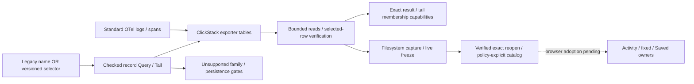
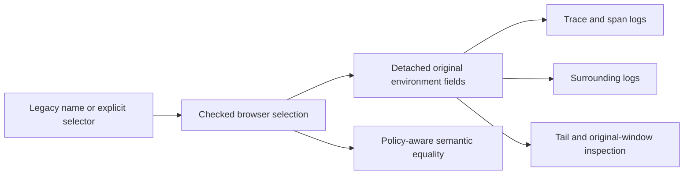
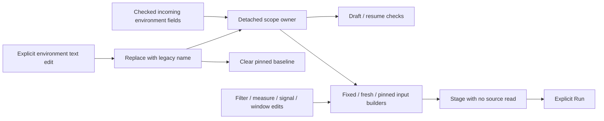
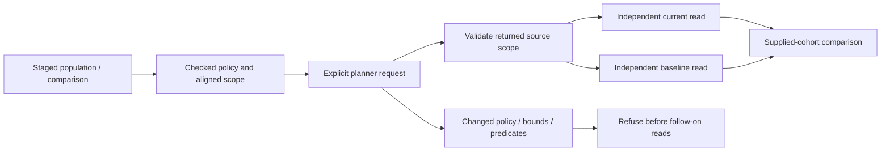

# Checked record selector APIs — 250

Logs and spans without an environment label can now use the main **record APIs**,
not only the separate adoption preview. Fixed reads, rolling tails, context
constructors, population/comparison/explanation planning, server-held results,
filesystem captures, exact reopen/refresh and live comparison/freeze preserve the
explicit selection policy. This is the server portion of A0, not full UI adoption.

```json
{
  "signal": "logs",
  "environmentSelector": {
    "version": "goo/environment-selector/v1",
    "policy": "effective",
    "scope": {"mode": "unreported"}
  },
  "fromMs": 1793275200000,
  "toMs": 1793275260000,
  "limit": 100,
  "offset": 0
}
```

Submit a fixed question to `POST /api/explore`, or as
`question: {kind: "explore", explore: QUESTION}` to `POST /api/captures` with a
title. The latter performs a fresh bounded source read; it does not save an
already displayed page. Exact `GET /api/captures/{id}` reads retained data.
`POST /api/tail` accepts signal, environmentSelector and optional where, without
fixed time bounds; each poll uses the existing rolling 60-second event window.
The [wire contract](ENVIRONMENT_SELECTOR_PROTOCOL.md) defines policies and modes.

## Identity and selection

Choose a nonempty legacy `environment` name **or** `environmentSelector`. With
the new field the legacy name must be empty or omitted. The Go output still
serializes `environment: ""`; that value alone is invalid, never a wildcard.
Unknown versions, invalid/ambiguous combinations and malformed DTOs refuse before
source access. Existing legacy inputs, canonical bytes, plans and stored IDs stay
current-key-only and unchanged. No old saved question is reinterpreted.

Effective selection distinguishes unreported (neither key), present-empty and
named values. Current-key presence wins even when empty or conflicting; legacy
is used only when current is absent. An explicit `current-only` named selector
means the same population as its legacy name. Semantic compatibility accepts
that equivalence, while immutable identities retain the actual wire choice.
Effective named `prod` remains different from current-only `prod`.

New-selector rows are checked against signal, half-open event window and raw
resource map presence/values, including overflow rows before truncation. Missing
or null resource maps/values do not become unreported data. The same checks apply
to result snapshots, tail membership issuance and stored capture verification.
Counts/groups remain independent full source reads; this does not establish
transactional snapshots, ingestion completeness, unique requests or healthy data.
Existing source/row/byte/time and capability lifetime limits still apply.

Derived context/followup questions copy the full selector, including policy.
Comparison, explanation and companion checks use checked semantic equality.
Returned selector DTOs are detached where queries, normalized captures, scopes and
capabilities cross ownership boundaries. Membership resolution binds the full
serialized selector; a token for effective named data cannot be reused under a
legacy name. Snapshots retain their own exact question rather than caller scope.

## Captures and catalog

Filesystem capture serialization includes the selector; capture refresh cannot
change it. Exact reopen and explicit catalog rebuild verify selected record
membership. The catalog adds optional `environmentSelector`; its legacy
`environment` is null for these entries. Null alone still means unknown metadata,
not unreported. Policy/scope are explicit in summaries, including comparison
members. Existing named environment filters match legacy summaries only; use
unfiltered/title searches to discover selector captures in this cut.

The v2 metadata extension preserves old entry bytes/digests and supports mixed
catalog pagination/rebuild without rewriting capture payloads. A pre-250 reader
may reject the **whole catalog** after selector captures are added; it will also
reject selector-bearing exact captures. Rollback requires a compatible reader;
do not delete or downgrade immutable evidence to make an old reader accept it.
No index migration runs automatically.

## Explicit unsupported boundaries

| Surface | Current behavior |
|---|---|
| Browser Activity/fixed-question authoring | Find environments remains local preview. No selector handoff, live selector control or question link is enabled. |
| Browser selector-capture inspection | Catalog/linked facts label policy/scope. Opening refuses before mounting legacy investigation owners and offers the exact captured JSON read link. Existing legacy capture UI continues working. |
| Saved Activity/exploration views, authored steps and reusable package generation | Server validation refuses selector-bearing intent before publication. Known selector-capture baselines are refused by view HTTP owners. |
| Native/metric discovery, service/inventory/dashboard/pod/trace-search request families | Existing named-only schemas remain; passing the new field is unsupported, and an empty name is not accepted. |
| Reported parent-edge queries | New-selector queries refuse before compilation/source access; parent ownership SQL has not been migrated. Exact trace/span record followups retain the selector and remain supported through ordinary record queries. |
| XTDB result/tail retention | Explicit refusal before publication; current named entity/catalog/annotation contracts are not reinterpreted. Exact filesystem capture references remain immutable IDs. |

These are server gates where applicable, not hidden UI controls as the only
protection. A valid standalone DTO does not grant support to another family.



Next: adopt the shared selector protocol throughout browser applied/draft state,
observation-to-fixed handoffs, routes, return links, record/context and saved
owners together. Only then remove the browser gates. Service/native/package/
retention scope adoption remains separate capability work.

The expanded [journey 247](../journeys/247-environment-adoption-storyboard.md),
Go properties and bounded observed Quint traces exercise the implemented cut.
[VALIDATION](../VALIDATION.md) records actual runs and limits.

## Browser constructor foundation — 251

The pure record-environment module now provides `selection(question)` for checked
semantic scope, `questionFields(question)` for detached representation-preserving
copying, and `sameQuestionEnvironment(a, b)` for compatibility. Legacy names map
to current-only policy for comparison; this never rewrites stored wire identity.
Missing/empty names without a selector and ambiguous combinations refuse.
Trace/span-log, surrounding-log, retained-tail inspection and tail preparation
use the shared copy boundary. Tail preparation validates before changing owner
state or clearing a retained buffer.



This is a constructor foundation, not enabled browser selector support. Existing
Activity/session/link and Saved gates remain. Next migrate Activity builders,
owner identity/invalidation and fixed/Saved handling together. In particular,
SSE reset checks must reconcile server omission defaults (`null` selector and
explicit empty scope values) without changing immutable question identity.
Unsupported saved intent, native/service and XTDB paths stay gated.

## Activity internal protocol foundation — 252

`validateRecordQuestion` checks executable record questions using explicit checked
environment selection. Shared-link/step validation remains legacy-only. Activity
latency, explanation scope, baseline distributions, numeric plotting and error
triage use the internal check rather than granting link support. Counted-value
queries and Analyze handoffs copy complete detached environment fields.
Baseline compatibility compares selection policy rather than empty name strings.

Session starts validate environment before mutation. Response matching accepts
only environment wire omission defaults: null/absent selector on legacy questions,
empty/omitted old name on explicit questions and normalized selector scope values.
It does not equate explicit current-only representation with a legacy name, or
current-only policy with effective policy. Stored questions and IDs are untouched.
Tail reset matching also handles omitted log signal and null/absent predicates;
it retains all other selector fields in the comparison.

This remains internal preparation. Activity entry controls, full draft/resume/
return ownership, fixed/Saved mounting, explanation execution and log-pattern
owners need coordinated migration. Browser saved-baseline loaders explicitly
refuse selector captures before assigning a baseline, even when an explicit
current-only capture is semantically compatible with legacy Activity. This avoids
an incomplete workflow into server-refused view persistence. Existing Saved,
share-link, native/service/package and XTDB gates stay in place.

## Record scope ownership — 253

The application-owned `RecordScopeDraft` retains detached environment fields
independently of displayed result/question objects. Activity uses it for applied
versus draft checks, signal changes and resume eligibility. Returning to paused
Activity retains its owner rather than rebuilding scope from the name input.
Saved Activity view writing/browsing stays disabled for selector-bearing scopes.

The fixed editor uses the same owner through pinned-baseline, fixed-bound and
fresh-lookback input construction. Filter/measure/signal/window edits preserve
scope. An explicit environment input edit replaces it with a legacy name and
clears the pinned baseline so baseline precedence cannot undo that edit.
Incoming questions validate before mutating the visit. Scope text labels policy
instead of using an empty name or a sentinel. Named-only deployment, package,
trace-search and recent-population paths are guarded. Unsupported shared-question
links remain gated; numeric selector staging uses the internal owner directly.



[Journey 253](../journeys/253-record-scope-ownership-storyboard.md) mounts the
production fixed owner through its internal API and checks real source requests.
This does not enable selector entry or Saved mounting, and does not establish a
complete live selector workflow. Comparison/explanation/log-pattern/population
owners and Saved mounting still require coordinated adoption before activation.

## Internal population and comparison adoption — 254

Population narrowing/widening, categorical selection/rest, duration regions,
recent question construction, explanation inputs and pattern comparisons retain
checked environment policy. Multi-query time changes require aligned windows and
semantically equal environment selections. Legacy and explicit current-only named
scopes can be semantically compatible; effective policy remains distinct.

Before automatic record reads, planner responses must preserve source predicates,
reported-edge selectors, exact environment representation/policy, windows and
expected signal identities. Record reply matching uses the shared omission-aware
question identity. Live reset keys include full selectors, so a policy-only change
cancels old live work. Baseline restoration uses decoded `postJSON().data` (fixing
an existing attempted `.json()` call), and rejects an incompatible baseline before
its source read. Baseline and current source reads remain independent.

Numeric side drill plans must preserve parent scope/measures and the original
parent-predicate branch. Explanation filtering checks returned side scope before
staging. Unsupported selector-bearing question links remain gated, including
explanation side navigation and timeline links. Timeline selection and local
population owners retain their internal callbacks.

Exploration views remain unsupported for selector questions or selector baselines:
settings/definition validation and all save-button re-enable paths refuse before
publication. Saved pattern-baseline loading remains explicitly gated. Observed
explanation result-token capture is supported by the existing filesystem API and
makes no telemetry reread; opening it through Saved still uses the existing
browser-pending gate. This is separate from unsupported reusable view intent.



[Journey 254](../journeys/254-population-environment-storyboard.md) verifies the
production population owner with real ClickHouse and negative transport controls.
Public entry, fixed-to-population activation and Saved mounting are still gated;
these are internal task prerequisites, not full A0 delivery. Next integrate exact
Saved record/comparison owners and their remaining navigation boundaries before
opening selector handoffs.
