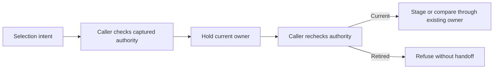

# Shared record refinement and aggregate handoff

436.1 consolidates existing behavior before app CEL authoring. Ordinary Goo
predicates, CEL lowering and a selected non-CEL drill-down now share domain
admission and detached refinement. Volume and latency share a small synchronous
selection handoff while retaining their separate acquisition controllers.

## Ordinary domain operations

`exploration` now owns:

| Operation | Contract |
| --- | --- |
| `ValidatePredicate(predicate, signal)` | Validate a standalone ordinary predicate; no fabricated environment/window/page |
| `ClonePredicate(predicate, signal)` | Validate, then return a detached typed copy |
| `CloneQuery(question)` | Validate, then detach all mutable query members |
| `Refine(parent, predicate)` | Validate both inputs and combined budgets, then clone the whole parent AND condition |

Nil predicates mean no restriction. A nil refinement returns a detached identity
copy; it does not remove the parent's filters. Empty nonnil branches, unknown
signals, cycles and over-budget inputs refuse before recursive copying. Combined
predicates retain the existing 32-node/depth-4 limit.

Typed copying covers predicate branches/field/numeric pointers, grouping slices,
environment selection, numeric/histogram bindings and all reported-edge namespace
pointers. `slices.Clone` handles grouping; no JSON encode/decode is used for cloning.
Valid ordinary numeric literal spelling such as `"01"` remains unchanged. No new
normalization, clock, grouping, projection or pagination policy is introduced.

CEL `Compile` calls standalone predicate admission. `Program.Apply` delegates to
`Refine`, and its getter uses the detached predicate operation. Existing
`StageGroupSide` delegates to the same refinement after validating the selected
positive reported group and side context. It still explicitly resets offset to
zero as that drill-down's policy; the generic operation preserves paging.

```go
question, err := exploration.Refine(parent, condition)
if err != nil {
    return err
}
plan, err := exploration.Compile(question)
```

This operation is additive. Slot-owned replacement, typed positioned compiler
diagnostics and interactive expression authoring remain later 436 slices.

## Hold, recheck, then hand off

`aggregate-selection-lease.mjs` provides `holdSelection(current, hold, handoff)`:
check the caller's eligibility, hold synchronously, check again, then hand off.
It owns no fetch, timer, scope, clock, navigation or publication.

Volume supplies its own captured data/render/scope, band revision, clean state and
native-control checks. Latency supplies its own duration snapshot, accepted read's
scope binding, render/selection revision and native availability. A synchronous
pause can retire the context; a stale action cannot stage a filter or comparison.

Latency deliberately supports Compare while its selected duration filter is an
unapplied draft. The guard captures that invocation's clean/dirty state rather
than imposing a universal clean-only rule. This preserves the existing held
selected/rest comparison over its original fixed source population.

Latency leaving and returning retains the displayed data while retiring old invocation
leases. Compare is disabled when its selection/render lease has expired. A fresh
aggregate read and selection establish current authority. A direct retained
callback cannot pause, stage, compare or read under a changed/hidden owner, even
if a provider changes scope before notifying the adapter through `sync`.



No acquisition controllers were merged. Apply still opens a new rolling Activity
window; fixed Run still performs explicit source reads; held Return does not
reread. Numeric severity and native latency keep their respective source/quality
contracts.

See [executed storyboard](journeys/refinement-consolidation.md),
[independent acceptance](reviews/REFINEMENT_CONSOLIDATION_436_1.md) and
[validation](../VALIDATION.md). [436.2](CEL_CHECKED_PLANNING.md) delivers pure checked planning and typed
positioned diagnostics; [436.3](CEL_REPRESENTATION_OWNERSHIP.md) delivers exact
representation and owner state. [436.4](CEL_CONTEXTUAL_EDITOR.md) mounts the
contextual editor; source provenance preservation is next in 436.5.
