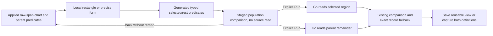
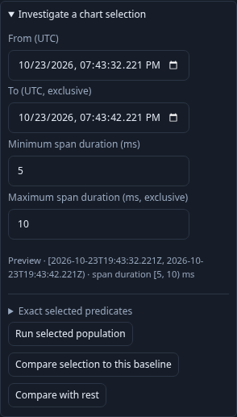
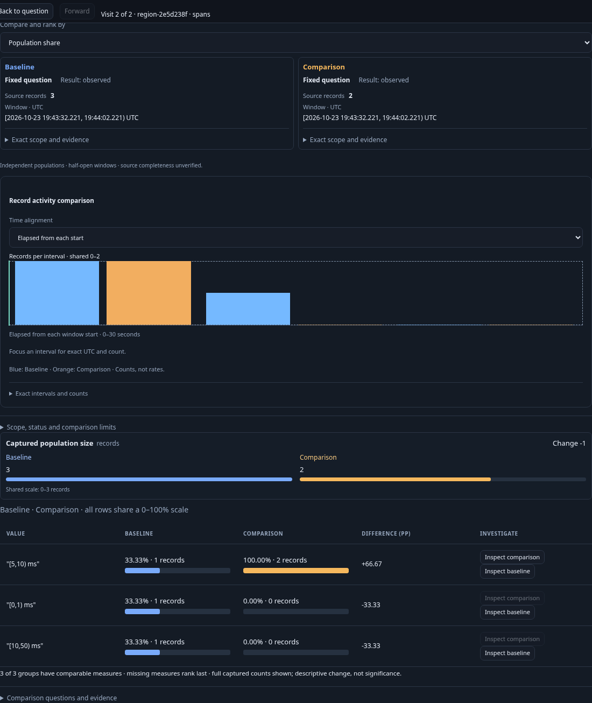

# Compare a time/latency region with the rest

In a raw span duration heatmap, select a rectangle by dragging or using Space,
Shift + arrows and Enter. Open **Investigate a chart selection** and choose
**Compare with rest**. The existing UTC/duration form provides the same precise
selection without a chart gesture. Opening stages a population view; **Run
population view** explicitly reads both sides. Back to question restores the
paused parent chart and selection without reading telemetry.

Both questions keep the parent's full environment, half-open window, predicates,
reported-edge scope, grouping, measures and page limit. Their offsets reset to zero.
For parent P, selected time range [a,b) and duration range [c,d):

- Selected is P AND a ≤ event timestamp < b AND c ≤ duration < d.
- Rest is P AND (timestamp < a OR timestamp ≥ b OR duration < c OR duration ≥ d).

An omitted duration edge stays unbounded. Decimal milliseconds convert exactly to
integer nanoseconds; exclusive upper edges become inclusive limits minus one.
`column:timestamp_ns` is a typed UInt64 event-time field compiled by Go to the
source timestamp; it is not ingestion time or a browser-generated SQL fragment.
Both source questions retain the parent window, so the remainder includes records
outside the chosen time slice. No counts are calculated by subtracting pages.

This complements only generated time/duration intent. It never negates an arbitrary
parent predicate. Existing depth/node budgets apply to both generated queries;
over-budget or unsupported selections are refused before reading. Numeric attribute
bindings, categorical chart-value intent and native histogram-to-span inference
are outside this cut. The previous **Run selected population** still narrows the
window; **Compare selection to this baseline** still uses supplied parent data.

Native span Duration is a non-null UInt64 source column; zero is a valid observed
duration. There is no missing/string duration bucket in this physical source.
Arbitrary missing, invalid or nonnumeric attribute values are not coerced into zero
and are not covered by this operation. Parent attribute predicates retain their
existing missing-versus-empty semantics.

Save the staged/applied population as an exploration view to reuse the selected and
rest queries. Reopening stages without reading. Capture comparison explicitly
rereads both definitions and retains immutable evidence; opening that capture does
not reread telemetry. Both reads have independent bases and may see late/corrected
data; this partition is exact for fixed record values, not an atomic snapshot.

Journey 134 (`journeys/region-partition.spec.js`) emits ordinary OTLP spans,
including exact time/duration upper boundaries, zero duration and an excluded
owner. With a one-row UI page, complete result pages verify selected members 1/4
and rest members 2/3/5. It checks mobile staging, explicit two-sided reads, parent
return, reusable view reopen and immutable capture reopen. Hegel checks both
transforms through Go compilation and its independent predicate interpreter,
including UInt64 extremes. Observed Quint replay uses the existing drilldown model
with rejecting controls; Bombadil requires actual source-free staging and return.

