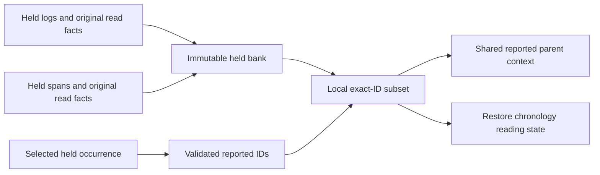

# Related held records

Hold both Activity lanes, inspect a record, then choose **Related held records**.
Goo shows held logs and spans with the same valid reported TraceId. **Same
reported span** narrows this to the inspected occurrence's valid SpanId within
that trace. Its visible **Anchor span** ID stays fixed while other related
records are inspected. When no valid span ID was reported, the disabled control
has an associated visible reason.

This is a local scope over the immutable held bank, independent of chronology
Find and each lane's Find. It does not broaden the source scope, subscribe,
query, save or capture. Source counts, latest reads, gaps and evictions remain
available. Matched counts retain their original held-bank denominators.

**Return to chronology** restores its Find, page, selected occurrence and table
scroll, including the original inspector. Related-record inspection does not
replace the return point. Returning to lanes or replacing a source scope retires
the local drill-in. There is no saved format for this presentation yet.

Reported parent context reuses the shared `goo-record-context` component and only
held span observations as parent candidates. Logs provide correlation IDs, not
parentage. Repeated span IDs remain distinct observations: a parent with multiple
candidates is ambiguous. Missing parents, invalid IDs, cycles and depth limits
remain explicit. Same trace identity does not establish causality, trace
completeness or end-to-end latency; nearby timestamps do not add relationships.

The passive chronology accepts `showRelated(signal, occurrenceKey)` for a current
held occurrence. The application supplies that occurrence from its guarded
inspector. A new supplied bank resets local reading state. The component emits
`goo-chronology-return` with `{selectedKey}` on explicit Return. The application
restores that original inspector even when Find or paging hides its row, using
visible Find as the focus fallback. Source and preservation authority remain
with the application.

[Executable storyboard](journeys/related-held-records.md).

Selected occurrences have a persistent text marker and forced-color outline,
in addition to programmatic `aria-current`.
