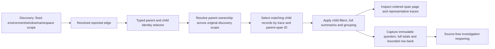

# Investigating reported edges

The distributed view offers **Investigate reported edge** for resolved reported
parent relationships. It stages a span question with exact parent and child
service/namespace identities and the original fixed environment/window. Expanding
a link does not query telemetry; **Run question** performs a new bounded read.
The adjacent child-service link remains explicitly labeled as a wider population.

A typed `reportedEdge` selector is part of the ordinary record question. It is
preserved through filters, grouping, reusable YAML packages, captures and typed
investigation steps. **Use wider child service population** deliberately removes
it and stages the broader question. Signal changes require that deliberate step;
span-parent semantics cannot silently become a log search.

Parent ownership uses all captured parent records in the original discovery scope,
before child filters. Duplicate parent records with the same service identity do
not multiply children. Multiple service owners for one reported trace/span ID
remain ambiguous; they do not become an arbitrary edge. Missing, empty and literal
namespaces remain distinct. A namespace-filtered discovery retains that same
parent-search namespace in the question. Parents outside the environment/window
remain unresolved. Trace/parent IDs use the same validation as discovery.

Every measure counts **child span records**, including exporter duplicates and
retries. Duration measures describe those child spans; they are not unique calls
or end-to-end request latency. Unset status is not success. Async span links,
external peer inference and declared topology are separate future relationships.

The ClickHouse adapter uses an exact trace/parent-ID membership subquery over
uniquely owned parent IDs. It never materializes a truncated parent-ID page into
the question, and never computes totals from the 100 displayed records. Existing
window/execution/cardinality safeguards apply; failures remain unavailable rather
than partial edge totals. Each source read can see late data, including new
conflicting parents. Captures freeze the results actually read; source-free
reopening does not rerun the parent lookup. Refresh explicitly reruns the fixed
question and can advance its evidence basis.

A whole-trace expansion intentionally shows a broader population in the same
window. Its scope explanation records replacement of the edge selector. This is
reported ID context, not inferred causal reconstruction. A reusable package can
retain the runtime relationship; a single-function annotation cannot express it.

[Journey 62](../journeys/reported-edges.spec.js) injects a 130-child edge and tests
duplicate parent rows, ambiguous ownership, foreign trace/environment parents,
out-of-window parents, internal spans, parent-search namespace scope, child-error
filters, full duration/status totals, trace expansion and saved investigations.
