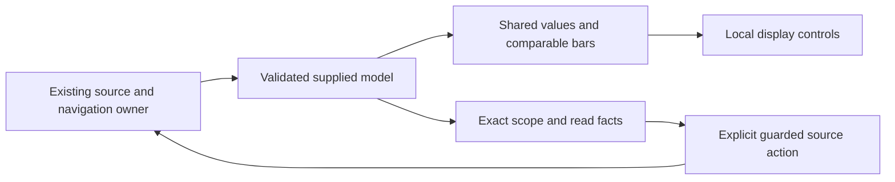

# Result presentation refinement after 415

This visual pass applies the operator-workbench hierarchy to service comparisons,
service timelines and local scope recall. The next functional roadmap item remains
416, recurring exception groups.

## Shared presentation

Comparisons have one title and prominent paired values on a shared scale, using
consistent blue baseline and teal comparison roles. Narrow layouts align values
when a role label wraps. Exact values remain inspectable. The checked comparison
model, source queries, selection gestures and read ownership are unchanged.

The composing application keeps one **Scope and read facts** disclosure for exact
operand counts, windows, source clocks, bases, identity and quality. Routine
coverage limitations live there; the concise unknown-coverage note stays visible.
Active read failures and incompatible states retain visible status. The folded
baseline refresh has a native visibility guard, including retained callbacks.

The passive `goo-measure-comparison` supports `data-first`. In that profile,
`external-context` lets a composing host own the single context disclosure. The
host must render the validated operand facts. Standalone default rendering keeps
its provenance; standalone `data-first` retains its own **Read facts**. These
attributes affect presentation only and confer no source or navigation authority.

Unknown timeline intervals retain every supplied key, exact timestamp, accessible
name, keyboard target and event. A quiet rail replaces overlapping question-mark
glyphs. All-unknown lanes keep a shorter brush surface, while numeric zero remains
a numeric value. Two UTC endpoints give visual orientation; full timestamps and
nanosecond precision remain in accessible labels and tooltips.

Recent/Pinned and held visits share a readable filter/identity/time hierarchy.
Small Stage/Return controls retain contextual accessible descriptions. Exact
selectors and UTC bounds remain available; retention and opt-in persistence are
unchanged. Service summaries use a compact metric row and unified action footer.

## Actual review and checks

The existing real-source [version journey](journeys/service-versions.md),
[scope recall journey](journeys/recent-pinned-scopes.md), and previous-window
comparison regression regenerate documentation frames. Added assertions check
paired numeric alignment and chart placement at 1440/390/320px, keyboard opening
of exact read facts, closed-action refusal and unchanged local read budgets.

See [validation](../VALIDATION.md) for final outcomes and
[independent review](reviews/RESULT_PRESENTATION_REVIEW.md) for acceptance limits.

- [Desktop comparison](journeys/screenshots/service-versions-count-comparison.png)
- [390px comparison](journeys/screenshots/service-versions-count-comparison-390.png)
- [320px comparison](journeys/screenshots/service-versions-count-comparison-320.png)
- [Service overview](journeys/screenshots/service-versions-picker-1440.png)
- [Scope recall](journeys/screenshots/recent-pinned-scopes-390.png)
