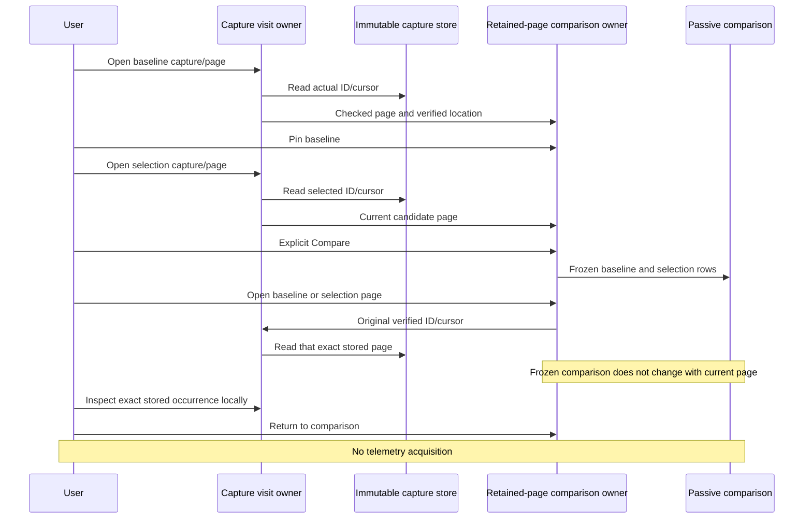

# Compare retained span pages

Milestone 361 connects the existing supplied-page comparison to verified saved
evidence. Actual execution and frame acceptance are recorded in
[validation](../VALIDATION.md).

[366's compact evidence headers](COMPACT_PAIRED_EVIDENCE.md) now keep each side's
policy, UTC window, supplied page counts and uncertainty visible above timings.
Source/custody clocks, full counts and receipts remain independently available
under each side's Scope and receipt disclosure. This changes presentation, with
matched desktop/narrow acceptance, while preserving the comparison grain below.

Choose **Pin stored page as baseline** on a captured span page, open another stored page,
then explicitly compare it with the baseline. Each operand is the whole supplied
page, including mixed traces and duplicate observations. No implicit trace filter
or fetch of omitted pages changes that grain.

The baseline and applied pair are local to this saved-record owner. Changing the
currently open capture/page does not silently replace a comparison operand.
Explicit Replace baseline or Clear invalidates the old pair. Each side keeps its
receipt, original question/policy/window, source basis/read clock, capture clock,
offset/limit, supplied row count and retention limits independently.

Opening an operand uses the actual opaque cursor captured from its loaded visit;
a capture ID alone would incorrectly reopen page one. Store GETs are accounted
separately from telemetry reads. Inspection reuses the existing captured-page
inspector, and returning to the held comparison changes only local presentation.
If a side cannot be opened, the eligible previously displayed page and held pair
remain usable; the failed visit cannot supply a new comparison operand.

The existing Go `CompareTracePages`, matching JavaScript model and passive
`goo-trace-comparison` remain the calculation/display contract. Groups use exact
nullable reported service/operation labels. A unique label match is descriptive,
not the same invocation or verified equivalent instrumentation. Repeated labels
are not zipped; one-sided groups do not imply zero work on the other full trace.
Mixed or unreported trace pages withhold individual row pairing.

Comparison positions use each **page's** earliest valid supplied start and one
common elapsed scale. These origins are independent and differ from the per-trace
origins in the single-page waterfall. Unknown timing stays unavailable. Inclusive
span sums can overlap; outside-observed-children time is not CPU, self time,
critical-path time or complete-trace latency. A page without a continuation token
still does not establish upstream completeness.

This cut adds no telemetry endpoint, comparison kernel, persistent comparison
artifact, global reference store or capture format. The existing explicit fresh
trace expansion remains a separate operation.
