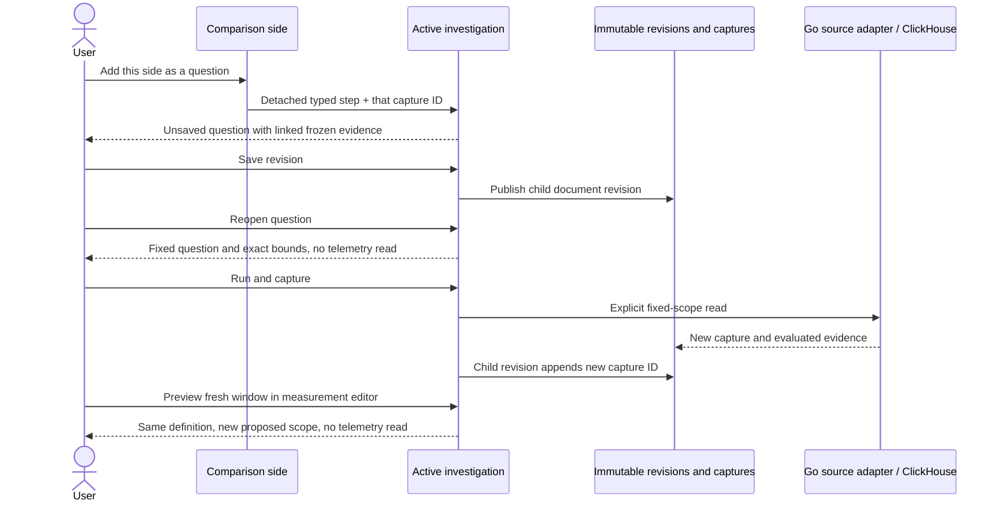

# From comparison to reusable question

Each record or native measurement side in a comparison offers **Add baseline
question** or **Add comparison question**. The action adds one question card to
the active investigation draft, with that side's exact typed question and its
single immutable capture ID already linked. It does not read telemetry, replace
an existing question, combine the two populations, or publish a revision.

The action works in both a transient comparison and a saved comparison card,
including the exact sub-scopes produced by [observed window discovery](OBSERVED_WINDOW_DISCOVERY.md).
Unavailable or incompatible evidence can still supply a reusable question; its
stored state remains visible and no numeric comparison is implied.

Save the investigation revision to share the new question. A failed save retains
the draft and linked IDs for retry without recapture. Reopening the shared revision
loads frozen evidence only. **Reopen question** restores its fixed typed step and
exact native nanosecond bounds without reading telemetry. **Run and capture**
explicitly reads the same question, appends the new capture ID in a child revision,
and preserves the original evidence and all earlier revisions.

Beside the measurement time controls, **Preview fresh window** keeps the package definition
and source binding while proposing a fresh lookback window. Preview does not read
telemetry. **Run measurement** executes that new question explicitly. The fresh
window is not written back to the saved fixed question or relinked to its old
evidence. Add it as a separate question through the existing investigation action
if it should become part of the narrative. Ordinary fresh-window previews use
millisecond bounds; exact captured questions retain their nanosecond strings.

## Boundaries

The existing versioned question step and document revision APIs provide the
storage contract. No new persisted card kind, manifest language or receipt
algorithm is introduced. Presentation builds a detached typed question from a
validated capture receipt, links only that capture, and assigns a fresh question
key. Document publication validates the step and resolves the referenced capture.

Staging checks the active document context, save-in-progress state and 32-card
limit before mutating the draft. The UI disables the action during publication.
Inventory and legacy pair captures are not eligible typed question sides. A
question card is reusable intent plus independently retained evidence; it does
not establish ingestion completeness or health.

The executable [storyboard 56](journeys/README.md#56--reuse-comparison-questions)
uses real standard OTLP counters with 123 ns offsets and exercises failed
publication, fresh-browser sharing, fixed reruns and fresh-window execution.
