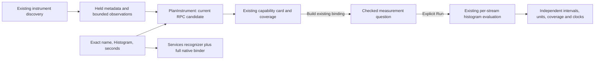

# Current RPC duration capability

Milestone 362 aligns Services and Measurements on the current RPC duration
instrument. Implementation, main Go/UI, generated, native/observed-model and positive actor
checks pass, including telemetry-refused frozen reopening. See [validation](../VALIDATION.md) for execution status.

The convention remains the [357 official pin](CURRENT_RPC_CONVENTION_357.md):
OpenTelemetry semantic conventions v1.45.0, commit
`fb30ca17193b551473b1f43c315482918ab6987c`. This cut does not perform new convention
research or change the current/older RPC record populations.

## One shape, separate authorities

`measurements.CurrentRPCDurationShape` recognizes exactly
`rpc.server.call.duration`, Histogram, unit `s`. The service native selector and
the existing `PlanInstrument` capability branch share that small Go fact. It
does not establish a valid binding, stream coverage or producer conformance.

Services still requires its full native-duration binder: original service,
namespace/environment, definition, scope/version/schema and supported OTLP
temporality. Measurements retains its generic binding eligibility and existing
explicit execution path. The UI's independent same-row span witness is unchanged;
native metadata does not prove a server-span population.

The existing capability card uses profile `rpc-server-call-duration`, title
**Current RPC duration candidate**, and rule set **OpenTelemetry semantic
conventions v1.45.0**. Shape match, generic execution eligibility and verification
`not-run` are distinct. A wrong-unit current-name instrument can retain an eligible
generic binding while failing the pinned current RPC shape; no unit conversion,
schema migration or legacy alias is applied. The older `rpc.server.duration`
milliseconds instrument and custom metrics remain separate.

Capability planning and opening its disclosures add no telemetry query. Existing
discovery and explicit Run retain their own source effects. No new UI component,
HTTP endpoint, registry, calculation kernel, stream merge or capture format is introduced.

## Bounded presence is not validation

The existing observed-stream coverage watches four keys:

| Key | Meaning in this capability |
| --- | --- |
| `rpc.system.name` | Required by the pinned convention; presence does not validate its value or establish conformance. |
| `rpc.method` | Conditional. Missing, present empty and literal `_OTHER` remain distinct; a missing method does not disable Run. |
| `rpc.status_code` | Conditional. Reported protocol status is not a universal success/failure policy. |
| `error.type` | Conditional on failure; independent of recorded span Error and business outcome. |

Missing, empty and reported presence stay separate per exact observed stream.
The bounded preview and omitted-stream counts cannot certify every export or
prove absence. Neither a matching name nor a schema URL becomes a verification
badge. Attribute presence alone does not validate allowed values.

Run evaluates the admitted native histogram streams using their original units,
temporality, resets, intervals and coverage. Seconds are not legacy milliseconds;
independent delta/cumulative streams do not merge. No span-to-metric join, fleet
percentile, request rate, complete-trace latency or health score is inferred.

## Acceptance and next checkpoint

Source checks cover exact name/kind/unit, wrong shapes with generic fallback,
conditional/missing/empty attributes, bounded previews and unchanged bindings.
Genuine discovery → service/native selection → Measurements inspection → explicit
Run → capture/reopen must preserve complete questions, exact streams, units and
independent clocks. Positive actor completion and observed-model rejection
controls remain separate from metadata and source-review claims. See the
[architecture](reviews/RPC_CAPABILITY_ARCHITECTURE_362.md) and
[design](reviews/RPC_CAPABILITY_DESIGN_362.md) contracts.

This is the final cut of the 359 finite sequence. After its own acceptance,
perform the planned whole-product checkpoint, including the recorded compact
comparison-provenance opportunity from 361; no further feature sequence is
implicitly selected here.
