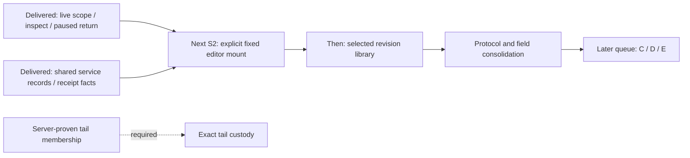

# S2/A3 acceptance reconciliation

This audit reconciles the active queue with delivered work as of 2026-10-22.
It closes the bounded A3 record/one-service cut, while keeping S2 consolidation
open at the explicit editor-mount removal gate. The authoritative order remains [the active queue](IMPLEMENTATION_PLAN.md).
Comparison work belongs to D1; it is not the immediate successor to these cuts.

| Acceptance | Implementation and evidence | Disposition |
| --- | --- | --- |
| Stage/apply typed live scope; one active owner; no hidden inspection reads | `stream-entry.js` owns draft/applied scope and subscription transitions. Journeys 103/104 and the Live attribute filters validation section cover real signal changes, unavailable/gap states, obsolete results and explicit fixed staging. | Delivered bounded S2. |
| Held ancestry, honest missing/ambiguous/cycle/depth states | `record-presentation.js` resolves only supplied same-trace parents. Journey 106 and 200 Hegel supplied-parent cases cover cross-trace independence and non-mutation. | Delivered; wider trace context remains an explicit read. |
| Return to paused parent with anchor/focus, no rerun | Activity owns its tab-local return anchor; journey 105 and the paused-return validation section cover cancellation, scroll/focus and explicit resume gaps. | Delivered; reload/cross-session resume is outside this cut. |
| Two real surfaces share facts without flattening source types | Live/fixed/Saved records and held Services rows share the record/table presenter; journeys 106/59 cover source-free inspection. Independent service overview reads keep their own scope and basis. | Delivered A3 one-service adoption. |
| Record receipt adapter in captures and documents | `GooEvidenceScope.record` supplies count/window/source/custody facts to both, with unknown count/page disagreement. Journeys 32/41/45/50 and their validation entries cover fixed continuation and source-free reopen. | Delivered A3 receipt adoption. |
| Remove duplicate editor/details after parity | `saved-records.js` replaces the hidden query editor; `record-results.js` shares fixed/Saved context. Journey 107 and the single-inspector validation campaigns cover paging/context, delayed response rejection, one inspector and hidden unusable comparison controls. | Delivered; typed fixed query authoring is still a real consumer, not an unused compatibility editor. |
| Contextual lookback | Navigation hides the default on Saved and labels new discovery/operation/example reads and the Definitions HTTP preview. Journey 107 checks route labels, unchanged default and no added source reads. Fixed questions retain their own bounds. | Delivered by this closure cut. |
| Mobile, passive component lifecycle and formal evidence | Journey 106 covers SSR, detached-property/reconnect and no component API reads. Subsequent service/Saved/inspector journeys cover narrow layouts. Existing Hegel state/swarm and Quint observed ledgers with rejection controls protect ownership boundaries. | Evidence is cumulative; this audit does not claim every historical campaign was rerun. |

## Remaining work has an owner

- **S2, next:** stop eagerly mounting the complete fixed query editor beneath fresh
  Activity. The architecture review explicitly makes this a removal gate after
  shared record/scope/continuation parity. Keep an explicit fixed-question destination,
  lazy authoring access, existing links, draft retention and paused-parent return.
  Prove no extra read on entry/disclosure/staging and reject obsolete completions.
- **B1, after that gate:** compact record/native definition revision rows with only the selected
  editor/meaning/review mounted. Preserve unrelated same-title definitions, families,
  parallel heads, dirty drafts, old links and source-free selection. Start with these
  two definition families before extending to compatible document/retained catalogs.
- **B2:** broader applied-chip/qualified-field and proven request-owner consolidation.
- **D1:** remaining aggregate/native comparison compositions and fitting inspector
  adoption. The recent native presenter is useful groundwork, not completion of D1.
- **E1:** broader native instrument discovery and explicit convention capabilities.
- **S3:** exact tail custody stays blocked on server-proven membership/expiry/retry
  contracts. Existing live-page retention is not a substitute for tail membership.

The `entry-advanced` disclosure remains a named migration adapter containing the
real fixed question/charts/saved-view authoring flow. Its consumers need equivalent
explicit access; they do not justify eagerly mounting the full editor under every
fresh Activity entry. `index.html` currently mounts `GooInvestigationTrail` before
`GooStreamEntry` wraps its DOM. This is the remaining S2 removal gate identified in
the architecture review, not a new capability request. Complete it before B1.

See [actual validation](../VALIDATION.md), [record presentation](RECORD_PRESENTATION.md),
[saved record ownership](SAVED_RECORD_PRESENTATION.md) and [Live Activity](LIVE_ACTIVITY.md).
