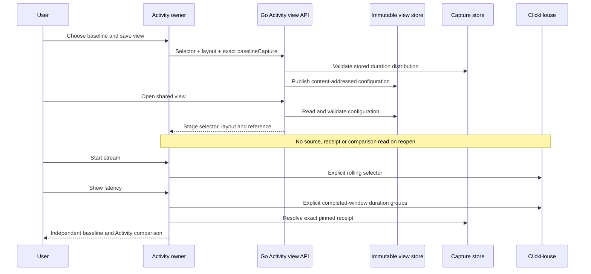
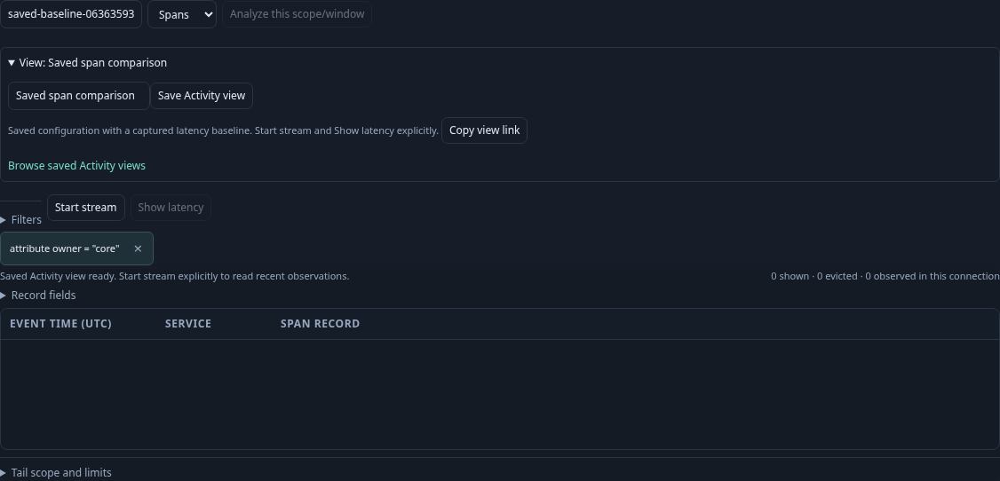
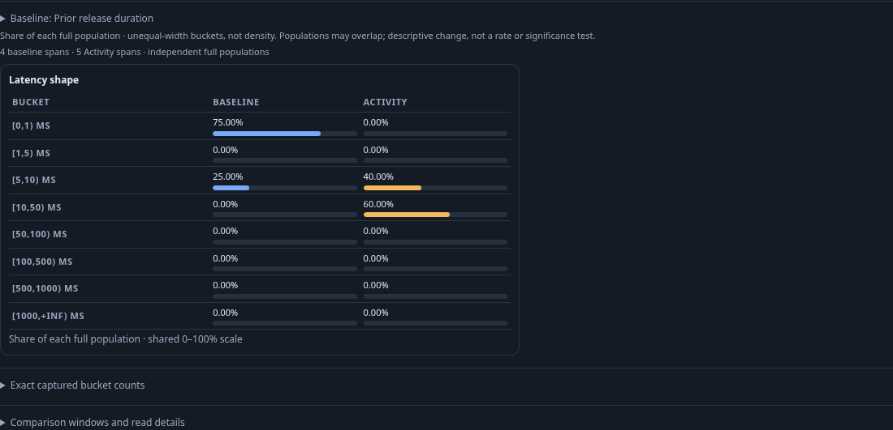
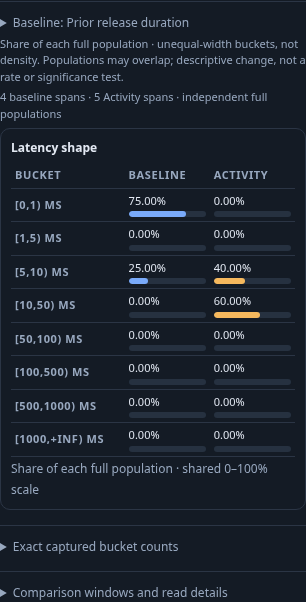

# Saved Activity baseline references

A saved Activity view can now include the selected latency baseline's exact
capture ID. Use Baseline to choose stored evidence, then save from Views as usual.
The immutable configuration contains its rolling selector, column layout and an
optional `baselineCapture` string. It contains no copied groups, records, source
or custody clocks, read window, membership proof, refresh cadence or startup flag.
Changing or clearing the reference produces a new view identity; the original
view and captured evidence remain unchanged.

The optional field extends version 1. Its empty/omitted form serializes exactly
as before, preserving existing hashes and old files. Publication checks the ID,
span selector, stored capture integrity, environment, raw duration-bucket grouping,
source-read time and full native cohort accounting. No-data baselines are valid;
unknown/changed reads, native metrics, transforms and unsupported buckets refuse.
This check reads local stored evidence only and never calls ClickHouse. It is an
availability check at publication, not a cross-store transaction or deletion lock.

Open/share/reload restores a staged reference with empty observations. It does
not resolve a receipt, compare data, subscribe or query telemetry. Start stream
remains explicit and reads only the rolling span selector. Show latency then
reads the current aggregate and resolves the pinned stored capture before pure
comparison. The panel reopens closed, with manual updates. Cadence and brush state
are not preferences stored by this change.

If evidence becomes unavailable later, the configuration still opens and appears
in its catalog. The baseline reference stays visible. An explicit retry uses
stored evidence and the held Activity result without rereading telemetry. Clear
removes it; a new publication with an unavailable/incompatible reference is refused.
Changing to logs clears the inapplicable latency reference. Changing environment
keeps the pin visible but publication requires a compatible capture in that
environment; it is never silently rebound to another capture.

Reference changes participate in the existing modified-view/keep-or-discard guard.
Save snapshots the selected reference together with title, scope and layout. A
late save response cannot erase a later Clear or replacement. Loaded evidence
metadata is separate from the reference, so resolving an unchanged pin does not
mark a view modified or mutate its content identity.

| Operation | Baseline behavior |
| --- | --- |
| POST `/activity-views` | Strict 16 KiB publication; validate optional reference against stored evidence. |
| GET `/activity-views/{id}` | Validate configuration/hash without resolving capture availability. |
| GET `/activity-views` | Bounded configuration catalog; no evidence resolution or source read. |
| Start stream | New rolling observation connection; no baseline read. |
| Show latency | Explicit current read, then stored receipt resolution and pure comparison. |

Storyboard 158 uses real OTLP spans and ClickHouse: capture four prior spans,
select a baseline over five current spans, save/reload without any new source,
receipt or comparison request, then explicitly Start and Show. It covers mobile
layout, clearing/revising while preserving the old view, a committed-but-delayed
save response, unavailable receipt transport and source-free retry. Bombadil
explores the staged configuration without starting a stream or resolving evidence.
Hegel checks immutable identities and clear-to-legacy equivalence; quint-go replays
observed reopen/retry counters with mutations that reject hidden reads and ref drift.

