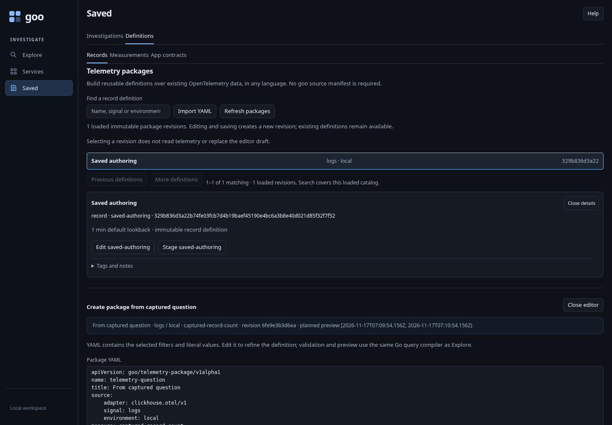

# Reusable definitions in Saved

Use **Saved → Definitions** to find, import and edit reusable record and measurement
packages. Application contracts remain in the same collection. Definitions store
configuration; investigations and captures live in the **Investigations** tab.

## Build from an investigation

1. Run a fixed question in Explore.
2. Open **Edit question → Reusable question package → Save reusable question**.
3. Saved opens the record editor with the captured question staged as a draft.
4. Choose a name and title, then **Build package**. Validate edits before saving.
5. **Save package revision** preserves the definition. **Preview captured data**
   reads the displayed window; **Stage in Explore** stages a question without
   reading telemetry.

## Reopen and edit

Open **Saved → Definitions → Records**, select a revision and choose **Edit**.
Saving produces another immutable revision. Import and export continue to use the
existing YAML format. Measurements retain their existing workbench in Explore;
**Open measurement workbench** takes you there.

Switching tabs retains drafts and library filters. It cancels a pending record
preview or HTTP evaluation; returning does not restart it. Hidden editor actions
cannot issue a telemetry read. Opening an investigation or capture selects the
Investigations tab, including when following a link from an authoring session.

The Definitions sidebar entry and `#definitions` workspace are removed. There is
no compatibility redirect. Existing definition endpoints, stored package revisions,
annotations, capture formats and readers are unchanged. The prepared HTTP evaluator
is retained here pending its separate consolidation.

## Walkthrough and checks

[`saved-authoring.spec.js`](../journeys/saved-authoring.spec.js) runs against an
isolated generic Go server. It imports, validates, saves and reopens through the
real package APIs; builds from a fixed Explore question; checks keyboard family
navigation and hidden controls; and runs the shared Bombadil navigation campaign.

[Narrow layout](journeys/screenshots/saved-authoring-390.png) ·
[320 px layout](journeys/screenshots/saved-authoring-320.png)
