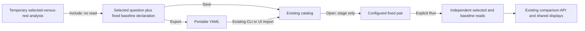

# Save a fixed cohort comparison — 308

> Delivered in 308. Executed checks are recorded in
> [VALIDATION.md](../VALIDATION.md).

A useful selected-versus-rest investigation can become a view that you reopen,
run again or keep as YAML beside service code. In a temporary **Compare with rest**
child, choose **Include comparison in view**, then use the existing Preserve
Save/export actions. Include changes configuration only: it clears the temporary
answer, preserves the selected question and record presentation, and stages the
view for explicit Run. A category-template marker is removed visibly because
this comparison retains its own fixed questions.

Held-parent comparisons do not offer this action. A held observation must not
silently become a fresh query on reopen.

## Store two questions, not their observations

The selected query remains the view's primary question. A comparison child stores
one `baselineQuery` with a pinned `query-count-comparison` kind. Both questions
must have the same checked environment policy, fixed bounds, signal, grouping and
ordinary count profile. Both start at page zero with independently valid limits.
Their predicates may differ; the file does not contain rows, read clocks, a held
snapshot or a capture ID.

The existing comparison role has two disjoint variants:

| Kind | Required operand | Forbidden operand |
| --- | --- | --- |
| `captured-count-comparison` | `baselineCapture`: exact store-local capture ID | `baselineQuery` |
| `query-count-comparison` | `baselineQuery`: checked fixed question | `baselineCapture`, including empty/null |

Unknown fields and ambiguous mixed/null operands are refused. Go's shared type is
`CountComparisonViewDeclaration`; captured serialization and content identity stay
unchanged. Composition retains its single presentation owner: there is no parallel
flat breakdown configuration or extra top-level same-signal query list.

[The checked YAML example](../config/views/fixed-cohort-comparison.yaml) compares
canary and stable service spans in `prod`, using the same five-minute window on
2026-01-01. It uses distinct explicit predicates; it makes no claim that stable is
the complete remainder of canary. The checked-file test and CLI validate the
actual file.

## Reopen and explicitly refresh

Open original question stages the saved definition without reading. **Run
population view** reads the selected question and, when the comparison is visible,
its fixed baseline independently, then uses the existing pure comparison API and
shared summary/group displays. Earlier observations are not restored. **Read fixed
baseline** can refresh that operand against the currently held selected result;
its separate UTC read clocks stay visible. Changing local Summary/Groups/order
presentation does not read telemetry.

Persisted labels are generic Baseline and Selected. Although the UI can create a
pair from a remainder calculation, the stored questions can later be edited and
are not a proof of a complement, causal relationship or atomic partition. Count
quality, empty operands, changed reads and unknown upstream coverage retain the
existing comparison model semantics.

[Shared comparison-window controls](PAIRED_COMPARISON_WINDOWS.md) stage both
questions together for a new explicit or fresh UTC window, preserving independent
predicates and presentation. Run remains explicit. Root-only grouping, profile and
interval changes stay disabled for fixed pairs; edit both questions in YAML and
validate/import, or remove the comparison before changing that shared context.
Value predicates remain independently editable under the checked fixed context.

## Portable configuration and safe reuse

Save, YAML encode/decode, offline CLI validation and explicit CLI import use the
existing admission/catalog path. Query comparisons are portable; captured-ID
comparisons remain nonportable. Opening an imported pair is still staged for Run.
No automatic source read or capture occurs during Save/export/import.

A fixed pair cannot be applied as presentation to another population, even when
hidden. Both **Apply composition** and aggregate-only Apply are refused rather
than copying a foreign baseline or silently dropping the comparison. Category
template creation/expansion is also refused. This cut supports fixed question
Open/import, not inferred destination rebinding. Count, records and existing
timeline declarations remain in the same composition.

See [temporary authored cohorts](AUTHORED_COHORTS.md),
[portable definitions](PORTABLE_VIEWS.md),
[CLI workflow](VIEW_ARTIFACT_CLI.md),
[architecture review](reviews/SAVED_COHORT_ARCHITECTURE_308.md) and
[design review](reviews/SAVED_COHORT_DESIGN_308.md).
