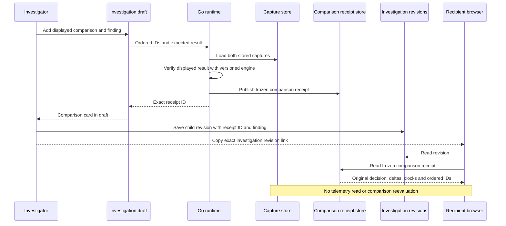
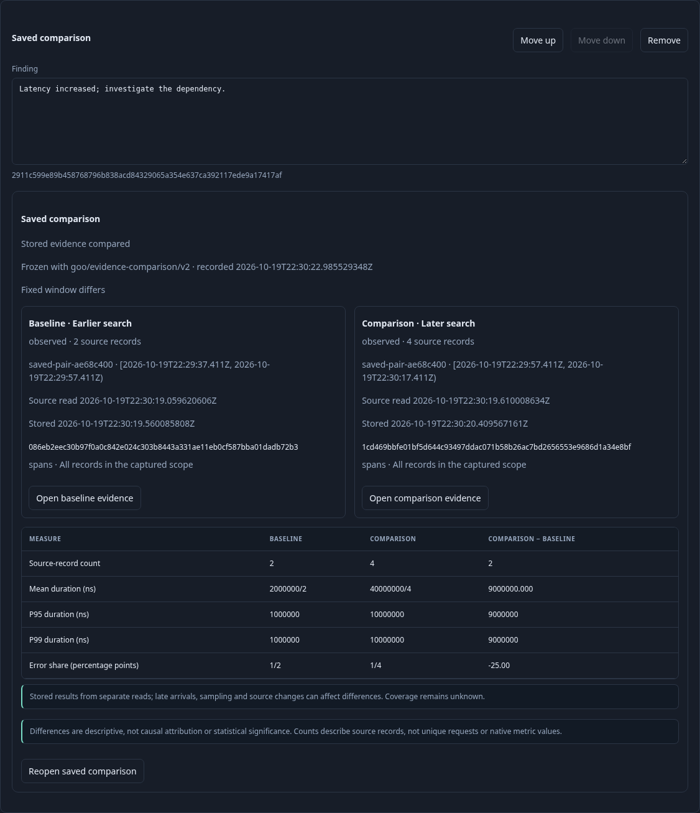
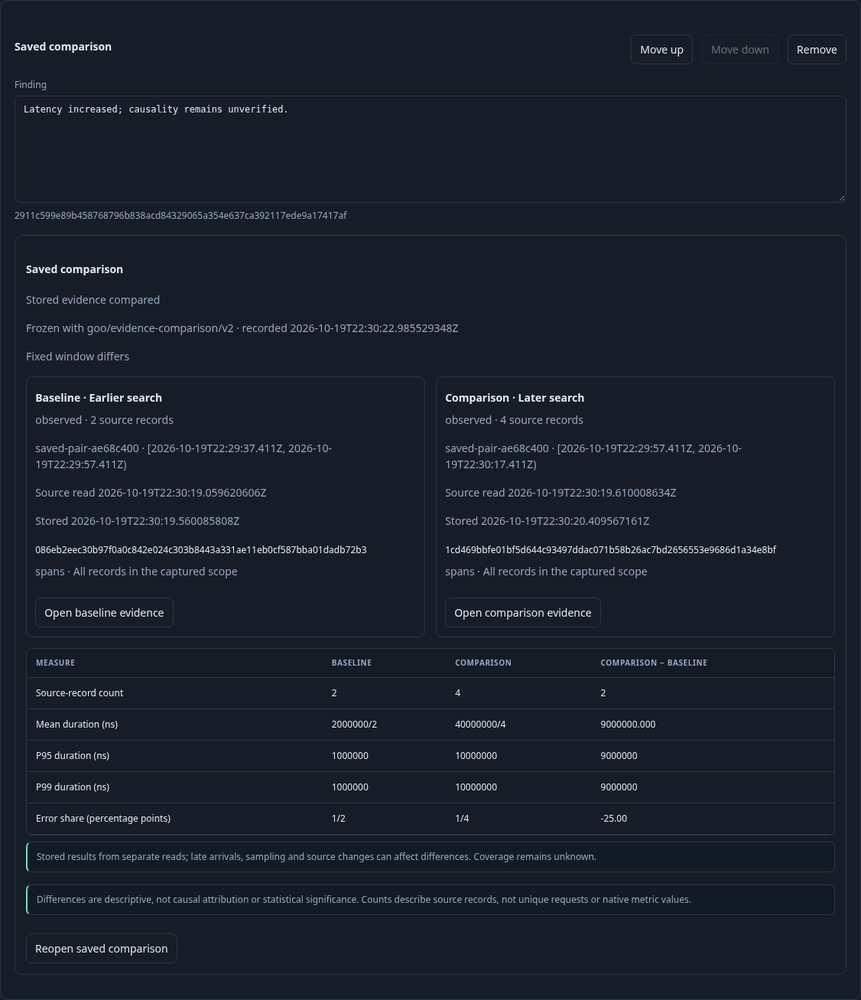
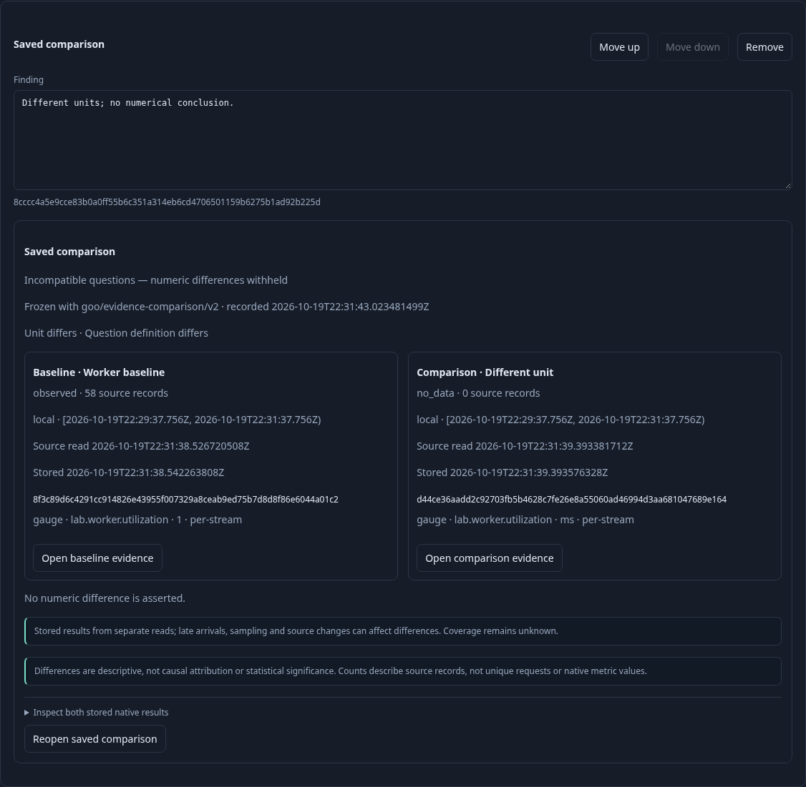

# Save and share a comparison

After comparing two linked captures, enter an optional finding and choose **Add
comparison to investigation**. Goo saves an immutable comparison receipt and adds
a card to the current draft. **Save revision**, then **Copy revision link**, to
share the exact investigation and finding. Recipients use the same Goo workspace;
this is not a public hosting or authorization feature.

The card keeps the receipt ID and authored finding. The receipt freezes both
capture IDs in baseline/comparison order, the compatibility decision, displayed
deltas, scope/read/custody metadata, warnings, comparison algorithm version and its
own server recording time. Editing the finding creates a child investigation
revision; earlier findings, comparison receipts and captures remain unchanged.
An incompatible or unavailable decision can be saved as evidence of why a numeric
conclusion was withheld. Saving never turns it into a comparable result.

## Publication and reopening

`POST /api/captures/comparisons` accepts two distinct exact capture IDs and the
comparison that was displayed. The Go server loads and validates both captures,
compares them with the versioned engine, rejects a changed/forged displayed result,
and publishes the frozen receipt. The client cannot assert its own decision or
delta. Receipt and request sizes are bounded to 128 KiB; oversized comparisons fail
explicitly instead of dropping streams or evidence. Narrow and recapture the
question if a complete snapshot exceeds that bound.

`GET /api/captures/comparisons/{id}/receipt` returns the stored snapshot after
integrity checks. Reopening an investigation automatically loads these receipts;
it does not invoke the current comparison engine or query telemetry. Even the
**Reopen saved comparison** retry reads the snapshot. A later engine revision must
not silently redefine an old decision. The current algorithm is
`goo/evidence-comparison/v2`; version 1 receipts remain readable without
reevaluation.

Saved cards reuse the existing comparison renderer, including both original
scopes, exact counts, span summaries and native gauge endpoints. Expanding native
results separately reads the underlying immutable captures; it may report those
captures unavailable without changing the frozen comparison. [Complete counter/histogram windows](NATIVE_WINDOW_COMPARISON.md) now support
validated rate and bucket-population comparisons. Lifecycle deltas, interval
realignment and statistical inference remain outside this feature.

## Failure recovery

If saving the investigation fails, the card and finding remain in the draft;
retry **Save revision** without recapturing or creating another comparison receipt.
If the draft or selected pair changes while a receipt is being saved, Goo refuses
to attach it to the changed context and reports its retained ID. Use **Link a saved
comparison by ID** to attach that receipt explicitly, then save the revision.
A 32-card limit likewise leaves a successfully published receipt recoverable.
There is no transaction across receipt and document publication and no mutable
latest investigation head. Findings are human interpretation, not verified causes.

Storyboard 53 uses standard OTel HTTP spans and live native worker gauges. It
shares a revision with a fresh browser, revises a finding, simulates a document
outage, changes the active draft during a real receipt publication, recovers the
retained receipt by ID, checks mobile containment and saves a unit mismatch.
Hegel state/swarm tests cover saves, forks, order and historical immutability;
Quint validates observed publish/reopen/failure transitions with six rejecting
controls; Bombadil reopens frozen cards through ordinary controls.

