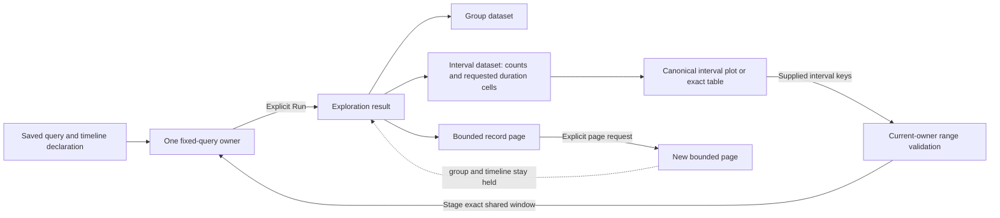

# Saved record timelines — 281, 287

A fixed composition can add a timeline beside its required aggregate and bounded
record table. In View settings, choose an interval width and **Add timeline**.
A width change stages the shared query; **Run population view** reads it. Adding a
timeline at an already supplied width is a local presentation change.

Choose Captured records, Mean duration or p95 duration. Duration choices require
an existing span question with `summary: "span-duration"`; changing presentation
never silently requests that summary or reads telemetry. The existing focused-signal
workflow makes recent span questions available for this authoring path.

Counts are captured records, not rates or an assertion of health. Duration values
come from raw spans evaluated per interval, not averages of stored percentiles.
Labels use human duration units; exact values, sample support and the empirical
quantile method remain available in tooltips and the exact table. An authored title
is retained; otherwise a duration plot uses its measure label.

UTC labels expose exact half-open interval boundaries. Unknown coverage stays
unknown. A valid measured zero differs from no duration data or no valid samples;
neither is replaced by zero. Complete-only checks admitted interval coverage,
independently of record-page bounds, group coverage, measure availability and
upstream sampling. The table shows all supplied fields and support; the measure
selector applies to interval plots.

Drag across intervals, or use Space, Shift+Arrow and Enter, to preview a range.
**Stage selected interval** stages one shared root window. Run refreshes records,
aggregate and timeline together. Reset stages the starting window and also requires
Run. If a finer width would exceed 240 intervals in the starting window, choose a
wider interval explicitly before Reset. Selections cannot cross unknown coverage
or missing buckets. Known intervals can be selected even when a duration cell has
no value; that selects time, not a claim about duration. Pending record selections
must be resolved before changing scope.



## Declaration

The optional third child is a typed `goo.view/1` declaration:

```json
{"timeline":{"version":"goo.view/1",
  "scope":{"kind":"record-query","signal":"spans"},
  "kind":{"name":"time-bar","version":1},
  "display":{"value":"duration.p95","requiresComplete":false}}}
```

`display.value` is `count`, `duration.mean` or `duration.p95`. Duration values require
`signal: "spans"` and the configured duration summary; Go validates support against
the existing measure fields. `table` is the other kind. An optional title belongs
in display. Exactly one aggregate and one records child are required, with at most
one timeline. Order and visibility are local, with at least one visible child.

The parent query owns `bucketMs`: 1000, 10000, 60000 or 300000, with at most 240
intervals. Buckets begin at the query start and the final bucket clips to its end.
There is no second width in the child. Whole-composition reuse requires equal
positive source/destination widths and destination measure support, including when
the timeline is hidden. Apply never silently changes the destination query.

Record paging retains the original group and interval snapshots and clocks. Saved
configuration contains no rows, witnesses, cursors or action authority. Hidden,
detached or retired mounts cannot stage windows. The checked action owner derives
bounds from contiguous known supplied rows rather than component milliseconds.

This profile is fixed-window and single-query. Numeric/native metric timelines,
rates, grouped time series, live subscriptions and arbitrary nested layouts remain
separate work. The HTTP service template keeps its two-child default.
