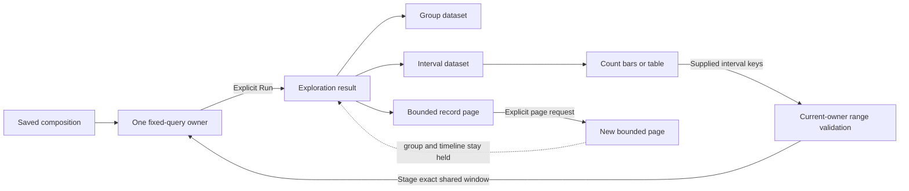

# Saved count timeline — 281

A fixed composition can add a count timeline beside its required aggregate and
bounded record table. In View settings, choose an interval width and **Add count
timeline**. A width change stages the shared query; **Run population view** reads
it. Adding a timeline at an already supplied width is a local presentation change.

The timeline shows captured record counts, not rates or an assertion of application
health. UTC labels expose exact half-open interval boundaries. Unknown intervals
stay unknown; a known zero does not mean healthy. Complete-only is checked against
the admitted interval coverage, independently of record-page bounds and group
coverage. Table and interval bars consume the same snapshot.

Drag across intervals, or use Space, Shift+Arrow and Enter, to preview a range.
**Stage selected interval** stages one shared root window. Run refreshes records,
aggregate and timeline together. Reset stages the starting window and also requires
Run. If a finer width would exceed 240 intervals in the starting window, choose
a wider interval explicitly before Reset. Selections cannot cross unknown coverage
or missing buckets. Pending record
selection drafts must be resolved before changing scope.



## Declaration

The optional third child is a typed `goo.view/1` declaration:

```json
{"timeline":{"version":"goo.view/1",
  "scope":{"kind":"record-query","signal":"spans"},
  "kind":{"name":"time-bar","version":1},
  "display":{"value":"count","requiresComplete":false}}}
```

`table` is the other kind. An optional title belongs in display. There is exactly
one required aggregate, one required records child and at most one timeline; order
and visibility are local configuration, with at least one visible child.

The parent query owns `bucketMs`: 1000, 10000, 60000 or 300000, with at most 240
intervals. Buckets begin at the query start and the final bucket clips to its end.
There is no second width in the child. Whole-composition reuse requires equal
positive source and destination widths, including when the timeline is hidden.
Apply never silently changes a query to make a saved timeline fit.

Record paging retains the original group and interval snapshots and clocks. Saved
configuration contains no rows, source witnesses, cursors or action authority.
Hidden, detached or retired mounts cannot stage windows. The checked action owner
derives bounds from contiguous known supplied rows rather than trusting component
milliseconds.

This profile is count-only, fixed-window and single-query. Native metric streams,
rates, grouped time series, live subscriptions and arbitrary nested layouts remain
separate work. The HTTP service template keeps its two-child default.
