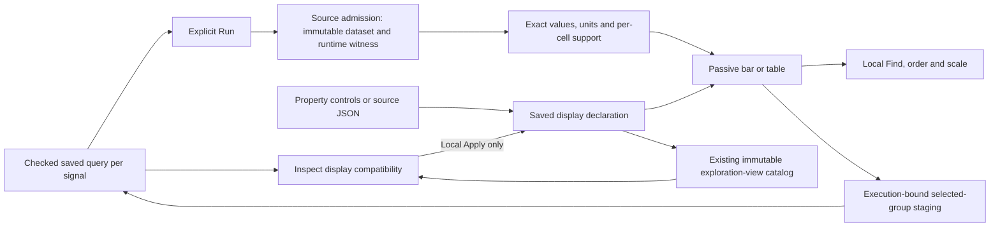

# Saved display declarations — 275–277

Use **View settings** to author a display; the existing **Preserve → Save exploration view** flow can save a reusable record-measure display
alongside its checked queries. Reopen it from **Saved exploration views**, then
**Run population view** explicitly. Browsing or reopening configurations does not
read telemetry. A saved view is configuration; captures preserve frozen evidence.

Choose **Reusable display** for an ordinary single-field span or log
breakdown. Switch bars/table, captured values/population share, Find and sort
locally. **Measure** selects count or a numeric/duration measure supplied by the
query. More options includes complete-groups-only. The **Display source**
disclosure edits the same declaration as these controls, including its title.
Apply source explicitly; invalid or unapplied text keeps the last good preview
and prevents saving. Invalid Find text likewise keeps the applied preview and
blocks Save until corrected. Resolve query drafts and staged facets before saving.

## One declaration and one source owner



`ExplorationView.displays` maps `spans` or `logs` to a pinned declaration. Its
scope references the parent query for that signal; it does not duplicate predicates.
For example, the parent query must have exactly one ordinary grouping:

```json
{
  "version": "goo.view/1",
  "scope": {"kind": "record-query", "signal": "spans"},
  "kind": {"name": "bar", "version": 1},
  "display": {
    "category": "category", "value": "count",
    "scale": "population", "order": "value-desc",
    "query": "", "title": "Requests by service",
    "requiresComplete": false
  }
}
```

Allowed kinds are `bar` and `table`, version 1. Scale `max` displays supplied values;
`population` is available only for captured record count. Order is `source`, `label`, `value-desc` or `value-asc`.
Find is bounded to 256 UTF-8 bytes, title to 120. Unknown fields are rejected.
The declaration stores no rows, private completeness witness, runtime execution
identity, or arbitrary script. `requiresComplete` is a requirement checked against
the admitted runtime dataset, never a claim supplied by the author. Local Find
and ordering preserve the full captured partition denominator.

Property and source edits retire pending save acknowledgements. A delayed response
may have created an immutable saved revision, but cannot label a changed draft as
saved. Group actions retain the current source snapshot and execution generation;
query drafts, staged selections, busy reads and withdrawn owners block continuation.

Queries and configured baselines retain exact typed environment policies, including
current-only/effective and empty/unreported values. Equality uses the checked
selector, not its display string. Reopening still requires an explicit telemetry read.

## Supported measures — 276

| Parent query intent | Allowed display values |
| --- | --- |
| Every eligible ordinary grouped record query | `count` |
| Checked `numeric` binding | `numeric.mean`, `numeric.sum`, `numeric.min`, `numeric.max` |
| `summary: "span-duration"` | `duration.mean`, `duration.min`, `duration.max`, `duration.p50`, `duration.p95`, `duration.p99` |

The declaration references the existing query's binding, scale and unit; it does
not create a new calculation. Go validates compatibility using the same measure
metadata that produces canonical dataset fields. The UI intersects allowed measures
with supplied fields. Switching measures is local and preserves the captured basis.
A missing numeric binding or duration summary is a configuration error. A supported
measure with no valid runtime values remains a valid display and shows unavailable
values with valid/missing/empty/invalid support, never an invented zero.

Non-count measures accept only `max` or omitted/empty scale. The renderer formats
duration nanoseconds in human units and retains exact values and empirical
`quantilesExactHigh` methods in detail. Quantiles describe captured spans; they
are not averages of service percentiles. Signed numeric bars fall back to an exact
table with an explanation while keeping the saved bar intent. Find/order and
complete-only requirements retain their existing semantics across measure changes.

## Apply to the current population — 277

In **Saved exploration views**, **Open original question** restores a saved fixed
configuration as before. **Inspect display** loads its configuration only and
checks each authored signal against the current fixed population. **Apply** reuses
that signal's display declaration; the current question stays authoritative.

| Compatibility | Rule |
| --- | --- |
| Every display | Same record signal and exact qualified grouped field; both checked queries and the declaration must be valid. |
| Count | Environment, time window, predicates and unrelated aggregate bindings may differ. |
| Numeric measure | Same field namespace/key, numeric type, decimal scale, unit and parser. No implicit conversion or field remapping. |
| Duration measure | Both queries request the checked span-duration summary. |
| Runtime availability | Missing/unknown values do not make valid intent incompatible; current data and witnesses decide rendering. |

Applying copies only detached display intent. It does not import the source view's
query, environment selection, filters, window, rows, clocks, completeness witness,
record layout, tail or baseline. Other signals retain their own configuration.
Tables currently include destination-supplied measure columns; this declaration
does not pin a custom column subset. The existing current dataset can redraw locally; a staged view still requires
explicit Run before showing telemetry. Save creates a new immutable configuration
with the destination queries; the original saved revision is unchanged.

Busy reads or pending comparisons, staged selections, unapplied query/source/Find
drafts and a configured target baseline comparison block Apply. Remove the baseline explicitly first;
applying a display must not silently discard a comparison. A delayed inspection
response cannot apply after the owner, query generation or draft revision changes.
The browser helper checks record-question metadata; it is not a standalone SQL
compiler. Go query compilation remains authoritative when saving.
The same catalog is available in the current population's settings, including
Activity-created grouped drilldowns, rather than a second view library.

## Deliberate boundary and next step

This authored profile supports count, numeric and duration measures over one
ordinary grouping. Recorded status fractions and native
metrics, numeric/duration histograms, grouped time series, pattern groups,
multi-field tables and authored baseline comparisons remain outside this profile.
Existing specialized screens continue to work; this is not whole-screen composition
or a WYSIWYG page builder. Source syntax is bounded JSON, without CEL/KCL evaluation.

The 276 product/architecture checkpoint and 277 current-scope reuse advance the
next task to one OTel service record template with a contextual Customize entry.
Broader chart kinds and page composition should reuse this workflow rather than
create a second configuration library.
