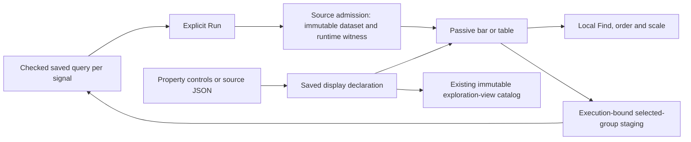

# Saved display declarations — 275

The existing **Save this exploration view** flow can save a reusable count display
alongside its checked queries. Reopen it from **Saved exploration views**, then
**Run population view** explicitly. Browsing or reopening configurations does not
read telemetry. A saved view is configuration; captures preserve frozen evidence.

Choose **Reusable count display** for an ordinary single-field span or log
breakdown. Switch bars/table, captured values/population share, Find and sort
locally. More options includes complete-groups-only. The **Display source**
disclosure edits the same declaration as these controls, including its title.
Apply source explicitly; invalid or unapplied text keeps the last good preview
and prevents saving. Invalid Find text likewise keeps the applied preview and
blocks Save until corrected. Resolve query drafts and staged facets before saving.

## One declaration and one source owner



`ExplorationView.displays` maps `spans` or `logs` to a pinned declaration. Its
scope references the parent query for that signal; it does not duplicate predicates.
For example, the parent query must have exactly one ordinary grouping:

```json
{
  "version": "goo.view/1",
  "scope": {"kind": "record-query", "signal": "spans"},
  "kind": {"name": "bar", "version": 1},
  "display": {
    "category": "category", "value": "count",
    "scale": "population", "order": "value-desc",
    "query": "", "title": "Requests by service",
    "requiresComplete": false
  }
}
```

Allowed kinds are `bar` and `table`, version 1. Scales are `max` (captured values)
and `population`; order is `source`, `label`, `value-desc` or `value-asc`.
Find is bounded to 256 UTF-8 bytes, title to 120. Unknown fields are rejected.
The declaration stores no rows, private completeness witness, runtime execution
identity, or arbitrary script. `requiresComplete` is a requirement checked against
the admitted runtime dataset, never a claim supplied by the author. Local Find
and ordering preserve the full captured partition denominator.

Property and source edits retire pending save acknowledgements. A delayed response
may have created an immutable saved revision, but cannot label a changed draft as
saved. Group actions retain the current source snapshot and execution generation;
query drafts, staged selections, busy reads and withdrawn owners block continuation.

Queries and configured baselines retain exact typed environment policies, including
current-only/effective and empty/unreported values. Equality uses the checked
selector, not its display string. Reopening still requires an explicit telemetry read.

## Deliberate boundary and next step

This first authored profile supports count only and one ordinary grouping. Native
metrics, numeric/duration histograms, grouped time series, pattern groups,
multi-field tables and authored baseline comparisons remain outside this profile.
Existing specialized screens continue to work; this is not whole-screen composition
or a WYSIWYG page builder. Source syntax is bounded JSON, without CEL/KCL evaluation.

Next, extend the same checked declaration/eligibility path to numeric and duration
measures already represented by the shared model. Preserve support, units,
unavailable values and completeness requirements before adding new editor controls.
Broader chart kinds and page composition should reuse this workflow rather than
create a second configuration library.
