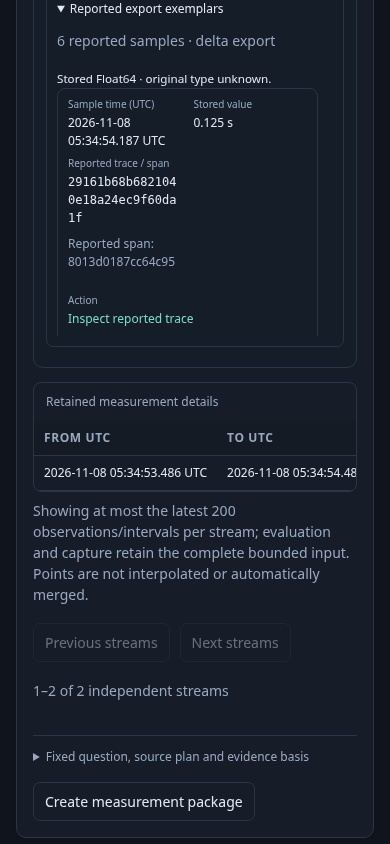
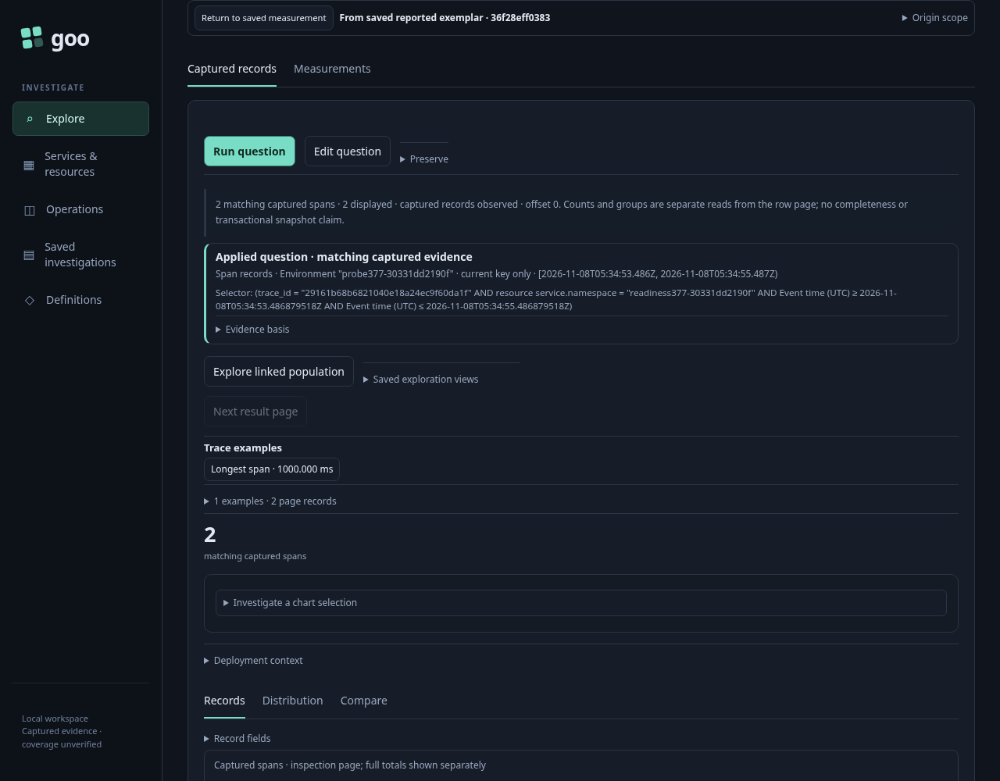

# Follow reported exemplars from Saved evidence

Select a retained histogram export in a Saved measurement, expand **Reported
export exemplars**, then choose **Inspect reported trace**. The existing fixed
question view stages the original environment, exact namespace and nanosecond
window without reading telemetry. **Run question** reads fresh spans by the
reported trace ID. Service, instance and metric predicates are omitted; the span
ID is a hint, not a filter. The trace population may span several services in
that scope, but does not claim a complete trace or causality.

The return bar identifies **From saved reported exemplar** and the capture ID.
Its disclosed citation retains the immutable receipt, original measurement,
stream, source basis/read clock, raw source-row occurrence, export start/end,
sample ordinal/time and reported trace/span IDs. Saving or sharing the child
record question alone does not preserve that native citation.

**Return to saved measurement** restores the same held capture, selected export,
disclosure, focus and scroll without a metric read or capture-store GET. Pending
child work is suspended and late responses cannot replace the restored owner.
Links become usable locally on return; immutable evidence does not need a fresh
measurement Run to reactivate them. Old callbacks remain retired.

Source-free does not mean no HTTP control traffic. Staging loads the existing
recipe/retention-status metadata; returning during a pending read sends the
existing upstream cancellation request. Checks admit only those bounded metadata
and cancellation routes, while requiring zero telemetry SQL and zero capture-store
GETs during stage/return. Ordinary Back has no additional requests.

## Admission and scope

The Saved owner detaches and freezes the authoritative receipt and result. It
recomputes the full exemplar plan from the held raw export and sample ordinal,
then compares the complete proposed relation, original question, basis and read
clock. Foreign/ambiguous exports, missing metadata, changed occurrence and invalid
trace references are unavailable. Distribution validity is independent: an
unknown numeric interval does not invalidate a retained reported association.

An explicit Saved-only rendering capability supplies these actions. It neither
pretends the capture is a live source adapter nor enables exemplar navigation in
service widgets. Those widgets retain their existing interval-only contract.
The existing planner and [reported reference limits](HISTOGRAM_EXEMPLAR_REFERENCES.md)
remain authoritative, including stored Float64 and unknown original scalar type.

```mermaid
sequenceDiagram
  participant U as User
  participant S as Saved capture owner
  participant P as Existing exemplar planner
  participant Q as Fixed question owner
  participant C as ClickHouse spans
  U->>S: Select captured export and reported sample
  S->>P: Recompute from immutable raw export and ordinal
  P-->>S: Checked relation and exact scoped trace question
  S->>Q: Stage question and full capture/export citation
  Note over S,Q: No source read; capture and DOM stay held
  U->>Q: Explicit Run question
  Q->>C: Fresh read of reported trace in original exact scope
  C-->>Q: Independent record evidence
  U->>Q: Return to saved measurement
  Q->>Q: Suspend child and retire late publication
  Q->>S: Restore same DOM, focus and local action lease
  Note over S,Q: No metric or capture-store read
```

See [the executable storyboard](../journeys/380-saved-exemplars-storyboard.md),
[validation](../VALIDATION.md), and the existing
[Saved interval contract](SAVED_NATIVE_RECORD_CONTEXT.md).




