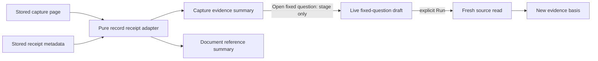

# Saved record evidence presentation

Capture pages and document capture references now use the same pure
`GooEvidenceScope.record` adapter and passive `goo-evidence-summary`. The visible
facts are signal/population, environment, original fixed UTC window and full source
count. Exact predicates, source read, immutable custody time and capture ID stay in
one disclosure. Full pages additionally report displayed rows/current offset,
retained inspection count and whether source records exceeded retention. Metadata
references do not invent page counts or a source basis absent from their receipt.

Count/page disagreement displays unknown with an explicit notice. Missing source
time never falls back to custody time. Counts remain decimal strings; inspection
pages never determine full totals. Oversized predicate summaries direct users to
the exact receipt instead of invalidating the entire display.

The record capture continuation now stages the original fixed question; Run is
required to reread. The saved receipt remains unchanged. Inventory and measurement
continuations retain their family-specific behavior. Rerun fixed question still
explicitly captures a new revision and preserves its predecessor.

The capture owner supplies the shared summary, so its embedded saved record viewer
suppresses its repeated introduction and scope block. Existing stored-page controls,
record inspection/selection, distributions, reusable-question creation, trace/log
context and retention continue through that viewer. Trace/log context remains a
separately named live read; it does not amend the stored capture.

This is the first saved-result consolidation cut, not full editor removal. The
hidden read-only editor remains a named compatibility consumer until result,
selection, numeric/grouped measures, paging, trace/surrounding context and package
creation are extracted with parity. Do not infer that all capture families now use
one universal result model or execution owner.

Journeys 32, 41, 45 and 50 cover capture paging/revisions, document reference reuse,
fixed staging and independently owned query drafts. The capture Bombadil actor
checks the summary's exact receipt/count/custody alongside immutable paging; Hegel
capture state/swarm and entry-state campaigns plus existing Quint/quint-go capture
and investigation ledgers protect the surrounding protocols. See
[actual validation](../VALIDATION.md) and [storyboards](journeys/README.md).

Saved record tables reuse the shared responsive record rows and now give native
captions the full mobile width. Journey 32 checks caption height as well as page
overflow; screenshot review remains necessary because narrow wrapping can pass
an overflow-only assertion.
