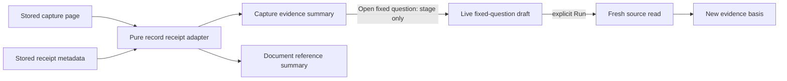
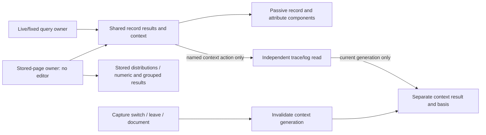

# Saved record evidence presentation

Capture pages and document capture references now use the same pure
`GooEvidenceScope.record` adapter and passive `goo-evidence-summary`. The visible
facts are signal/population, environment, original fixed UTC window and full source
count. Exact predicates, source read, immutable custody time and capture ID stay in
one disclosure. Full pages additionally report displayed rows/current offset,
retained inspection count and whether source records exceeded retention. Metadata
references do not invent page counts or a source basis absent from their receipt.

Count/page disagreement displays unknown with an explicit notice. Missing source
time never falls back to custody time. Counts remain decimal strings; inspection
pages never determine full totals. Oversized predicate summaries direct users to
the exact receipt instead of invalidating the entire display.

The record capture continuation now stages the original fixed question; Run is
required to reread. The saved receipt remains unchanged. Inventory and measurement
continuations retain their family-specific behavior. Rerun fixed question still
explicitly captures a new revision and preserves its predecessor.

The capture owner supplies the shared summary. `GooSavedRecords` now mounts only
stored result views, page controls, shared record inspection/selection, distributions,
package creation and explicit context. It creates no query builder, numeric measure
composer, question session or tail. Numeric/grouped results are rendered from their
stored values rather than repopulating hidden controls.

`GooRecordResults` is the shared application module for record/group tables and
trace/surrounding-log context. Live/fixed Explore and Saved instantiate independent
owners. Passive record/attribute/chart elements still have no source client. Context
reads enter through an explicit application callback, preserve their own query/basis,
and never amend a capture. Inspect record is the single attribute entry point in these tables; duplicate inline disclosures are removed. Close hides the detail slot and returns focus to the original row action. Selection and retention remain separate from inspection.

Switching captures, leaving Saved or opening a document invalidates pending context
publication. Stored primary rows remain independently owned. Generation invalidation
rejects old completions; this extraction adds no new upstream abort guarantee.
Legacy callers of `GooExploration.mount({readOnly:true})` delegate directly to the
saved owner before constructing an editor. The old saved paint/state path and live
editor's unused saved pager are removed. Other capture families keep their existing
presenters and execution contracts.

Journeys 32, 41, 45 and 50 cover capture paging/revisions, document reference reuse,
fixed staging and independently owned query drafts. The capture Bombadil actor
checks the summary's exact receipt/count/custody alongside immutable paging; Hegel
capture state/swarm and entry-state campaigns plus existing Quint/quint-go capture
and investigation ledgers protect the surrounding protocols. See
[actual validation](../VALIDATION.md) and [storyboards](journeys/README.md).

Saved record tables reuse the shared responsive record rows and now give native
captions the full mobile width. Journey 32 checks caption height as well as page
overflow; screenshot review remains necessary because narrow wrapping can pass
an overflow-only assertion.

Journey 107 uses real generic OTel spans and logs to prove the saved owner has no
query controls, follows wider trace and surrounding-log context explicitly, returns
keyboard focus, and rejects a held real response after switching captures. Every
source request and local transition is replayed through the existing Quint
read/history protocol with four rejecting controls. This validates read accounting
and observed coherence, not a new model of all trace completeness semantics.
