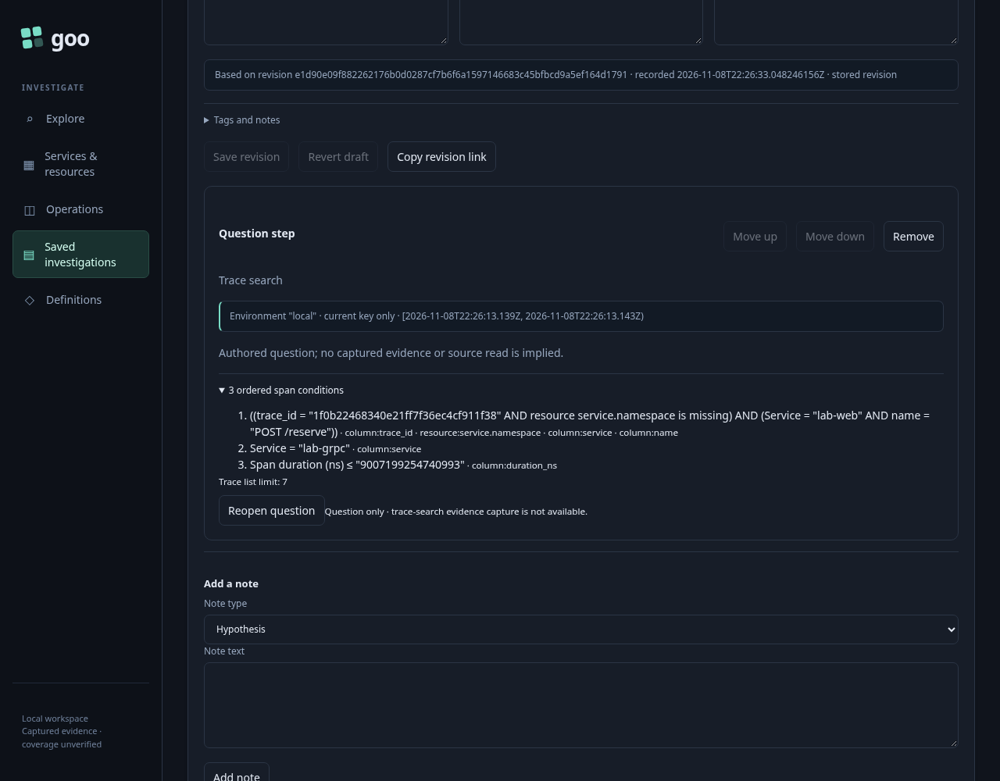
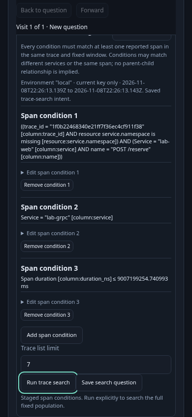

# Reuse a trace-search question

Trace search finds reported trace IDs whose spans satisfy a bounded set of
independent conditions. **Save search question** keeps that intent in the existing
investigation as a typed question card. Save the investigation revision, then
**Reopen question** to stage its full fixed request. Neither action reads telemetry.
**Run trace search** explicitly reads the selected source again.

A saved question keeps the environment policy and fixed window, ordered span
conditions, qualified fields, exact numeric strings and trace-list limit. Added
conditions can match other services. One span may satisfy several conditions;
matching a reported trace ID does not establish a causal path, a unique invocation
or a complete trace. The saved question is configuration, not captured search
results or witness evidence.

The card uses the existing typed step/link boundary with `kind: trace-search`,
a typed `traceSearch` request and `view: Traces`. Exactly one payload is admitted.
Mixed arms, foreign scope, native-only bounds, unknown fields and null coercions
are refused. Reopening can stage the search without requiring an applied record
result; it does not misrepresent a multi-span request as one ordinary predicate.
The normal record and measurement question flows remain available.

## Bounds and publication

The existing search limits remain one to four conditions, 64 total predicate nodes
and a trace-list limit of 1–100. Exact thresholds above JavaScript's safe integer
range remain strings. Saved search intent also respects the source endpoint's
64 KiB request budget. Search step links have a separate finite 256 KiB encoded
allowance so an admitted request can reopen; ordinary record/native link limits
are unchanged. No extra recipe registry or authoring format is introduced.

Save, reopen and Search callbacks belong to the current draft/visit/revision.
Edits, navigation, hidden controls and retired rendered cards cannot publish an
old search or run its stale request. Exact saved revisions remain immutable.
Metadata and investigation persistence are separate from telemetry reads.

**Run and capture** and **Capture search evidence** use the existing server-owned
capture workflow. Capture explicitly rereads the fixed request and stores its own
source basis, bounded witnesses and custody receipt. Compatible evidence can be
attached to the question card; an ordinary span page cannot substitute for a
search result. See [captured search evidence](CAPTURED_TRACE_SEARCH.md).

```mermaid
sequenceDiagram
  participant U as User
  participant S as Existing trace-search owner
  participant D as Investigation document
  participant Q as Typed fixed-step dispatch
  participant C as ClickHouse
  U->>S: Define span conditions and list limit
  U->>S: Save search question
  S->>D: Add typed search intent card
  U->>D: Save investigation revision
  Note over S,D: No telemetry read or witness capture
  U->>D: Reopen question from exact revision
  D->>Q: Checked complete fixed search request
  Q->>S: Stage conditions and original limit
  Note over Q,S: Source-free; no applied record result required
  U->>S: Run trace search explicitly
  S->>C: Existing bounded trace-search execution
  C-->>S: Fresh qualified witnesses and independent read basis
```

See [storyboard](../journeys/382-saved-trace-search-storyboard.md),
[review](reviews/SAVED_TRACE_SEARCH_REVIEW_382.md) and [validation](../VALIDATION.md).




