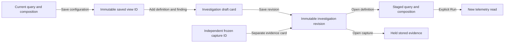

# Saved view findings — 282

An investigation can retain an exact saved view definition and an authored finding.
The definition records the checked query, component order, display choices and
interval width. It does not store the records or chart inputs previously displayed.

Save the current view, enter an optional finding and choose **Add saved view to investigation**. This stages a card in the existing investigation editor. Save its
revision to preserve it. If a view has unsaved changes, save those first so the
reference cannot accidentally point to an earlier configuration.

**Open saved view definition** restores that exact saved view in a staged state. Only Run
reads telemetry. Later reads can differ because telemetry arrived or expired.
Existing frozen capture and retained-evidence cards remain the way to reference
stored evidence; add them separately when a finding needs that support.



## Card contract

```json
{"kind":"view","reference":"<64-character saved view ID>",
 "caption":"Optional label","text":"Optional authored finding"}
```

The reference resolves to an existing immutable exploration view. A capture ID is
not a view definition. Caption and finding use the existing document bounds of
160 and 4000 UTF-8 bytes. A view card cannot carry question steps, capture evidence,
source bases, retained reviews or action authority.

The existing investigation destination, pending-note, recovery and revision guards
apply. Attaching a definition never saves the investigation automatically, replaces
another draft, queries telemetry or captures evidence. Definition metadata and
frozen evidence retain independent identities and clocks; displayed record pages
and aggregate snapshots are not combined into an atomic capture.
