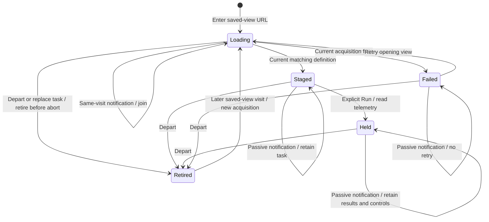

# Saved-view restoration

A saved exploration view is configuration. Opening its URL acquires the definition
and stages its exact questions; Run explicitly reads telemetry. A browser history
traversal can send both `popstate` and `hashchange`, but those notifications belong
to one visit, not two user requests.

The population workspace owns that visit locally. Repeated notifications for the
same active visit retain its pending request or its displayed task, including local
edits, held results and child inspections. This is not a saved-definition cache:
after departure, revisiting the same ID acquires its definition again.

A response must still own the visit, generation and exact route before it can
restore a question or display an error. Cancellation saves work; the ownership
check also rejects responses from sources that ignore cancellation. Observed
queued hash departures retire the old visit even when the current URL has already
returned to identical bytes. Response identity must match the requested view ID.

Only a current failed acquisition offers **Retry opening view**. Retry reacquires
configuration, reads no telemetry and replaces the old failure control immediately.
A retained button from a departed or replaced task cannot retry. Passive browser
notifications never retry a failed request.

The parent question editor is synchronized explicitly without invalidating the
population that requested restoration. Ordinary question changes still invalidate
that population. After the synchronization callback returns, the saved-view owner
checks its visit again before rendering. A departed pending load releases its
obsolete loading panel so the destination remains usable.

This change leaves source acquisition, immutable captures, query planning and
child-return behavior with their existing owners. It adds no global navigation
manager or data cache. See the [roadmap](ROADMAP_2026_11_05.md),
[architecture review](reviews/SAVED_VIEW_RESTORE_ARCHITECTURE_335.md) and
[design review](reviews/SAVED_VIEW_RESTORE_DESIGN_335.md). Validation is recorded
in [VALIDATION.md](../VALIDATION.md). Final source, full suites, generated schedules
and deployed browser/actor acceptance pass for this bounded contract.
