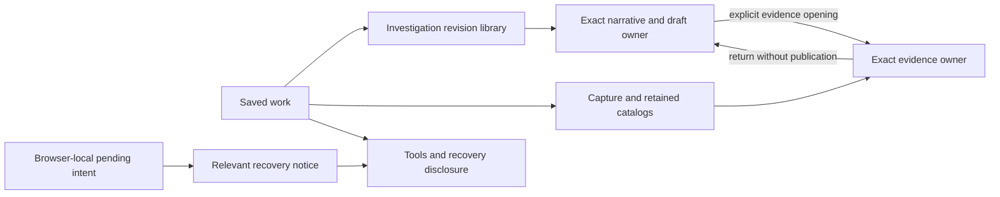

# Saved work: browse, inspect and continue

Implemented bounded follow-through from the whole-product coherence review.
Saved leads with **Browse investigations** and **Browse evidence**. The existing
revision and capture libraries retain their separate cursors, identities and
selected-detail behavior; this is not a unified cross-store search engine.

Browse investigations opens the narrative library and its loaded-page search.
Selecting a library row previews metadata; opening a revision reads that exact
stored document. Browse evidence exposes saved captures and collapses the notes
editor without discarding its draft. Retained selections remain a separate,
explicit catalog with current-head metadata snapshots, optional-store failure
states and exact opening. No source query or publication is triggered by changing
a disclosure or selecting catalog metadata.

Opening a capture collapses the notes panel and capture catalog. The selected
capture keeps its scope, receipt, evidence and explicit continuation actions.
Opening notes suspends the capture viewer. Opening retained evidence hides other
saved evidence views; leaving it invalidates a pending retained read so it cannot
reopen itself after another case is chosen. Draft text and exact document/capture
references remain with their existing owners. The active-investigation context
and Browse investigations return to the retained page-local draft.

## Secondary tools and relevant recovery

- General capture ID entry lives in **Open a capture by ID** inside the evidence
  catalog. Ordinary browsing does not lead with a raw-ID form.
- **Tools and recovery** contains cross-workbench annotation search, browser-local
  native retry recovery and operation-capture ID entry. Selected operation
  evidence and its refresh/receipt actions remain outside the tools disclosure.
  Invalid ID/read errors remain visible in the operation entry tool.
- A pending-save notice appears only when this browser has pending native intent.
  Opening it discloses recovery, without sending a retry. An unreadable journal
  exposes a recovery notice instead of silently hiding the problem. Forget/retry
  retains the existing original-request and acknowledgment contracts.
- Exact annotation links reveal their Tools destination. Existing capture,
  operation, document and retained-evidence links retain their IDs and readers.

`GooSavedWorkspace` owns disclosure/focus composition only. Documents own draft
and revision guards; capture readers own generations and stored pages; retention
owns manifests/reviews and visibility tokens; the native retry journal owns its
bounded intents. Display components remain passive. There is no new query engine,
global state store, storage migration, API effect or durability promise. Browser
reload still loses ordinary unsaved document drafts.

## Acceptance and remaining work

[Journey 117](../journeys/saved-workspace.spec.js) uses a real OTel log, immutable
capture and narrative revision. It checks metadata browsing, exact opening, a
finding draft retained across evidence inspection, mobile containment and zero
source reads/writes during these interactions. A valid local retry fixture is
shown without submitting it; a corrupt-journal case verifies visible failure.
[Selected evidence](journeys/screenshots/117a-selected-saved-evidence.png) ·
[Relevant recovery](journeys/screenshots/117b-contextual-pending-recovery.png).

Existing capture, notes, annotation and retention journeys cover stored-page
races, immutable successors, interrupted real retention acknowledgment, pinned
historical citations and optional-store failure. Their Go/Quint/Hegel checks and
expanded Bombadil actor remain the semantic regression evidence. The new
[Saved Bombadil actor](../verification/bombadil/saved-workspace.ts) exercises the
source-free task/disclosure path; it does not save or retry anything. Actual
executions and limitations are recorded in [VALIDATION.md](../VALIDATION.md).

A cohesive read-only case outline, global search across stores, durable drafts,
collaboration and a normalized investigation/evidence storage model are not
implemented by this presentation cut. Wider grouping of context within a selected
case should build on these owners and explicit references, not replace them.
