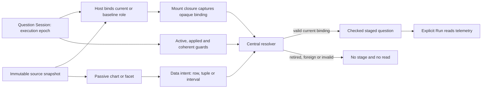

# Scoped action ownership — 266

271 adds `context.duration(binding, intent)` for exact supplied duration ranges
and `context.canAct(binding)` for app-owned manual bounds. Both check the same
captured source/role/epoch; arbitrary manual bounds do not claim bin membership.
See [duration contract](SCOPED_DURATION_HISTOGRAMS.md).

269 extends this ownership model to [fixed numeric histogram ranges](SCOPED_HISTOGRAMS.md).
`context.histogram(binding, intent)` resolves ordered supplied keys to captured
coefficient geometry for the Go planner. It does not construct threshold
predicates. Hosts recheck the same binding after asynchronous planning; generic
group/window staging, inspection and row projections refuse this shape.

A data revision describes immutable contents. It is not permission for an old
view to change the current question. Two executions can return the same revision,
and a baseline can contain the same data as the current selection.

The scoped group and interval adapters now capture a host-owned binding when they
mount. The resolver checks that binding immediately before returning a staged
question. Passive display elements continue to receive snapshots and emit data
intents; they neither own execution state nor read global current scope.



## Ownership rules

- Each context owns private role/slot bindings. Rebinding a slot retires its old
  binding even when the exact same snapshot object is reused.
- The Session execution generation is separate from the snapshot's content basis
  and `scope.generation`. Changing the question, starting another run or cancelling
  invalidates bindings from the previous execution.
- Leaving or suspending the fixed view and switching to recent/population mode
  revoke bindings explicitly. Returning to the same contents does not revive old
  mount closures.
- Baseline bindings are distinct from current bindings. Replacing a baseline does
  not revoke an unrelated current slot; a baseline cannot stage into current scope.
- The resolver derives a question from the captured immutable scope. It does not
  reinterpret an old intent using the latest global question.

The host still owns request publication, cancellation, visibility and source
admission. This module does not replace Question Session or the H0 snapshot trust
boundary. A returned command is consumed synchronously by the host. An extension
that awaits before applying an action must resolve again after the await.

## Host API

```js
import {createActionContext} from './scope-actions.mjs';
const actions = createActionContext({
  epoch: () => session.snapshot().generation,
  active: () => hostIsActive(),
  canStage: () => session.snapshot().phase === 'applied',
});
const binding = actions.bind({
  role: 'current', slot: 'groups',
  epoch: session.snapshot().generation,
  snapshot, question: snapshot.scope.selector, coherent: true,
});
// Capture binding in this mount, never look up a newer binding inside the callback.
function onScope(intent) {
  const command = actions.resolve(binding, intent);
  if (command.ok) stageQuestion(command.question); // synchronous; no source read
}
// On leaving the visit, withdraw its action affordances too.
actions.revoke();
```

`bind` requires explicit `current`/`baseline` role, `groups`/`intervals`/`summary`
slot, numeric host execution epoch, admitted snapshot, matching checked question
and coherence boolean. Its frozen public role/slot/epoch/snapshot facts are not
serialized authority: copying the object does not copy its private binding.
Current source slots share one private source instance in an execution. A foreign
current source instance is rejected even with an identical logical source label;
baseline inspection remains independent. Multiple active source contexts require
separate owners in this cut.

`resolve(binding, intent)` returns either `{ok: true, question, label, role, slot,
epoch}` or `{ok: false, code, reason}`. It does not throw for an invalid action;
invalid binding construction and projection setup throw `ScopeActionError`.
`project(binding, selectRows(snapshot, keys))` creates a direct derived binding;
`revoke()` retires every binding in that context. Membership intents are closed
plain data with bounded text, depth and node inspection. Question validation also
uses the existing predicate limits; a full parent predicate is refused when an
additional refinement would exceed its budget, rather than silently truncating it.

## Checked actions

| Intent | Required supplied evidence | Result |
| --- | --- | --- |
| Group facet | Declared group dimension, supplied typed value, correct equality/missing operator | Add a predicate to the bound question |
| Group tuple | Stable row key and all matching supplied dimension values/operators | Add the complete tuple predicates |
| Interval | Stable known interval key and exact supplied half-open bounds | Narrow the bound window to that interval |

Every action must match dataset ID, revision, scope identity and content generation
in its binding. The resulting question resets record paging and passes the existing
record-question and predicate validators, including their budgets. Checked
environment policy, numeric bindings and measurement intent remain intact.
Selection identifies a refinement; it is not an attested list of member records
and cannot authorize keeping those records.

Source completeness and action authority remain separate. A coherent partial
source result can identify a known supplied member without proving full query
coverage. A complete source result in a retired or baseline binding cannot act on
the current question. Source guarantees are never upgraded by binding or staging.

## Projection and trust limits

A proper local row projection remains incomplete. An explicit derived binding can
use only an admitted direct projection of its captured parent, with matching
private lineage, source instance, immutable scope/fields and shared row identity.
Retiring the parent retires the derived binding. Imported or serialized copies
cannot supply that lineage. Passing every row is the H0 no-op and retains the
parent binding.

These checks validate data claims against a host-captured context. They are not
proof of a human click, producer authentication or replay protection against
trusted JavaScript that deliberately mints another valid action. Normal staging
changes the Session epoch, so a second use of the old mount cannot retarget the
new draft. The pure resolver performs no source reads, navigation or publication.

## Bounded adoption

This cut covers canonical scoped group/facet and timeline staging in fixed Explore.
Saved results remain read-only, with explicit fresh-question reuse. Population,
legacy distribution/error-triage and other noncanonical action families retain
their existing owners and need deliberate migration before claiming whole-product
centralization. No new controls, renderer or editor are introduced here.

267 delivers [ordinary Distribution consolidation](ORDINARY_BREAKDOWNS.md) with
typed partition/denominator semantics before replacing full-population shares.
The specialized families retain explicit owners until deliberately migrated.

`inspect(binding, selectionIntent)` shares the current-role/source/epoch/coherence
and known-member guards, but returns the captured immutable parent question and
supplied aggregate row without adding a predicate. This permits a trace-context
read even when refining the parent would exceed its filter budget. It performs no
read itself and grants no verified record membership or Keep authority. The host
still validates a trace-ID dimension/identifier and builds the explicit trace
question. Staging remains a separate `resolve` operation with its original limits.
