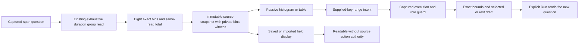

# Captured span-duration histograms — 271

Duration-count Distribution and Activity latency now use the same immutable
`goo.dataset/1` histogram, table and typed range display as numeric histograms.
The adapter owns source access, exact bounds and population actions. The display
never fetches, subscribes or reads the current global question.



## Data contract

`shape: 'histogram'` requires a discriminated `histogram` descriptor. Numeric
histograms explicitly declare `kind: 'numeric'`; span durations declare:

```json
{"kind":"span-duration","binning":"goo-duration-v1","unit":"ns","total":"11","closure":"left-closed-right-open"}
```

Duration has no numeric binding or parsing support: every captured span contributes
one duration. The denominator is the checked uint64 sum of the same exhaustive
group read, independent of the displayed record page or another count read.
Eight ordered rows partition the exact nanosecond edges:

`0, 1000000, 5000000, 10000000, 50000000, 100000000, 500000000, 1000000000, +inf`.

`from` and `to` use the `histogram-bound` field type, unit `ns`. `+inf` is legal
only at the last upper edge. Infinity is not a missing value or an integer maximum.
Counts are canonical uint64 strings; positive bins are observed, known zeros are
no-data. Missing categories become zero only after an exhaustive coherent group
read. Unknown, null, duplicate or overflowing groups withhold the histogram.
A no-data source with positive group total, or observed source with zero group
total, is inconsistent and also withheld. No extra source read is introduced.

Labels use ns/µs/ms/s and retain exact bounds in disclosure. Equal-width bars show
counts in unequal duration ranges, not density. All eight bins remain visible.
The table uses the same data. Full-only display requires a private `bins` witness;
serialization or import cannot create that witness. Row projection is refused.

## Interaction contract

The passive chart emits ordered supplied keys. `context.duration(binding, intent)`
checks the captured source, current role, execution epoch, question coherence and
identity before returning exact millisecond bounds. The final bin has an open
upper bound. Zero-count selections remain valid empty populations.

Manual exact bounds use the same captured-owner gate without pretending arbitrary
bounds are supplied bin edges. Editing bounds clears the old painted brush.
Selected/rest actions retain the parent window and predicates. Local chart/table,
brush and draft changes read nothing; explicit Run reads. Hidden, replaced,
suspended or disposed owners cannot resume effects from an old DOM node, even if
a new read has identical contents. Saved views remain readable and read-only. Returning to a retained visit restores
focus to its enabled origin control, or to Run when the origin was revoked.

Duration-count Distribution removes its duplicate bucket-facet list. Non-count
metrics, categorical duration comparisons and Activity baseline comparisons retain
their explicit specialized presenters; they are not numeric histogram pairs.

## Boundaries and next work

This is a raw-span partition. Native OTel histograms count instrument observations,
use right-closed explicit buckets, and retain interval/temporality/reset/gap
semantics. They need a separate descriptor and compatibility rules before shared
adoption. Do not infer contributor spans, invent zero observations for gaps, or
interpolate a precise percentile from a bucket range. Renderer/editor expansion
still follows the remaining V0 adoption gate.

See the [executable storyboard](../journeys/271-duration-histogram-storyboard.md)
and [validation record](../VALIDATION.md) for actual checks.
