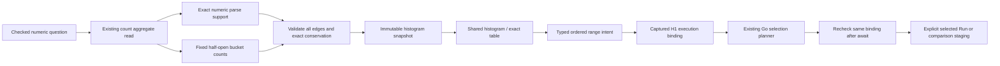

# Exact numeric histograms in scoped views — 269

270 extends this foundation to [independent aligned comparisons](SCOPED_HISTOGRAM_COMPARISONS.md),
with explicitly different captured-record and valid-value share denominators.

Fixed numeric histograms now use the same immutable dataset and passive
`goo-chart` contract as other scoped displays. The existing Go numeric selection
planner still owns selected/rest questions and comparisons. This cut covers
`numericHistogram: {binning: 'powers-of-two'}` over checked integer/decimal
bindings. Native OTel histogram streams and categorical span-duration buckets
retain their distinct presenters and semantics.

## Geometry and support travel together

Explore returns `histogramDataset` with `shape: 'histogram'`. Its `histogram`
descriptor declares the checked numeric `binding`, `binning: 'powers-of-two'`,
`closure: 'left-closed-right-open'` and exact population `support`:
`total`, `valid`, `missing`, `empty`, `invalid`.

Rows have stable `bin:<index>` keys and exact `from`, `to`, `count` fields. Edges
are reduced rational strings in the binding's human unit; counts are canonical
uint64 strings in captured records. Integer bindings have scale zero; decimal64
edges divide coefficients by the declared power of ten. Every fixed bin is
present, including known zeros. The 65 unsigned or 128 signed/decimal bins must
match the complete schema in order. Their counts sum to **valid**, while the four
support classes sum to **total**. Missing/empty/invalid records are not zero-valued
observations and do not disappear from coverage.

The exclusive max+1 edge is geometry, not a representable numeric predicate
threshold. For example, the unsigned top edge is 18446744073709551616. Decimal
human bounds are never passed to a coefficient predicate. The pure action guard
resolves supplied keys into coefficient indices/bounds; the Go planner handles
domain sentinels when constructing checked predicates.

## Display does not redefine the measurement

The `histogram` kind uses equal-width ordinal bars for unequal numeric ranges:
heights are counts, not density. It hides only outer zero bins; interior zero
bins and original indices remain intact. Exact decimal labels avoid converting
large boundaries or decimal coefficients through floating point. The shared
Exact values disclosure retains every bin and raw exact boundary. The compatible
`table` kind consumes the same handle without a source read.

An empty captured population has zero support and known-zero fixed bins. A
positive population with no valid parsed values also has zero bin counts, but
displays **No valid numeric values** and its excluded support. Unknown or malformed
source data cannot manufacture empty bins. Held imports retain supplied exact
values with unknown provenance; private `bins` coverage is required for a
complete-only display. Dropping rows is not a supported histogram projection;
local trimming preserves the full fixed schema. No valid-population share or
density calculation is added by this cut.

## Effects stay with the host

The passive element emits `goo-histogram-range` with a `scope-histogram` intent,
snapshot identities and inclusive ordered `fromKey`/`toKey`. Drag, keyboard range
selection, exact tables and local highlighting perform no source reads.
`context.histogram(binding, intent)` validates the captured current execution,
role, source, scope and membership before returning planner inputs. The adapter
rechecks the same binding and intent after asynchronous planning. A replacement
binding, suspended visit or same-content rerun cannot revive an old action.

Existing selected-population Run, selected-versus-rest count/numeric comparison,
explanation, Saved and reusable-package workflows remain. Rest includes excluded
parse classes. Returning to retained data is source-free; after withdrawal a new
explicit parent Run is required before effects resume. Saved range highlighting
is local only, with no planner, Run, comparison staging or explanation actions.

The histogram is produced from the existing count aggregate with no extra reads.
Separate source disagreements conservatively withhold complete coverage. Ordinary
group/time/summary histogram-query adoption and aligned comparison/native/duration
families remain explicit follow-up work. See the
[storyboard](../journeys/269-scoped-histogram-storyboard.md) and
[validation](../VALIDATION.md) for checks actually executed.
