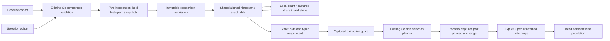

# Independent histogram comparisons — 270

Aligned numeric histograms now consume two canonical histogram snapshots through
`goo.histogram-comparison/1`. The operands retain separate questions, support,
content revisions and optional capture times. There is no merged population,
combined capture clock, rebinned distribution or pooled percentile.

## Exact operands and explicit denominators

`CohortComparison.histogramComparison` contains `baseline`, `selection`, `state`
and, for diagnostics, `reason: 'source-reads-disagree'`. Each operand uses the
[fixed histogram contract](SCOPED_HISTOGRAMS.md). The entire numeric binding,
including its field/type/scale/unit/parse policy, must match; signal, environment
and every fixed edge must align. Filters and fixed windows may differ.

The shared `goo-aligned-histogram` element accepts an immutable `.comparison`
and closed `.display` options. `scale` explicitly selects:

| Scale | Value | Interpretation |
| --- | --- | --- |
| `count` | Exact captured count per bin | Both sides share the maximum from both full operands |
| `population-share` | Bin count / that side's total captured records | Existing share semantics; sums can be below 100% when parsing excludes records |
| `valid-share` | Bin count / that side's valid parsed values | Conditional distribution of valid values; distinct from captured-record share |

The two percentage modes use a fixed 0–100% scale. Exact rational percentages,
support and signed differences remain available in the full aligned table;
plotting coordinates are separate approximations. Only common outer zero bins
are hidden, so the same bin stays at the same position on both sides. Equal-width
bars represent unequal numeric ranges: these are counts/shares, not density.
Changing scale performs no source read and never alters the frozen operands.

`no_data` means at least one captured total is zero, rather than globally unknown
counts. That side's counts are known zero and its percentage denominator is
unavailable; the other side remains independently displayable. A positive total
with no valid values has known zero population shares and unavailable valid-value
shares. Diagnostic comparisons retain supplied counts and coverage while
withholding shares, differences and range actions.

## Custody and source coverage

The Go envelope is produced from validated supplied cohorts with no extra source
reads. Its operands are browser-held evidence with unknown source extent and no
completeness proof. Missing capture times stay missing; changing a clock does not
change content identity. Source-basis strings are descriptive caller claims.

Raw JSON/SSR input is bounded, validated and conservatively imported into frozen
handles. Ordinary properties preserve already admitted handles. The HTTP
comparison adapter always imports operands as held, including prebranded source
objects supplied by application code. A hard `requiresComplete` display needs
both runtime `bins` witnesses; serialized metadata cannot grant those witnesses.
Independent scope/capture disclosures and parse support stay visible.

## Explicit side continuation

The element emits only a side name and typed histogram range intent. The host's
`createHistogramComparisonActions` captures the immutable pair. It validates the
chosen operand, exact supplied membership and nonzero selected count; it resolves
coefficient geometry for the existing Go planner without turning max+1 into an
illegal threshold. A held baseline is not relabeled as a current H1 source.

The adapter checks the same controller/intent before and after asynchronous
receipt loading and planning. Loaded questions and retained content must match
the displayed pair; a same-question replacement is insufficient. Route changes,
closed disclosures, replacement pairs and explicit invalidation cancel pending
work. Saved operands and receipts remain immutable; an owner can still offer
explicit continuation into fresh work. Clicking **Open baseline range** or
**Open comparison range** invokes the source-free planner and then reads that
selected fixed side. Brushing, scale changes and inspecting exact values do not
read telemetry. There is no separate automatic read merely because data arrived.

This cut preserves existing numeric summary/comparison and capture workflows. It
does not convert native OTel histograms or categorical duration buckets, change
their temporality, or claim causal/statistical significance. See
[the storyboard](../journeys/270-histogram-comparison-storyboard.md) and
[validation](../VALIDATION.md) for checks actually executed.
