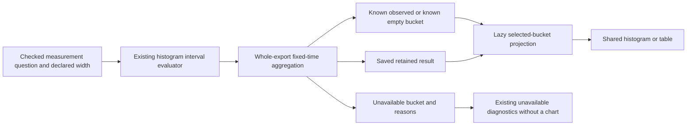

# Selected native histogram time buckets — 273

This extends the implemented [native interval contract](SCOPED_NATIVE_HISTOGRAMS.md)
to one selected fixed-time bucket, without changing evaluation or adding reads.

## Scope and coverage

The explicit `measurement-time-bucket` selector contains the checked measurement
question, complete stream identity, exact `fromNS`/`toNS`, declared `widthNS` and
zero-based `bucketIndex`. Windows are anchored at the question's exact start;
the final bucket is clipped to its exact end. The declared width remains visible
in scope even when the final window is shorter. Time windows are half-open;
instrument value buckets keep their separate right-closed semantics.

The projection validates the derived time result's window and width, and its
source-basis chain back to the retained evaluated histogram result. Original and
derived stream membership must be unambiguous. It uses the original derived
bucket rather than the timeline's display proxy. No total comes from the export
row count, timeline cap, another stream or a previously selected bucket.

A fixed-time bucket can be wider than the per-export maximum gap. Several valid
whole exports may cover it contiguously; applying the single-export duration
limit to the aggregate would reject legitimate data. Existing Go aggregation
continues to own coverage, cumulative differencing, overflow, layout and crossing
checks. The display projection does not split increments, interpolate, merge
streams, recompute percentiles or re-run the evaluator.

Positive `observed` buckets have no diagnostic reasons. A known zero `no_data`
bucket retains the evaluator's canonical `empty-distribution` reason and all zero
counts. Unavailable buckets expose their reasons without a partial histogram or
an earlier known-value fallback. Known local coverage does not establish complete
collection over the measurement's whole window.

## Display and ownership

`HistogramTimeView` in Go and its pure browser counterpart project only the
selected retained bucket. The existing `otel-explicit` observation descriptor,
exact binary64 bounds, infinite tails and histogram/table displays are reused.
Counts remain observations per selected time window, not rates. Short final
windows must not be silently normalized or treated as equal traffic exposure.

Switching time/export views, selecting a bucket or changing display kind reads
nothing. A matching live request owner may admit the source projection; Saved
and default callers remain held without private completeness. Native datasets
continue to refuse record-population bindings. Context links, heatmaps, native
window comparisons and explicit compatible merges retain their existing owners.

The old selected-time-bucket table is replaced by the shared display. The app
keeps the original source series while its timeline uses a transformed time view;
full stream identity resolves the matching derived series, including reordered
inventories. Ambiguous or foreign membership is refused.

Actual checks and generated user journeys are recorded in [VALIDATION.md](../VALIDATION.md).

See the [real instrument storyboard](../journeys/273-native-time-histogram-storyboard.md).
