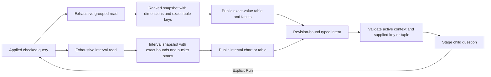

# Scoped intervals and grouped tuples — 262

263 extends this contract to [numeric and latency measures](SCOPED_MEASURES.md).
The262 delivery below describes the interval/count foundation.

The shared display contract now covers count time series and one/two-field count
breakdowns. This extends [the first scoped-view pilot](SCOPED_VIEW_PILOT.md), not
a new query engine, Plotly integration or complete visual-authoring system.

## User flow

Run a fixed span/log question with a time bucket. **Intervals** shows captured
record counts over half-open UTC intervals; **Table** shows the exact same values
and interval states without querying. Select an interval with pointer or keyboard,
then **Stage selected interval** and Run explicitly. The child retains the parent's
environment selection, predicates, grouping and bucket settings, narrowing only
the time window and resetting pagination. Existing advanced region investigation
remains available without opening automatically on every selection.

For ordinary two-field count breakdowns, the shared table shows every dimension.
A selected row stages the conjunction of both values; each facet stages only its
own field. Missing and present-empty values remain distinct. Multi-dimensional
plots are refused until a series/facet mapping can represent every dimension.
Dedicated service/type triage action tables remain on their existing presenter;
this is not a claim that every grouped presenter has migrated.

## Data and quality

`goo.dataset/1` now has `ranked` and `time-series` shapes. There is one canonical
prerelease format; no alternate legacy reader is added. Go `ViewValues` is an exact
string/null map, with declared field types; numeric strings do not pass through
float conversion in the data model. Ranked snapshots declare `dimensions`;
`groupIntent` emits the full checked row tuple, not an inferred label-to-field map.

Time snapshots declare `interval: {fromMs, toMs, bucketMs}` using exact decimal
millisecond strings. Timestamp fields are typed `timestamp` with unit `ms`.
Rows declare exact start/end/count and one of these states:

| State | Meaning and presentation | Scope action |
| --- | --- | --- |
| `observed` | Positive captured count, exact label/table and proportional interval mark | May stage its supplied window |
| `no_data` | Known zero captured records in this exhaustive query read; baseline mark, health unknown | May stage its supplied window |
| `unknown` | Count absent/null; hatched interval, never zero | May inspect locally; aggregate-item window staging refuses |
| Omitted interval | Unreported coverage gap; no invented data row/count | No supplied key to select; coverage remains unknown |

Intervals are anchored to the query start. The final clipped bucket has its true
width; the renderer does not imply a constant rate or connect bucket totals with
a continuous line. Exact interval arithmetic precedes approximate pixel geometry.
UTC labels/tooltips and the accessible table preserve the exact supplied boundaries.

Complete-only interval rendering needs a matching `intervals` attestation **and**
continuous known bucket coverage over the declared window. A matching total, page,
or attestation with a gap/unknown row is insufficient. Group completeness uses
`groups` independently. Go attests only the named result aspect after the existing
bounded exhaustive read and validation. Unknown upstream sampling/ingestion and
nontransactional count/page/aggregate reads remain separate facts. Diagnostic
changed-between-read results cannot drive narrowing. This cut adds no source read.

Native metrics, scalar latency summaries, numeric aggregates and grouped time
series retain their existing semantic presenters. Per-cell statistical bounds,
measurement error, correction history and native temporality are not flattened
into this count-only representation. Live subscriptions, saved view definitions
and WYSIWYG composition remain future work.

## Components and execution ownership

`goo-chart` supports `table` and `time-bar` for time snapshots; ranked native
bar/numeric-line contracts remain. Table mode displays all declared fields.
`selectionIntent` identifies a supplied key; `intervalIntent` emits `scope-window`
with that key and exact bounds; `groupIntent` emits `scope-group` with all declared
dimension predicates. Every intent carries dataset/revision/scope/generation.

The application rechecks the current active applied snapshot, validates supplied
values/bounds, and stages through the existing fixed-question owner. The controls
never fetch, navigate, subscribe or publish. Staging validates predicate budgets
and reports refusal without an uncaught exception. Retired controls cannot stage
a new active question. Checked current-only/effective environment policies are
copied intact, never replaced with a name or wildcard.

## Verification and next work

[Executable storyboard](../journeys/262-scoped-intervals-storyboard.md) uses actual
OTLP spans through ClickHouse and a generic Go runtime. It exercises clipped
intervals, exact values/table switching, keyboard selection, multi-field narrowing,
retired controls and checked-selector Saved reuse. Bombadil actions follow the
same UI and require observed completion with reads only during Run phases.

Go generated partition/cardinality checks, pure JS contract negatives, standalone
Chromium SSR/detached/component conformance, Hegel-generated operations and an
observed Quint effect replay cover the corresponding boundaries. Actual outcomes
are recorded in [VALIDATION](../VALIDATION.md), not implied by this list.

Next: represent numeric/latency measure support and richer quality in the same
contract, migrate their existing interactions without flattening units or support,
and reconcile the remaining widget-family mapping before adding Plotly or a
persisted composition editor.
