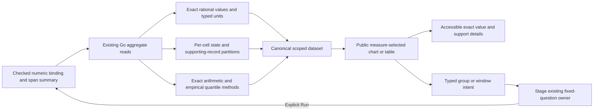

# Exact measures in scoped views — 263

264 extends this foundation to [population summaries and comparisons](POPULATION_MEASURE_VIEWS.md).
268 adds [status counts and same-row recorded-error fractions](STATUS_FRACTIONS.md),
whose class accounting is separate from numeric parse support.
The263 delivery below describes its original grouped/interval scope.

Numeric and span-duration group/interval results now use the same public snapshot
and display contract as counts. **Measure** switches between record count, numeric
mean/sum/min/max, and span mean/min/max/p50/p95/p99 without querying. **View as**
switches compatible chart/table presentation over that same captured basis.

Select a group or interval, inspect its value and contributing records, then stage
and Run explicitly. The child preserves the declared numeric binding, scale, unit,
summary method, predicates, environment selection and the chosen display measure.
This extends [count intervals and tuples](SCOPED_INTERVALS.md), not a second query
planner or a complete saved-view grammar/editor.

## Exact values and statistical meaning

Aggregate fields declare `type: rational`, a unit, and `aggregation` metadata.
Values are canonical signed integer or reduced numerator/denominator strings.
There is no float conversion in the data model. Plotting coordinates are separate
finite approximations; compact labels mark representational rounding with `≈`.
Exact values remain selectable inside keyboard/touch-accessible cell disclosures,
as well as tooltips. Durations display in human units; raw rational nanoseconds
remain available for precision and reproducibility.

| Measure | Exact representation | Method and support |
| --- | --- | --- |
| Numeric mean | `sum / (valid × 10^scale)` | Exact rational arithmetic over valid parsed values |
| Numeric sum/min/max | Coefficient divided by `10^scale` | Exact aggregate in the binding's declared unit |
| Span mean | `sumNs / count` | Exact rational arithmetic over captured span records |
| Span min/max | Integer nanoseconds | Exact extrema over captured span records |
| Span p50/p95/p99 | Integer nanoseconds | `quantilesExactHigh`, exact empirical captured quantiles |

Quantiles are never averaged to form a fleet percentile. Exact empirical
quantiles do not establish complete production telemetry, a confidence interval or
an SLO. Upstream sampling/ingestion remains unknown. Numeric exporter strings must
still satisfy the declared strict canonical parse; the display does not infer
original OTLP types, convert units silently or reinterpret invalid values.

Each aggregate field has `aggregation: {family, kind, method, quantile?}`. Each row
has `cells[field]` with a state and exact supporting counts:
`total`, `valid`, `missing`, `empty`, `invalid`. Their partition must sum to total,
and total must match that row's captured-record count. Duration support counts
captured spans; numeric means divide by **valid**, not total, and retain missing,
empty and invalid partitions independently.

For example, five records with values `1.20`, `2.40`, absent, empty and `bad` under
a decimal64 scale2 USD binding yield mean **9/5 USD**, displayed as1.8 USD, with
**2/5 valid**,1 missing,1 empty and1 invalid. That information is inspectable in
both the chart selection and table. A signed mean has its actual sign; the bounded
nonnegative bar kinds explicitly fall back to a table instead of taking absolute
values or clipping it.

## Availability, quality and completeness

| Cell state | Value | Meaning |
| --- | --- | --- |
| `derived` | Exact rational string | Defined arithmetic/statistic over its declared support |
| `estimated` | Supplied rational string | Explicit estimated knowledge; visibly hatched, no invented confidence bounds |
| `no_data` | Null | No captured records for this cell's result extent |
| `no_valid_values` | Null | Records exist, but none satisfy the declared numeric parse |
| `unknown` | Null | Value/support is unknown; unknown interval counts do not acquire invented support |

No-valid sums remain null even though an aggregate's internal identity is zero.
A genuine arithmetic sum of valid positive/negative values may be zero; these
cases remain distinct. Missing measure values produce gaps, not zero-height
observations. Known zero record counts and unknown/unreported intervals keep the
separate count/coverage semantics introduced in262.

Complete-only rendering still concerns the named query-result aspect (`groups` or
`intervals`), with a matching scope/revision and known interval coverage. It does
not promise that every record has a valid numeric attribute: a complete aggregate
can truthfully report only2/5 valid values. Per-cell support expresses that separate
fact. Input estimates, support and value availability never become implicit
collection guarantees.

## Components and effects

`goo-chart.display.value` binds one declared measure at a time, keeping one unit
per plotted scale. Tables preserve all declared fields; exact cell disclosures
include raw value/unit, method, state and support. The IO-free `view-values.mjs`
formatters are shared by charts, table cells and the application selection summary.
Fields that cannot be projected finitely retain exact table representation.

Group/window selection identifies supplied scoped keys. A mean or quantile is not
an exact record-membership set or a raw attribute predicate. Aggregate fields and
non-dimensions refuse facet actions before rendering controls; only declared
source dimensions narrow groups. A selected known interval remains investigable
when its numeric values are invalid, because its captured-record window is known.

Current adoption covers one/two-field group and ordinary interval numeric/duration
results. Histogram distributions, status summaries, grouped time series, native
metric temporality/reset semantics, dedicated triage actions and whole-population
summary cards retain their existing presenters. Signed bar geometry remains a
visible table fallback. Saved captures retain these typed facts, but selected
presentation settings remain local; no saved composition editor is claimed.

## Verification and next work

[The executable storyboard](../journeys/263-scoped-measures-storyboard.md) uses real
OTLP spans, ClickHouse and the generic Go runtime. It verifies exact scaled means,
invalid support, exact empirical p95, no-read measure/view switching, keyboard
precision inspection, source-free staging and preserved bindings on child Runs.
Bombadil follows measure switches and interval/group narrowing through observed
completion. The existing bounded Quint ownership checker validates the settled
effect ledger with negative controls. Hegel executes generated rational/support
cases against the actual JS contract, using Go `math/big` as the arithmetic oracle.
Actual results are recorded in [VALIDATION](../VALIDATION.md).

Next: extend this contract to whole-population summaries/comparisons and finish
richer widget-family quality/interaction parity. Proper signed scales and native
metric semantics need explicit support; they should not be hidden by numeric
coercion. Plotly and the composition editor still follow the native foundation.
