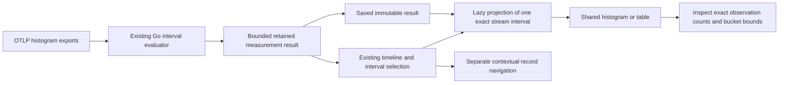

# Native interval histograms in scoped views — 272

273 extends this contract to [selected fixed-time buckets](SCOPED_HISTOGRAM_TIME_BUCKETS.md),
with explicit anchored width/index and derived coverage semantics.

This is the implemented bounded contract. Actual checks and remaining adoption
limits are recorded in [VALIDATION.md](../VALIDATION.md).

A native histogram counts instrument observations, not exported metric rows or
contributing spans. One selected, evaluated export interval now has a canonical
histogram projection. The existing evaluator continues to own cumulative/delta
arithmetic, resets, gaps, layout changes and percentile bucket ranges.

Projection performs no source read. It materializes one chosen interval rather
than eagerly expanding every interval into repeated bucket rows and scope metadata.
Go and JavaScript constructors share the same contract and are checked against
actual evaluated measurement results. Shared Go DTOs live below both measurement
and record-query packages, avoiding a measurement-to-exploration import cycle.

## Scope and geometry

`scope.signal: 'metrics'` introduces an explicit measurement interval selector:
`{kind: 'measurement-interval', question, stream, fromNS, toNS}`. It retains the
checked parent measurement question, complete resource/scope/instrument/attribute
identity and exact selected interval. A known interval may be displayed even if
another interval in the same series is unknown. The witness concerns the selected
interval, not complete collection or the full requested window.

The histogram descriptor declares `kind: 'otel-explicit'`, `binning: 'explicit'`,
`grain: 'observations'`, original temporality, unit, total and
`closure: 'left-open-right-closed'`. The currently supported evaluator accepts
nonnegative finite explicit bounds for duration instruments in `s` or `ms`.
The first lower bound is `-inf`; the final upper bound is `+inf`. Finite source
binary64 bounds are represented as exact canonical rationals. Human labels are
separate from exact disclosure. There is no numeric parse-support partition.

Bucket counts sum to the interval observation total, independently of measurement
`Result.Count`, which counts captured export records. Equal-width bars show bucket
counts, not density. Native charts do not emit raw-record selection intents, and
record-population action contexts refuse the measurement family explicitly.

## Unknown, zero and custody

Only a known evaluated interval supplies a histogram. Resets, gaps, missing values,
layout changes and boundary-crossing diagnostics retain their existing unavailable
state; choosing one cannot silently fall back to a different known interval.
Known zero observations remain different from unknown observations and do not
supply a percentile or health conclusion.

The live measurement request owner may admit its matching captured projection.
Other render callers and Saved views use held projections without private source
completeness. Importing serialized metadata cannot grant source action authority.
The passive component owns no requests, subscriptions, global query state or
context navigation. Native distribution inspection uses page scrolling while
plots and tables retain local horizontal overflow; it does not trap the chart
in the generic inspector’s short scroll pane. Existing contextual links remain explicitly separate: shared
resource/time context does not establish exact observation contributors.

## Adoption boundary

This cut replaces the selected raw-export bucket presenter. Existing fixed-time
bucket aggregation, heatmaps, native window comparisons and explicit compatible
stream merging retain their specialized owners. It does not add fleet merging,
arbitrary rebucketing, interpolated scalar percentiles, a new renderer or an editor.
Quantiles remain ranked bucket ranges, including infinite tails.

See the [real instrument storyboard](../journeys/272-native-histogram-storyboard.md).
