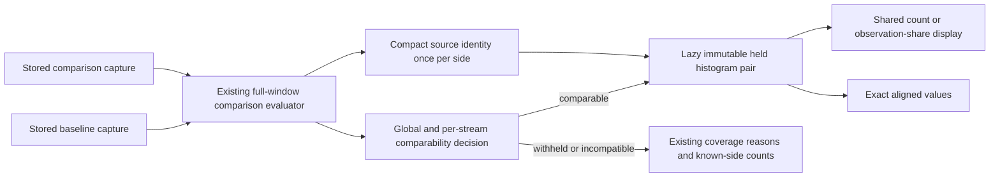

# Native histogram comparisons in the shared display — 274

This cut consolidates the existing captured-evidence comparison flow. Comparable
native histogram windows use one aligned histogram with observation-count and
observation-share choices plus an exact table. It replaces the separate percentage
chart, raw comparison bucket table and two-column count heatmap on the normal path.
No new comparison screen, source read or saved-view library is introduced.

## Independent windows and observation grain

Each operand retains its own checked measurement question, exact whole-window
bounds, read clock, measurement basis and histogram source basis. A
`measurement-window` selector describes a complete evaluated window, not one
export interval. Its duration may exceed the per-export maximum gap when whole
valid exports cover it contiguously. The projector never recomputes coverage or
aggregates exports again.

Native operands use `otel-explicit` buckets: exact binary64 rational bounds,
right-closed finite upper bounds, infinite tails and instrument observation
counts. They have no numeric parsing support. Exact stream identity, unit,
temporality and bucket layout must match; windows and read clocks stay independent.
There is no implicit rebucketing, unit conversion or fleet merge.

The existing `goo.histogram-comparison/1` envelope is discriminated by operand
family. Numeric behavior remains available with its existing denominators. Native
comparisons offer only counts and `observation-share`, where each side divides by
its own observation total. Both count plots share one full-pair scale; percentage
plots use a fixed 0–100% scale. Counts are not rates, especially for unequal window
lengths. Empty denominators are unavailable, not zero percentages.

## Existing withholding policy remains authoritative

The application requires both the overall comparison and the selected stream row
to be comparable. A locally known stream cannot bypass another member's withheld
comparison. Empty, incomplete, reset, changed-layout or otherwise incompatible
windows retain the existing coverage/reason path and known-side counts. They do
not acquire a new normalized comparison or scalar change through this adoption.

P95 remains an evaluated bucket range. The existing summary and range relation
remain visible; no precise percentile, averaged percentile or scalar percentile
difference is inferred from bucket counts.

## Bounded transport and passive components

The existing comparison response adds compact source metadata once per side:
measurement basis, histogram basis and ordered stream/temporality/state references.
Question and read time already exist in the side receipt. No source rows,
intervals or pre-expanded canonical pairs are added. The browser projects one
selected row lazily from this explicit context and existing window summaries;
there is no extra full-capture fetch or fabricated provenance. Histogram window
bodies build once on first expansion; only the first opens initially. Reopening
retains the same chart and scale, avoiding quadratic eager inventory projection.

Go constructors project the same operands from actual retained measurement
results. Their parity with the actual comparison-response browser path is tested.
Operands remain held without private completeness witnesses. Counts/share/table
switching is local. Native bars emit no record-range gestures, and numeric
continuation owners explicitly refuse native operands. Saved comparisons reopen
through the existing immutable comparison receipt flow.

See [the finite adoption checkpoint](VIEW_AUTHORING_CHECKPOINT_274.md) for the next
product step: reusable declarations through the existing saved-view workflow.
Actual checks are recorded in [VALIDATION.md](../VALIDATION.md).

See the [executable storyboard](../journeys/274-native-histogram-comparison-storyboard.md).
