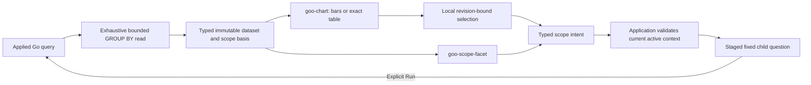

# Scoped displays — delivered pilot261

One single-group captured-record breakdown now supplies the same public dataset to
native bars, an exact-value table and a scope facet. This is the first V0 slice of
[the UI composition proposal](VIEW_GRAMMAR_PROPOSAL_260.md), not the whole grammar,
a saved view declaration, Plotly integration or WYSIWYG editor.

In fixed exploration, group spans or logs by one field with count only. **View as**
changes presentation without querying. Select a bar or table row to inspect its
exact category/count; **Stage selected group** or a facet stages a child question.
Run explicitly applies that question. Existing predicates, checked environment
selection and fixed time bounds survive. Missing keys and present empty strings
remain different filters. Display choice and the complete-only requirement persist
within that result host; selection does not cross dataset revisions.



## Public contracts

`ui/view-model.mjs` exports the frozen `kinds` registry, `validateSnapshot`,
`validateDisplay`, `eligibleKinds`, `selectionIntent` and `scopeIntent`.
`ui/scope-view.mjs` registers passive `goo-chart` and `goo-scope-facet` components.
Use property assignments before/after connection, or JSON `snapshot`/`display`
attributes in server-rendered HTML. Pre-upgrade properties are supported. Attributes
are parsed as data, never HTML or code. Explicit properties take precedence.

```js
chart.snapshot = response.viewDataset;
chart.display = {kind: 'bar', category: 'category', value: 'count', requiresComplete: true};
facet.snapshot = chart.snapshot;
facet.field = 'category';
chart.addEventListener('goo-select', event => inspectLocally(event.detail));
facet.addEventListener('goo-scope', event => stageCheckedScope(event.detail));
```

Load `components.css`, `chart-frame.css` and `scope-view.css` for standalone use;
`components.mjs` registers the shared table viewport. Components own no source
reads, navigation, publication, history or live subscription. The application
adapter in `scoped-breakdown.mjs` owns local display/selection state; exploration
owns staging and execution. Compatible switches preserve the supplied snapshot.
Intents carry dataset ID, revision, scope ID and generation. Application handlers
validate intent type, current active applied context and supplied member value;
retired, hidden, malformed and changed-between-read contexts cannot narrow scope.
A selected group is a category predicate, not a list of exact record references
and cannot authorize Keep of its unseen members.

The initial envelope is `goo.dataset/1`, shape `ranked`, with typed fields, stable
row keys, exact values and explicit quality. Go emits `Result.viewDataset` for
single-group count-only results. Its scope selector contains the full checked
query, including environment policy, time and predicate; scope ID hashes that
query, and revision/generation bind the captured result basis. Category keys hash
canonical nullable values. Counts remain uint64 decimal strings. Geometry uses
finite approximate coordinates; the table retains exact strings, including values
beyond JavaScript's safe integer range. Numeric lines require numeric x mappings;
service labels are not treated as a time axis. Negative bars and unknown value
knowledge refuse geometry and retain an exact table. Estimated bars are visibly
hatched; missing values never become zero.

## Completeness and uncertainty

The pilot exposes independent **group extent**, **value knowledge**, **upstream
sampling** and **fixed/live freshness** facets. Capture clocks show UTC milliseconds
with their exact supplied timestamp in a tooltip. This is a bounded subset of the
proposal's quality model; per-cell bounds/confidence, window/graph closure,
corrections and native-metric temporality remain future contract extensions.

The Go source path uses a1001-group sentinel and fails above1000, with overflow
configured to throw. Only a successful exhaustive group read may attest the
`groups` aspect for the matching captured-query scope and revision. Neither a full
row page nor agreement with a separate count proves this. The claim says nothing
about exhaustive raw records, transactional coherence or complete upstream
collection. Sampling remains unknown. Changed-between-read results withhold the
attestation and refuse narrowing actions.

**Complete groups only** is a hard rendering requirement. Missing/wrong aspect,
basis, revision or scope refuses; an earlier successful chart cannot remain as an
unlabeled substitute. An attested empty group set displays no supplied groups.
This pilot has no additional materialization/acquisition operation: Run repeats the
existing bounded read, which fails rather than returning truncated success.

Only this result family has migrated. Multi-field/numeric/duration/status/time
breakdowns retain their existing semantic presenters. Categories above1024 UTF-8
bytes omit the new envelope and retain the existing exact group table; no identity
is truncated. Existing charts are inventoried in
[the chart design review](reviews/CHART_PLATFORM_DESIGN_260.md); full-family and
whole-screen parity remain requirements before claiming V0/the grammar complete.

## Verification and next cut

[Executable storyboard](../journeys/261-scoped-breakdown-storyboard.md) uses real
OTLP spans through ClickHouse and the generic Go runtime. It checks zero source
reads during switching, selection and staging, then an explicit child Run.
Chromium component conformance covers SSR/pre-upgrade/detached use, table/bar/line,
exact values, uncertainty refusal, null/empty facets, keyboard and390px layout.
Pure contract checks and generated sequences cover invalid/stale identities and
false completeness. A bounded Quint replay checks observed effect ownership with
mutated traces that must fail; Hegel exercises sequences against the actual JS
contract. Validation details and executed counts are in [VALIDATION](../VALIDATION.md).

Next: extend the canonical snapshot quality/grain contracts to genuine time-series
and richer grouped results, then migrate those presenters through the same public
registry. Saved view declarations and checked scope authoring follow; renderer or
editor expansion must not create another source/scope owner.
