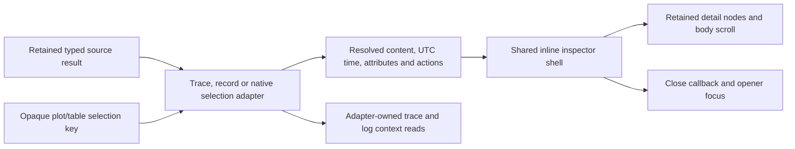

# Shared selected-item inspectors

Trace spans, span/log record inspection, and native chart observations, intervals
and buckets now use the same compact inline shell. It groups the selected title,
summary, scrollable detail body, explicit follow-up actions and close control.
UTC timestamps and exact-value tooltips reuse the existing timestamp formatter;
attributes reuse the typed attribute viewer. Selection itself stays in the owning
waterfall, record table, timeline or heatmap adapter.

`GooUI.inspector(host, {headingLevel, onClose})` is a framework-neutral DOM helper,
not a subscribing custom element or a universal telemetry schema. The application
supplies opaque selection keys and already-resolved DOM content through
`show({key,title,description,content,actions,opener})`. Reopening a retained key
needs no replacement content. `has(key)` supports lazy construction; `clear()`
removes all retained content and hides the shell. Applications still own queries,
context navigation, source generations, result lifetimes and source-read limits.

The shell preserves the actual detail nodes, disclosure/input state and body
scroll position for the 32 most recently inspected keys within this rendered
result. Older entries are evicted; new source results create a new inspector.
Selecting another retained item does not rebuild chart/table controls or move
focus. Close hides the details while retaining the controlled selection,
and restores focus to a connected opener without scrolling the page. Native
charts fall back to the corresponding retained plot mark if a heatmap layout
change removed the original cell. The shell never calls `scrollIntoView`, chooses
a record or invents a relationship. It does not introduce a cross-query history
or guarantee retention after source replacement.

## Adoption and evidence boundaries

- Waterfall selection retains exact span attributes/IDs and existing related-trace
  actions. Span duration uses the shared millisecond formatter. The enclosing
  trace workspace still owns independent context questions, bases and pagination. Selecting a span there retains the existing automatic linked-log read; the shared shell adds no reads and closing it does not refresh logs.
- Record tables offer Inspect record for both spans and logs. The panel appears beside the selected row in its detail cell and supplies
  event time, attributes, scope/basis disclosure and existing trace/surrounding-log
  continuation actions. Local inspection is source-free. Existing inline attribute
  disclosures/refinement remain available; this milestone does not remove them or
  redesign the outer trace/surrounding-log workspaces.
- Native selections retain their exact timestamp bounds, stream attributes,
  bucket counts, diagnostics and unknown-versus-zero distinctions. Closing retains
  plot/grid selection without changing a histogram layout or source question.
  Switching back to a cached point retains its detail disclosure state. A missing
  interval never acquires the previous interval's bucket table.

## Executable storyboard

Journey84 uses a clearly synthetic standalone helper fixture to verify no query
client is needed, item switching clears the visible prior body, cached nodes and
open disclosures/scroll survive, closing restores focus, clearing drops retained
content, and mobile layout stays contained. Journey35 uses real OTLP data to
inspect a linked log without source reads, select a trace span with its existing linked-log read, close and
return focus to each selected row, then continue the existing investigation.
Journey77 covers native unknown/zero/histogram layout semantics and immutable
capture replay; its Bombadil actor now closes/reopens a selected point and checks
focus. The typed-inspection actor checks waterfall/detail identity through the
new shell and explores record inspection/close actions.

[Selected log](journeys/screenshots/84a-log-record-inspector.png) ·
[Selected trace span](journeys/screenshots/84b-selected-trace-span.png) ·
[Synthetic reference](journeys/screenshots/84-synthetic-shared-inspector.png)
